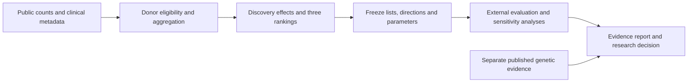

# EndoTarget Evidence

**Cross-study target prioritization in endometriosis using donor-level transcriptomics and network analysis.**

[English](README.md) · [简体中文](README.zh-CN.md)

[](docs/INPUT_PROVENANCE.md)
[](docs/LOCAL_EXECUTION.md)
[](receipts/local_primary_container_replay.json)

Can a biological network improve which disease-associated genes reproduce in another study? EndoTarget Evidence compares expression ranking with two network baselines, evaluates the frozen candidate lists in a separate endometrial cohort, and adds a traceable genetic-evidence assessment.

**Main finding:** the analysis did not establish a statistically supported cross-study target shortlist or an advantage for network propagation. The resulting research recommendation is to hold the candidate pool pending stronger evidence.

| Study at a glance | Scope |
|---|---|
| Biological focus | Proliferative-phase eutopic endometrial stromal fibroblasts |
| Data | 22 discovery donors / 150,788 cells; 22 external donors / 52,744 nuclei |
| Comparison | Expression, network degree and fixed network propagation on 11,749 genes |
| Evaluation | External expression-direction agreement, donor resampling and clinical sensitivity analyses |
| Reproduction | Five primary Nextflow tasks reproduced in Docker; 34 scientific tables and eight result metadata files matched |

**Read the results:** [Two-page research brief](reports/executive_brief_en.pdf) · [Method card](docs/METHOD_CARD.md) · [Full results and figures](reports/results_summary_en.md)

## Study design

Counts are aggregated **per donor** before statistical modeling, so thousands of cells from one person do not become thousands of independent observations. Each cohort is modeled separately with edgeR and limma-voom, adjusting for age, technical batch and adenomyosis.



| Cohort | Cases / controls | Retained cells or nuclei | Genes tested | Genes with BH q < 0.05 |
|---|---:|---:|---:|---:|
| Discovery: GSE266265 | 12 / 10 | 150,788 cells | 17,733 | 0 |
| External: HECA, E-MTAB-14039 | 15 / 7 | 52,744 nuclei | 17,643 | 0 |

These are **22 donors per cohort**, not cell-level sample sizes. Controls are surgical non-endometriosis donors and may have other conditions. Recruitment sources are separated; individual non-overlap is not genotype-confirmed. [Data provenance and eligibility](docs/INPUT_PROVENANCE.md).

## Benchmark results

The three methods share the same 11,749-gene, 123,313-edge STRING functional-association network. Lists, discovery expression directions and parameters were frozen before computing external disease effects.

| Method | Ranking rule | Same direction / evaluable / selected |
|---|---|---:|
| **Expression (B0)** | Absolute moderated disease statistic | **14 / 20 / 20** |
| **Network degree (B1)** | Weighted connectivity; topology control | **3 / 13 / 20** |
| **Network propagation (G1)** | Random walk with restart, seeded by discovery evidence | **6 / 19 / 20** |

G1 is a fixed graph algorithm with no model training or parameter search. Genes missing from external evaluation remain missing; lists are never refilled. B1 falls below the predefined 16-of-20 evaluability threshold. Both network lists agreed less often than their 200 expression- and degree-matched reference sets (0.5th percentile, versus the 96.5th for B0), a descriptive lower-than-reference pattern rather than only an absence of improvement; the percentile is not a calibrated p value.


**Interpretation.** Expression-direction agreement is not target accuracy. None of the selected genes combined direction agreement with external BH q < 0.05, where BH adjustment accounts for the full tested gene family. Lack of significance does not demonstrate absence of a disease effect.

The observed G1-minus-B0 agreement difference was **−38.4 percentage points**. Of 500 paired external-donor bootstrap draws, 487 were valid and 13 failed design checks. The conditional 95% interval was **−38.9 to +8.7 points**, including zero; it does not establish a general method advantage. Because resampling noise pulls both methods toward 50% agreement, this interval is not centered on the observed difference; see the [interpretation notes](reports/results_summary_en.md#notes-for-interpretation). All 22 discovery leave-one-donor-out analyses completed. [Uncertainty and sensitivity results](reports/results_summary_en.md#donor-sensitivity).

The separate genetic assessment retains all 40 frozen candidate-pool genes: one limited SKIDA1 mapping and 39 unavailable mappings in the selected source. The dossier rule yielded one inconclusive PARP9 case and no supported target dossier. [Genetic evidence report](reports/genetic_evidence_report.md).

## Design and implementation

| Component | Implementation | Inspect the evidence |
|---|---|---|
| Donor-aware analysis | Audited clinical eligibility, count provenance, covariate adjustment and explicit exclusions | [Method card](docs/METHOD_CARD.md), [donor selection](reports/figures/donor_flow_v1.svg) |
| Controlled graph comparison | Shared gene universe, fixed parameters, external evaluation and missing-outcome bounds | [Ranking code](scripts/rank_targets.py), [ranking configuration](config/ranking_algorithm.json) |
| Failure-aware uncertainty | Paired donor bootstrap, leave-one-donor-out fits and descriptive matched reference sets | [Resampling methods](docs/RESAMPLING.md), [execution record](receipts/real_resampling_execution.json) |
| Reproducible workflow | Nextflow DSL2, locked R/Python dependencies, Docker, input/output hashes and cache checks | [Discovery workflow](main.nf), [external workflow](replication.nf), [reproduction guide](docs/LOCAL_EXECUTION.md) |

The recorded local replay reproduced all five primary tasks. Discrete selections matched exactly; the largest continuous difference was **1.10 × 10⁻¹³**, below the declared absolute tolerance of 10⁻⁸. Synthetic checks also completed five fresh and five cached tasks. These are engineering checks on the same data, distinct from biological replication. [Replay record](receipts/local_primary_container_replay.json) · [Cache checks](receipts/local_container_nextflow.json).

## Explore and reproduce

The reports, figures, source code and small evidence records can be inspected directly on GitHub or cloned:

```bash
git clone https://github.com/NingyuSUN/endotarget-evidence.git
cd endotarget-evidence
```

**A clone alone is not a complete scientific rerun environment.** Large inputs, intermediate outputs, runtime environments and caches are excluded from Git. Full reproduction requires restoring the referenced artifacts and matching the recorded runtime and paths.

| Task | Entry point |
|---|---|
| Read the scientific conclusions | [Research brief](reports/executive_brief_en.pdf), [English results summary](reports/results_summary_en.md), [Chinese biology report](reports/biology_report_zh.md) |
| Review assumptions and figures | [Method card](docs/METHOD_CARD.md) |
| Reproduce the designated primary outputs | [Prerequisites, commands and checks](docs/LOCAL_EXECUTION.md) |
| Review a possible cloud deployment | [AWS guide — not executed](docs/AWS_DEPLOYMENT.md) |
| Navigate methods, results and provenance | [Documentation index](docs/README.md) |

## Scope and limitations

- This is a retrospective observational reanalysis with pre-external freezes, not a preregistered or blinded study. Author labels, phase ascertainment, residual confounding, cell-state composition and the cell-versus-nucleus assay difference limit interpretation.
- Discovery uses author-provided secondary estimated counts. The original full RDS was not recomputed. An 8,248-count component of the HECA raw/H5 discrepancy remains unresolved; details are retained in the [method card](docs/METHOD_CARD.md).
- Genetic annotations cover one selected 2023 publication. Missing mapping is not negative genetic evidence, and expression association does not determine causality or an activation/inhibition strategy.
- The project evaluates evidence for early target prioritization. It does not generate molecules or antibodies, train a GNN or foundation model, or demonstrate therapeutic efficacy. AWS deployment has not been executed.

## License

Code is released under the [MIT License](LICENSE). Documentation, reports and figures written for this project are released under [CC BY 4.0](https://creativecommons.org/licenses/by/4.0/). Third-party data, references and publications keep their own terms; see the [source register](docs/DATA_SOURCES.md) and [input provenance](docs/INPUT_PROVENANCE.md).

Maintained by [Ningyu Sun](https://github.com/NingyuSUN). AI assistance was used in implementation and review. Source studies and attribution are recorded in the [input provenance](docs/INPUT_PROVENANCE.md) and [genetics methods](docs/GENETIC_EVIDENCE_METHOD.md).

Historical execution identifiers and their corresponding published commits are documented in the [provenance note](docs/PUBLICATION_HISTORY.md).
