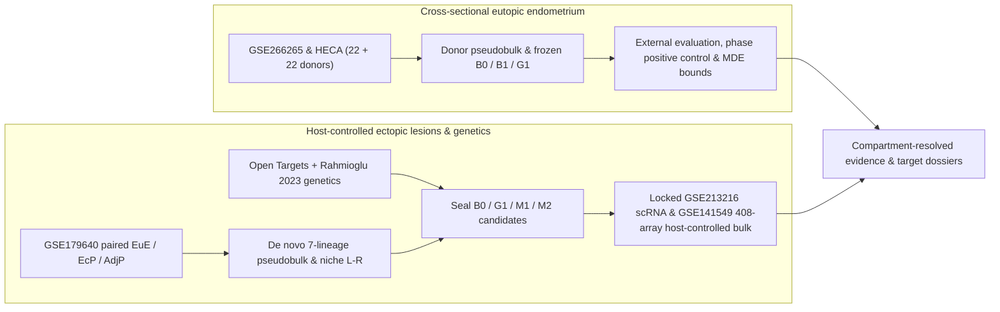

# EndoTarget Evidence

**Donor-level single-cell transcriptomics, host-controlled lesion modeling, network propagation, and human genetics for target prioritization in endometriosis.**

[English](README.md) · [简体中文](README.zh-CN.md)

[](docs/INPUT_PROVENANCE.md)
[](docs/LOCAL_EXECUTION.md)
[](receipts/local_primary_container_replay.json)
[](v2/receipts/prediction_seal.json)
[](https://github.com/NingyuSUN/endotarget-evidence/actions/workflows/ci.yml)
[](CITATION.cff)
[](https://github.com/NingyuSUN/endotarget-evidence/releases/latest)
[](LICENSE)

Where in human endometriosis tissues do reproducible, genetically anchored therapeutic targets reside, and when do standard expression or network rankings mislead? EndoTarget Evidence evaluates donor-level single-cell and tissue transcriptomics across both **eutopic endometrium** and **ectopic lesions**, tests fixed STRING network propagation against expression and niche-aware rankings under pre-external cryptographic freezes, and integrates germline genetics from Open Targets and Rahmioglu et al. (2023).

**Main finding:** target evidence in endometriosis separates sharply by tissue compartment and control choice. Cross-sectional **eutopic** endometrial stromal fibroblasts yield no statistically supported cross-study targets (`0` genes at `BH q < 0.05` across `22 + 22` single-cell donors, pooled median detectable effect `< 1.5–1.8×`, `0` bulk genes against pelvic-pathology controls, and no germline genetic enrichment). Moving to **ectopic lesions** (`357,832` single cells across `GSE179640` and `GSE213216` plus `408` arrays across `162` subjects in `GSE141549`) uncovers `569` paired lesion-versus-eutopic stromal genes at `BH q < 0.05`, but exposes a `100%` (`13 / 13`) peritoneal host-background false-positive rate in naive differential expression when lesions are tested against matched unaffected peritoneum from the same women. Dual-contrast host-tissue decontamination integrated with vascular/myeloid ligand–receptor activity and human genetics reverses the ranking hierarchy under host-peritoneum control (`+31.4` percentage points `[+8.2, +46.5]` in paired `PeL vs PP`, program `AUC = 0.684`, `p = 0.0045`, and `88.9%` direction agreement in `DIE vs PP`), demonstrates significant germline genetic enrichment in host-controlled lesions (`p = 2.9 × 10⁻⁵`), and locks **`RUNX1`** (`L2G = 0.653`, `BH q < 0.05` across discovery scRNA, external scRNA, and host-controlled bulk) alongside contextual niche and GWAS candidates (`CXCR4`, `ESR1`, `PDLIM5`, `F5`). Across both compartments and a strong cycle-phase positive control, global STRING random walk consistently underperforms expression ranking due to high-degree hub bias.

| Study at a glance | Scope |
|---|---|
| Biological compartments | Cross-sectional eutopic endometrium (`GSE266265`, `HECA E-MTAB-14039`, `GSE51981`, `GSE6364`) and paired/multi-subtype ectopic lesions with unaffected host peritoneum (`GSE179640`, `GSE213216`, `GSE141549`) |
| Scale | `561,364` retained single cells or nuclei across four scRNA/snRNA cohorts; `589` bulk microarray samples across three cohorts (`162` phenotyped subjects in `GSE141549`) |
| Method comparisons | Naive differential expression (`B0`), network degree (`B1`), fixed STRING random walk (`G1`), dual-contrast host-decontaminated lesion scoring (`M1`), and genetics + niche ligand–receptor integration (`M2`) |
| Human genetics & niche priors | `404` endometriosis genetic loci/genes (Open Targets `MONDO_0005133` / `EFO_0001065` + Rahmioglu et al. 2023 *Nat Genet*), `168` curated vascular/myeloid–stromal ligand–receptor pairs, GTEx v10 context |
| Zero-leakage governance | Candidate lists, signs, weights, and evaluation rules frozen with SHA-256 receipts prior to external cohort evaluation |
| Verification | Nextflow/Docker primary replay (`1.10 × 10⁻¹³` max continuous delta), exact integer UMI conservation, synthetic estimator tests, and automated CI link/contract checks |

**Read the results:** [Ectopic lesion & genetics full report](v2/reports/RESULTS.md) · [Multi-evidence target dossiers](v2/reports/target_dossiers.md) · [Eutopic benchmark summary](reports/results_summary_en.md) · [Two-page eutopic brief (PDF)](reports/executive_brief_en.pdf) · [Eutopic method card](docs/METHOD_CARD.md) · [Lesion method card](v2/docs/METHOD_CARD.md)

---

## Study design

Counts are aggregated **per donor and anatomical site** before statistical modeling so thousands of cells from one individual are never treated as independent patients. Unpaired cross-sectional cohorts are modeled with `edgeR` and `limma-voom` adjusting for clinical and technical covariates; multi-site cohorts use paired within-patient designs (`~ donor + site`) or donor-blocked generalized least squares with empirical Bayes moderation.



| Compartment & cohort | Assay & design | Donors or subjects (samples) | Retained cells / nuclei or genes | Differentially expressed genes (`BH q < 0.05`) |
|---|---|---:|---:|---:|
| **Eutopic discovery:** `GSE266265` | scRNA, unpaired proliferative (`12` case / `10` control) | `22` donors | `150,788` cells / `17,733` genes | `0` |
| **Eutopic external:** `HECA` (`E-MTAB-14039`) | snRNA, unpaired proliferative (`15` case / `7` control) | `22` donors | `52,744` nuclei / `17,643` genes | `0` (`0` pooled across `15,435` genes) |
| **Eutopic bulk:** `GSE51981` & `GSE6364` | Whole-tissue arrays, natural cycle | `144` & `37` samples | Tissue transcriptome | `0` vs pelvic-pathology controls (`9,593` vs all controls) |
| **Lesion discovery:** `GSE179640` | scRNA, within-patient `EuE`, `EcP`, `AdjP`, `EcO` | `14` donors (`31` libraries; `8` `EuE–EcP` pairs, `6` triplets) | `115,402` cells (`37,691` stromal) / `12,188` genes | `569` (`EcP vs EuE`); `0` (`EcP vs AdjP`, `n = 6`) |
| **Lesion external scRNA:** `GSE213216` | scRNA, donor-deduplicated `EcP`, `EuE`, `EcO` | `18` patients (`29` libraries; `12` `EcP`, `9` `EuE`, `6` `EcO`) | `242,430` cells (`106,424` stromal) / `15,794` genes | `2,844` (`EcP vs EuE` donor-blocked GLS) |
| **Lesion & host bulk:** `GSE141549` | Multi-lesion & peritoneum arrays (`PE`, `PP`, `CE`, `CP`, `PeL`, `DIE`, `OMA`) | `162` subjects (`408` arrays; `41` `PeL–PE` & `20` `PeL–PP` pairs) | `19,262` `ENSG` genes | `7,393` (`PeL vs PE`); `1,755` (`PeL vs PP`); `1,978` (`DIE vs PP`); `0` (`PE vs CE`) |

In the eutopic cohorts, controls are surgical non-endometriosis donors and recruitment sources are separated ([data provenance](docs/INPUT_PROVENANCE.md)). In the lesion module, single-cell lineages (`stromal_fibroblast`, `perivascular_mural`, `epithelial`, `endothelial`, `myeloid_macrophage`, `lymphoid`, `mesothelial`) are assigned de novo from canonical markers with zero transferred HECA labels ([lesion protocol](v2/docs/PROTOCOL.md)).

---

## Eutopic endometrium: cross-cohort benchmark and detectable-effect bounds

In proliferative-phase eutopic stromal fibroblasts, three frozen ranking rules share an `11,749`-gene, `123,313`-edge STRING network (`22` discovery and `22` external donors). Lists, discovery signs, and graph parameters were locked before external disease contrasts were computed.

| Method | Ranking rule | External same direction / evaluable / selected (`K = 20`) |
|---|---|---:|
| **Expression (`B0`)** | Absolute moderated disease statistic | **14 / 20 / 20** |
| **Network degree (`B1`)** | Weighted connectivity; topology control | **3 / 13 / 20** |
| **Network propagation (`G1`)** | Random walk with restart seeded by discovery evidence | **6 / 19 / 20** |

None of the selected genes combined directional agreement with external `BH q < 0.05`. Observed `G1 − B0` agreement was **−38.4 percentage points** (`95%` conditional paired-donor bootstrap interval `−38.9` to `+8.7` points across `487 / 500` valid draws; [uncertainty notes](reports/results_summary_en.md#donor-sensitivity)). Both network lists agreed less often than `200` expression- and degree-matched reference sets (`0.5th` percentile vs `96.5th` for `B0`). The separate genetic audit retained one inconclusive `PARP9` case and established no supported target dossier ([genetic evidence report](reports/genetic_evidence_report.md)).


Nine prespecified follow-on analyses—each frozen and hashed before execution ([follow-on script](scripts/render_summary_figure_follow_on_v1.py), [figure receipt](receipts/summary_figure_follow_on_v1.json))—establish what the cross-sectional eutopic null excludes and confirm pipeline sensitivity:


| Prespecified eutopic check | Recorded result | What it establishes |
|---|---|---|
| **Cycle-phase positive control** (`35` and `42` proliferative vs secretory donors) | **7,367 and 3,986** genes at `BH q < 0.05`; expression top-20 transfers **20 / 20** at external `q < 0.05`; `G1 − B0` = **−37 points** (`−53` to `−21`) | The donor-level pipeline detects and transfers large biological programs; global propagation degrades transfer even when true signal is strong. |
| **Single-cohort & combined minimum detectable effects** (`15,435` shared genes) | Pooled **`0` genes at `q < 0.05`** (min `q = 0.145`); median detectable effect **`1.27×`** at `α = 0.05`, **`1.52×`** at the `100`-discovery BH boundary, **`1.79×`** for one discovery (`2.2–3.4×` per cohort alone) | Twofold proliferative stromal disease differences are excluded family-wide for `60%` of genes (`1.5×` for `24%`); subtler cross-sectional effects remain open. |
| **Secretory-phase interaction & stromal composition** | Phase × disease `θ = +0.04 [−0.18, +0.25]` and `−0.11 [−0.40, +0.19]` (`AUC 1.00 / 0.99`); decidualized-like state OR `0.75` (`p = 0.18`) and `1.08` (`p = 0.75`) | Neither secretory-program attenuation nor coarse stromal-state mixture shifts explain the eutopic null at available donor counts. |
| **Germline genetics & bulk eutopic cohorts** (`GSE51981` `n = 144`, `GSE6364` `n = 37`) | Rahmioglu/Open Targets gene sets show `no_enrichment` (`p = 0.42–0.98`); bulk secretory `θ = −0.09` and `−0.15` (`p ≥ 0.13`); `0` bulk genes at `q < 0.05` vs other pelvic-pathology controls; stroma carries `< 20%` of published whole-tissue signature amplitude | Sub-threshold eutopic stromal variation is not concentrated in endometriosis GWAS genes and does not reproduce across pathology-controlled bulk endometrium. |
| **Public cohort metadata audit** (`GSE179640`, `GSE213216`) | Unconfounded natural-cycle eutopic case–control strata unavailable (`0 / 1` and `5 / 0`); rich paired **eutopic–lesion–peritoneum** designs identified | Directs target discovery from unpaired eutopic biopsies to paired host-controlled ectopic lesions. |

Detailed eutopic reports: [phase positive control](reports/phase_positive_control_results.md) · [detectable effect](reports/mde_results.md) · [secretory program](reports/secretory_program_results.md) · [combined bound](reports/combined_bound_results.md) · [stromal composition](reports/composition_test_results.md) · [genetic set test](reports/genetic_set_test_results.md) · [bulk replication](reports/bulk_replication_results.md) · [published signatures in stroma](reports/published_signature_test_results.md) · [cohort audit](reports/cohort_extension_feasibility.md).

---

## Ectopic lesions: host-tissue decontamination, niche crosstalk, and human genetics

### Why naive lesion differential expression misleads and how host-controlled scoring fixes it

Comparing peritoneal lesions against eutopic endometrium (`EcP vs EuE`, `n = 8` matched pairs in `GSE179640`) yields `569` stromal genes at `BH q < 0.05`, yet **`12 / 20` (`60%`)** of the top naive candidates (`B0`) move in the opposite direction when the same lesions are compared against matched adjacent unaffected peritoneum (`EcP vs AdjP`, `n = 6` triplets; e.g., `GPC3` `−2.22`, `S100A10` `−1.03`, `SFRP2` `−0.87`), and **`6 / 20` (`30%`)** are `> 4×` enriched in peritoneal mesothelium.

Before downloading external lesion expression matrices, four ranking methods over the `10,972`-gene expressed STRING universe (`97,462` direct edges) were sealed ([protocol freeze](v2/receipts/protocol_freeze.json), [prediction seal](v2/receipts/prediction_seal.json), [frozen shortlists](v2/manifests/frozen_candidates_v2.tsv)):
1. **`B0` (Naive paired lesion DE):** Paired `EcP vs EuE` moderated statistic in stromal fibroblasts.
2. **`G1` (Global STRING RWR):** Random walk (`r = 0.5`) seeded by `|z(EcP vs EuE)|` over STRING v12.5.
3. **`M1` (Dual-contrast host-decontaminated lesion score):** Conjunction minimum statistic requiring concordant remodeling in both `EcP vs EuE` and `EcP vs AdjP`, weighted against mesothelial ambient soup.
4. **`M2` (Genetics + niche crosstalk target score):** Pre-specified integration combining `M1` (`0.55`) with lesion vascular/myeloid-to-stromal ligand–receptor partner activation (`0.20`) and independent human endometriosis genetics (`0.25`).

| Frozen method (`K = 20`) | Discovery dual-concordant / mesothelial soup | `GSE213216` scRNA `EcP vs EuE` `BH q < 0.05` (same sign) | `GSE141549` paired `PeL vs PE` (`n = 41`) `BH q < 0.05` | `GSE141549` host-ctrl `PeL vs PP` (`n = 20`) same sign (`host FP%`) | `GSE141549` paired `DIE vs PP` (`n = 20`) same sign | `GSE141549` `All PeL vs PP+CP` (`54 vs 61`) program `AUC` (`p`) |
|---|---:|---:|---:|---:|---:|---:|
| **`B0` (Naive `EcP vs EuE`)** | `8/20` / `6/20` (`30%`) | **`9/20` (`68.4%`)** | **`13/20`** | `8/19` (`42.1%`, **`100%` FP**) | `7/19` (`36.8%`) | `0.430` (`0.115`) |
| **`G1` (Global STRING RWR)** | `13/20` / `0/20` (`0%`) | `4/20` (`47.4%`) | `10/20` | `7/18` (`38.9%`, **`90%` FP**) | `10/18` (`55.6%`) | `0.437` (`0.127`) |
| **`M1` (Dual-contrast host-ctrl)** | **`20/20` / `0/20`** | `0/20` (`36.8%`) | `6/20` | **`12/19` (`63.2%`)** | **`13/19` (`68.4%`)** | **`0.651` (`0.0348`)** |
| **`M2` (Genetics + niche L–R)** | **`20/20` / `0/20`** | `0/20` (`31.6%`) | `3/20` | **`13/18` (`72.2%`)** | **`16/18` (`88.9%`)** | **`0.684` (`0.00449`)** |


**Host-background false-positive collapse and hierarchy reversal.** In `GSE141549`, naive `B0` appears to replicate `13 / 20` (`65%`) in paired `Peritoneal Lesion vs Patient Endometrium (PE)` (`n = 41`), yet **`13 / 13` (`100%`)** of those hits fail when the same lesion class is evaluated against matched **Patient Unaffected Peritoneum (`PP`, `n = 20`)** (`0 / 20` joint `PE & PP` replication; `10 / 13` invert sign). Similarly, all `9` `B0` genes reaching `BH q < 0.05` in external `GSE213216` single-cell `EcP vs EuE` (`SKAP2`, `SFRP2`, `S100A10`, `HTRA3`, `KCNJ12`, `TBX18`, `GPC3`, `PDLIM3`, `CDON`) fail host-peritoneum validation (`8 / 9` negative in `PeL vs PP`). Once host peritoneum is controlled, `M2` outperforms `B0` by **+31.4 percentage points** (`2,000`-draw paired subject bootstrap 95% CI `[+8.2, +46.5]`, `P(>0) = 0.9975`) in `PeL vs PP`, reaches **`88.9%` (`16 / 18`)** same-direction concordance in paired deep infiltrating lesions (`DIE vs PP`), and transfers positively at the program level across all peritoneal lesions versus unaffected peritoneum (`AUC = 0.684`, `θ = +0.108 [+0.034, +0.182]`, `p = 0.00449`). Global `G1` again inflates median STRING weighted degree `43`-fold (`224.53` vs `5.24`) and inverts on `Top-50` host-controlled program transfer (`AUC = 0.334`, `p = 0.0073`).

**Regimen confounding in uncontrolled `EcP vs EuE` single-cell contrasts.** In `GSE213216` `EcP vs EuE`, removing resident peritoneal markers strips away the site-of-biopsy signal that inflates `B0`, leaving `M1` and `M2` at `0 / 20` (`M2 − B0 = −43.9` percentage points `[−55.0, −30.0]`). Audit of donor clinical metadata shows that `7 / 8` paired `GSE179640` discovery donors received `norethindrone` or `estradiol` hormonal suppression—quieting eutopic baseline inflammation—whereas `GSE213216` sampled untreated natural-cycle eutopic endometrium with high physiological expression of acute cytokines (`CXCL8`, `IL1B`, `SPHK1`, `KCNK3`), compounded by the `6`-triplet discovery `AdjP` sample size. In `GSE213216` ovarian endometrioma (`EcO vs EuE`), where peritoneal background is absent, `M1` and `M2` recover `63.2%` (`12 / 19`) direction agreement (`6 / 50` and `5 / 50` at `BH q < 0.05`).

### Compartment-resolved human genetics and multi-evidence target dossiers

Whereas cross-sectional eutopic stroma showed no concentration of germline risk (`p = 0.42–0.98`), the `404`-gene human endometriosis genetics set (Open Targets `MONDO_0005133` / `EFO_0001065` and Rahmioglu et al. 2023 credible-set/SMR genes) enriches significantly in **host-controlled peritoneal lesions** (`GSE141549` paired `PeL vs PP`, Mann–Whitney **`p = 2.9 × 10⁻⁵`**, expression-matched permutation `p = 0.0005` for credible-set genes), **external lesion stromal fibroblasts** (`GSE213216`, **`p = 1.9 × 10⁻⁴`**), and **discovery perivascular mural** (**`p = 7.5 × 10⁻⁴`**) and **endothelial** (**`p = 0.0045`**) compartments.


| Evidence tier / category | Target (`ENSG`) | Lesion direction | Discovery `log2FC` (`EuE` / `AdjP`) | `GSE213216` scRNA `log2FC` (`BH q`) | `GSE141549` `PeL vs PP` `log2FC` (`BH q`) | Genetics & niche support | Tractability |
|---|---|---|---|---:|---:|---|---|
| **Tier 1 (Locked 4-gate multi-modal)** | **`RUNX1`** (`ENSG00000159216`) | `UP_in_Lesion` | `+2.51` / `+0.45` | **`+1.61` (`0.00824`)** | **`+0.84` (`0.0492`)** | Open Targets `L2G = 0.653` (`G_prior = 0.39`) | Small molecule (`SM = True`) |
| **Contextual `M2` Top-20 niche** | **`CXCR4`** (`ENSG00000121966`) | `UP_in_Lesion` | `+1.33` / `+0.91` | `+0.19` (`0.859`) | **`+0.96` (`0.0320`)** | Active `CXCL12–CXCR4` vascular–stromal L–R (`0.74`) | Clinical SM & antibody |
| **Contextual `M2` Top-50 GWAS** | **`ESR1`** (`ENSG00000091831`) | `DOWN_in_Lesion` | `−0.94` / `−0.34` | **`−2.06` (`0.00226`)** | `+0.63` (`0.078`; `PeL vs PE` `−1.37`, `q = 1.5e-5`) | Canonical `6q25.1` GWAS locus (`G_prior = 1.00`) | Clinical SM & antibody |
| **Contextual GWAS credible set** | **`PDLIM5`** (`ENSG00000163110`) | `UP_in_Lesion` | `+1.87` / `−0.46` | **`+2.56` (`0.00212`)** | **`+0.29` (`0.0181`)** | `4q22.3` GWAS/SMR credible set (`G_prior = 0.86`) | Antibody (`AB = True`) |
| **Contextual coding GWAS (`rs6025`)** | **`F5`** (`ENSG00000198734`) | `UP_in_Lesion` | `+4.14` / `−0.17` | `+2.53` (`0.0596`) | **`+0.49` (`0.0386`)** | `1q24.2` missense credible set (`G_prior = 0.69`) | Clinical SM & antibody |

Across all `10,972` shared universe genes, **`RUNX1`** is the sole gene passing every pre-locked Tier-1 gate simultaneously (germline genetic association, dual-contrast discovery remodeling, external scRNA `BH q < 0.05`, and host-controlled bulk `PeL vs PP` `BH q < 0.05`), while `0` `M1`/`M2` Top-50 shortlist genes met Tier-2 simultaneous `BH q < 0.05` across both external cohorts because of the hormonal suppression mismatch in `EcP vs EuE`. Full evidence tables: [locked target dossiers](v2/reports/target_dossiers.md) · [extended dossier panel TSV](v2/reports/target_dossiers_extended_panel.tsv) · [complete lesion results](v2/reports/RESULTS.md).

---

## Design, engineering verification, and reproducibility

| Component | Implementation | Inspect the evidence |
|---|---|---|
| Donor- & host-aware modeling | Audited clinical eligibility, exact integer UMI pseudobulk conservation (`357,832` lesion module cells + `203,532` eutopic cells/nuclei), paired/GLS designs, and explicit host-peritoneum controls | [Eutopic method card](docs/METHOD_CARD.md), [donor flow](reports/figures/donor_flow_v1.svg), [lesion method card](v2/docs/METHOD_CARD.md) |
| Controlled ranking & priors | Shared gene universes, fixed STRING parameters, de novo 7-lineage markers (zero HECA label transfer), curated vascular/myeloid L–R pairs, and pre-locked human genetics | [Eutopic ranking](scripts/rank_targets.py), [lesion protocol](v2/configs/protocol_v2.yaml), [lesion library](v2/scripts/endotarget_lib.py) |
| Resampling & uncertainty | Paired donor/subject bootstraps (`500` eutopic and `2,000` lesion/bulk draws), leave-one-donor-out fits, and expression/degree-matched reference sets | [Resampling methods](docs/RESAMPLING.md), [eutopic record](receipts/real_resampling_execution.json), [lesion summary JSON](v2/reports/locked_evaluation_summary_v2.json) |
| Cryptographic freezes & replay | Nextflow DSL2 + Docker primary replay (`1.10 × 10⁻¹³` max continuous diff) for eutopic tasks; four-stage SHA-256 chain (`protocol_freeze` → `prediction_seal` → `locked_evaluation` → `figures`) for lesion analyses | [Eutopic workflows](main.nf), [replay receipt](receipts/local_primary_container_replay.json), [prediction seal](v2/receipts/prediction_seal.json), [evaluation receipt](v2/receipts/locked_evaluation_v2.json) |

On every push, [GitHub Actions](.github/workflows/ci.yml) runs three automated software checks: (1) eutopic Python unit tests on the pinned probe lock plus a repository-wide relative Markdown link check across all tracked documentation, (2) R donor-level and clinical-sensitivity checks on Bioconductor 3.20, and (3) clean-checkout `pytest` contract tests verifying the lesion module's cryptographic SHA-256 chain, donor/subject pairing invariants, exact UMI conservation, synthetic estimators, and report-to-artifact numerical synchronization. These are software and integrity checks, not biological reruns.

### Explore and reproduce

```bash
git clone https://github.com/NingyuSUN/endotarget-evidence.git
cd endotarget-evidence

# Repository-wide Markdown link verification (standard library only)
python3 scripts/check_markdown_links.py

# Lesion & genetics module contract, SHA-256 chain, and synthetic estimator tests
OMP_NUM_THREADS=8 OPENBLAS_NUM_THREADS=8 MKL_NUM_THREADS=8 pytest v2/tests -q
```

**A clone alone is not a complete scientific rerun environment.** Raw single-cell matrices, bulk workbooks, intermediate checkpoints, and runtime environments are excluded from Git via [`.gitignore`](.gitignore) and recorded by SHA-256 in `receipts/` and `v2/receipts/`. Full scientific reproduction of the eutopic Nextflow/Docker tasks follows [`docs/LOCAL_EXECUTION.md`](docs/LOCAL_EXECUTION.md); full reproduction of the ectopic lesion and genetics pipeline (`v2/scripts/`) follows [`v2/docs/PROTOCOL.md`](v2/docs/PROTOCOL.md).

| Task | Entry point |
|---|---|
| Read the ectopic lesion, host-control & genetics results | [English lesion report](v2/reports/RESULTS.md), [中文病灶与遗传报告](v2/reports/RESULTS.zh-CN.md), [target dossiers](v2/reports/target_dossiers.md) |
| Read the eutopic benchmark & detectable-effect bounds | [Research brief (PDF)](reports/executive_brief_en.pdf), [English eutopic summary](reports/results_summary_en.md), [中文在位内膜报告](reports/biology_report_zh.md) |
| Review statistical assumptions, formulas & freezes | [Eutopic method card](docs/METHOD_CARD.md), [lesion method card](v2/docs/METHOD_CARD.md), [lesion protocol](v2/docs/PROTOCOL.md) |
| Reproduce primary workflows & inspect provenance | [Eutopic local execution](docs/LOCAL_EXECUTION.md), [documentation index](docs/README.md), [AWS guide — not executed](docs/AWS_DEPLOYMENT.md) |

---

## Scope and limitations

- Retrospective observational reanalysis of public cohorts with pre-external cryptographic freezes, not a prospective clinical trial or wet-lab perturbation study.
- In single-cell lesion discovery (`GSE179640`), `7 / 8` paired donors received `norethindrone` or `estradiol` suppression whereas external `GSE213216` sampled untreated cycling eutopic endometrium, and discovery adjacent unaffected peritoneum (`AdjP`) covered `6` matched triplets (`0` individual genes at `BH q < 0.05`). This regimen asymmetry suppresses single-cell `EcP vs EuE` transfer of acute inflammatory transcripts (`CXCL8`, `IL1B`, `SPHK1`, `KCNK3`) and motivates pairing untreated cycling donors with adjacent unaffected peritoneum in future single-cell cohorts.
- Eutopic single-cell discovery uses author-provided secondary estimated counts, and an `8,248`-count component of the HECA raw/H5 discrepancy remains unresolved ([eutopic method card](docs/METHOD_CARD.md)). Minimum detectable effects are conditional on realized variance estimates; effects below the stated bounds are not shown to be absent.
- Germline genetic support (`L2G = 0.653` for `RUNX1`, credible-set/SMR mappings for `ESR1`, `PDLIM5`, `F5`) and host-controlled lesion overexpression establish convergent human target evidence, not therapeutic directionality (inhibition versus agonism) or clinical efficacy. No GNN or foundation model was trained, and no molecules were generated.

---

## Citation

Cite the repository using the metadata in [`CITATION.cff`](CITATION.cff); tagged releases and subsequent study milestones are documented in [`CHANGELOG.md`](CHANGELOG.md) and on the [releases page](https://github.com/NingyuSUN/endotarget-evidence/releases).

> Sun N. (2026). EndoTarget Evidence: cross-study target prioritization in endometriosis using donor-level transcriptomics, host-controlled lesion modeling, and human genetics. https://github.com/NingyuSUN/endotarget-evidence

```bibtex
@misc{sun2026endotarget,
  author = {Sun, Ningyu},
  title  = {EndoTarget Evidence: cross-study target prioritization in endometriosis using donor-level transcriptomics, host-controlled lesion modeling, and human genetics},
  year   = {2026},
  url    = {https://github.com/NingyuSUN/endotarget-evidence}
}
```

---

## License

Code is released under the [MIT License](LICENSE). Documentation, reports, and figures written for this project are released under [CC BY 4.0](https://creativecommons.org/licenses/by/4.0/). Third-party cohorts and databases retain their respective terms, including NCBI GEO (`GSE266265`, `GSE51981`, `GSE6364`, `GSE179640`, `GSE213216`, `GSE141549`), ArrayExpress (`E-MTAB-14039`), **Open Targets Platform** (https://platform-docs.opentargets.org/licence; [`v2/.licenses/opentargets_database_LICENSE.txt`](v2/.licenses/opentargets_database_LICENSE.txt)), **GTEx Portal API v10** (https://gtexportal.org/home/license; [`v2/.licenses/gtex_database_LICENSE.txt`](v2/.licenses/gtex_database_LICENSE.txt)), and **STRING** (CC BY 4.0); see [`docs/DATA_SOURCES.md`](docs/DATA_SOURCES.md) and [`docs/INPUT_PROVENANCE.md`](docs/INPUT_PROVENANCE.md).

Maintained by [Ningyu Sun](https://github.com/NingyuSUN). AI assistance was used in implementation and review. Source studies, historical execution identifiers, and attribution are recorded in [`docs/INPUT_PROVENANCE.md`](docs/INPUT_PROVENANCE.md), [`docs/GENETIC_EVIDENCE_METHOD.md`](docs/GENETIC_EVIDENCE_METHOD.md), and [`docs/PUBLICATION_HISTORY.md`](docs/PUBLICATION_HISTORY.md).
