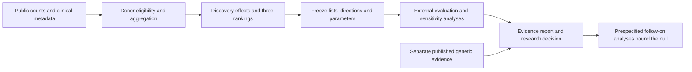
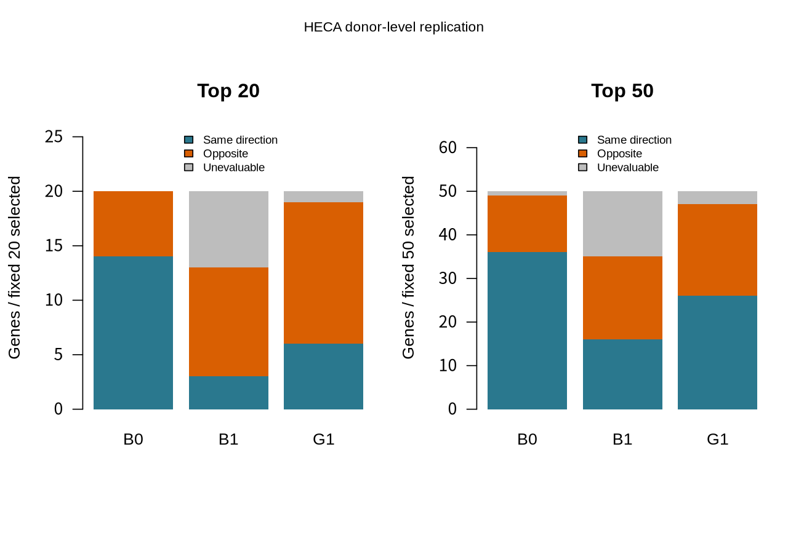
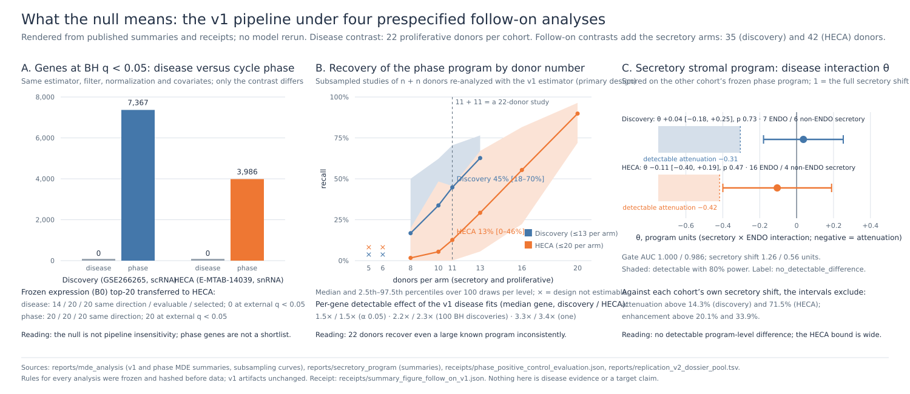

# EndoTarget Evidence

**Cross-study target prioritization in endometriosis using donor-level transcriptomics and network analysis.**

[English](README.md) · [简体中文](README.zh-CN.md)

[](docs/INPUT_PROVENANCE.md)
[](docs/LOCAL_EXECUTION.md)
[](receipts/local_primary_container_replay.json)
[](https://github.com/NingyuSUN/endotarget-evidence/actions/workflows/ci.yml)
[](CITATION.cff)
[](https://github.com/NingyuSUN/endotarget-evidence/releases/latest)
[](LICENSE)

Can a biological network improve which disease-associated genes reproduce in another study? EndoTarget Evidence compares expression ranking with two network baselines, evaluates the frozen candidate lists in a separate endometrial cohort, and adds a traceable genetic-evidence assessment.

**Main finding:** the analysis did not establish a statistically supported cross-study target shortlist or an advantage for network propagation. The resulting research recommendation is to hold the candidate pool pending stronger evidence. Four prespecified follow-on analyses (October 2026) show that the same pipeline detects a known cycle-phase program at these sample sizes, bound the null to effects below roughly 2.2- to 3.4-fold for the median gene at the multiplicity faced in each cohort and below 1.5- to 1.8-fold when both cohorts are pooled (still with no gene at q < 0.05), and find no detectable disease difference in the secretory-phase stromal program.

| Study at a glance | Scope |
|---|---|
| Biological focus | Proliferative-phase eutopic endometrial stromal fibroblasts |
| Data | 22 discovery donors / 150,788 cells; 22 external donors / 52,744 nuclei |
| Comparison | Expression, network degree and fixed network propagation on 11,749 genes |
| Evaluation | External expression-direction agreement, donor resampling and clinical sensitivity analyses |
| Reproduction | Five primary Nextflow tasks reproduced in Docker; 34 scientific tables and eight result metadata files matched |
| Follow-on analyses | Phase positive control, minimum detectable effect, secretory-phase program contrast and public-cohort extension audit, each frozen before execution (October 2026) |

**Read the results:** [Two-page research brief](reports/executive_brief_en.pdf) · [Method card](docs/METHOD_CARD.md) · [Full results and figures](reports/results_summary_en.md)

## Study design

Counts are aggregated **per donor** before statistical modeling, so thousands of cells from one person do not become thousands of independent observations. Each cohort is modeled separately with edgeR and limma-voom, adjusting for age, technical batch and adenomyosis.



| Cohort | Cases / controls | Retained cells or nuclei | Genes tested | Genes with BH q < 0.05 |
|---|---:|---:|---:|---:|
| Discovery: GSE266265 | 12 / 10 | 150,788 cells | 17,733 | 0 |
| External: HECA, E-MTAB-14039 | 15 / 7 | 52,744 nuclei | 17,643 | 0 |

These are **22 donors per cohort**, not cell-level sample sizes. Controls are surgical non-endometriosis donors and may have other conditions. Recruitment sources are separated; individual non-overlap is not genotype-confirmed. [Data provenance and eligibility](docs/INPUT_PROVENANCE.md).

## Benchmark results

The three methods share the same 11,749-gene, 123,313-edge STRING functional-association network. Lists, discovery expression directions and parameters were frozen before computing external disease effects.

| Method | Ranking rule | Same direction / evaluable / selected |
|---|---|---:|
| **Expression (B0)** | Absolute moderated disease statistic | **14 / 20 / 20** |
| **Network degree (B1)** | Weighted connectivity; topology control | **3 / 13 / 20** |
| **Network propagation (G1)** | Random walk with restart, seeded by discovery evidence | **6 / 19 / 20** |

G1 is a fixed graph algorithm with no model training or parameter search. Genes missing from external evaluation remain missing; lists are never refilled. B1 falls below the predefined 16-of-20 evaluability threshold. Both network lists agreed less often than their 200 expression- and degree-matched reference sets (0.5th percentile, versus the 96.5th for B0), a descriptive lower-than-reference pattern rather than only an absence of improvement; the percentile is not a calibrated p value.



**Interpretation.** Expression-direction agreement is not target accuracy. None of the selected genes combined direction agreement with external BH q < 0.05, where BH adjustment accounts for the full tested gene family. Lack of significance does not demonstrate absence of a disease effect.

The observed G1-minus-B0 agreement difference was **−38.4 percentage points**. Of 500 paired external-donor bootstrap draws, 487 were valid and 13 failed design checks. The conditional 95% interval was **−38.9 to +8.7 points**, including zero; it does not establish a general method advantage. Because resampling noise pulls both methods toward 50% agreement, this interval is not centered on the observed difference; see the [interpretation notes](reports/results_summary_en.md#notes-for-interpretation). All 22 discovery leave-one-donor-out analyses completed. [Uncertainty and sensitivity results](reports/results_summary_en.md#donor-sensitivity).

The separate genetic assessment retains all 40 frozen candidate-pool genes: one limited SKIDA1 mapping and 39 unavailable mappings in the selected source. The dossier rule yielded one inconclusive PARP9 case and no supported target dossier. [Genetic evidence report](reports/genetic_evidence_report.md).

## What the null means: follow-on analyses

Four prespecified analyses were added on 26–27 October 2026 and four more on 2 November 2026 (the two-cohort combined bound, the stromal-state composition test, the genetic set-level test and the bulk program-level replication), each with rules, inputs and thresholds frozen and hashed before any new value was computed. They reuse the v1 estimator, its saved fit quantities or its design matrices unchanged, refit no disease model and leave every v1 artifact byte-identical. None nominates a gene or a cell state. Secretory-phase genes are not endometriosis genes; the positive-control lists are cycle biology, not a shortlist.



The figure is rendered from the published summaries by a [standard-library script](scripts/render_summary_figure_follow_on_v1.py) with a [receipt](receipts/summary_figure_follow_on_v1.json) that records every number drawn; no model was rerun.

| Analysis | Result | What it bounds |
|---|---|---|
| **Phase positive control:** the v1 pipeline on proliferative versus secretory donors (35 and 42) | **7,367 and 3,986** genes at BH q < 0.05; the frozen expression top-20 transfers **20 / 20** same direction, all at external q < 0.05; G1 minus B0 −37 points, 95% interval −53 to −21 | The pipeline detects and transfers a large donor-level program at these sample sizes, so the disease null is not pipeline insensitivity. Propagation transfers worse than expression ranking even with a strong signal. |
| **Minimum detectable effect** from the saved v1 fits | Median gene: **1.5-fold** at α 0.05, **2.2- to 2.3-fold** at the BH boundary for 100 discoveries, **3.3- to 3.4-fold** for a single discovery; at 11 + 11 donors a study recovers a median 45% (discovery) and 13% (HECA) of the phase program | Fourfold proliferative stromal disease differences are excluded for most genes and twofold differences for a fifth of genes family-wide; 1.5-fold effects remain open. Twenty-two donors recover even a several-thousand-gene program inconsistently. |
| **Secretory-phase program contrast:** each cohort scored on the other cohort's frozen phase program; phase × disease interaction | Signature transfers at AUC 1.00 and 0.99; θ **+0.04** (−0.18 to +0.25) and **−0.11** (−0.40 to +0.19) program units; detectable attenuation 0.31 and 0.42 units; no interaction gene at q < 0.05 | No detectable program-level disease difference in secretory stromal fibroblasts in either cohort: discovery excludes an attenuation above 14% of the secretory shift, HECA admits anything short of a 71% loss. One nominal sensitivity (adenomyosis donors excluded, p 0.026) points to enhancement and is not reproduced. |
| **Two-cohort combined bound** (2 November 2026): fixed-effect combination of the two saved v1 disease fits over 15,435 shared genes | **0** genes at BH q < 0.05 (minimum q 0.145); median detectable effect **1.27-fold** at α 0.05, 1.52-fold at the BH boundary for 100 discoveries, 1.79-fold for one (each cohort alone 1.4–1.5, 2.0–2.1, 2.9–3.0) | Pooling both cohorts changes nothing about the shortlist and tightens the bound: twofold differences are excluded family-wide for 60% of genes, 1.5-fold for 24%. No donor added; a precision-weighted average across platforms, not a common effect. |
| **Stromal-state composition test** (2 November 2026): decidualized-like share of primary stromal cells on the v1 design | Odds ratio **0.75** [0.48, 1.17], p 0.18 (discovery) and **1.08** [0.64, 1.80], p 0.75 (HECA); detectable odds ratio 1.9 / 2.1; no author state at q < 0.05 | Disease does not detectably change the mixture of stromal states within the lineage at these donor numbers, so the null is not a composition artefact of that size; within-state change is untested. |
| **Genetic set-level test** (2 November 2026): four fixed gene sets from Rahmioglu 2023 and Open Targets on the pooled statistics | All four sets `no_enrichment`: matched percentiles 11, 51, 6 and 39; Wilcoxon p 0.42–0.98; sign agreement 43–50% versus 53% for matched genes | The sub-threshold stromal disease signal is not concentrated among genetically implicated genes. |
| **Bulk program-level replication** (2 November 2026): the frozen single-cell programs and top-20 list in public bulk eutopic cohorts GSE51981 (144 samples) and GSE6364 (37) | Secretory program disease interaction θ **−0.09** [−0.21, +0.03], p 0.16, and **−0.15** [−0.34, +0.04], p 0.13: `no_detectable_difference` in both; top-20 directions hold in 12 / 20, 7 / 20 and 4 / 20 genes: `does_not_transfer`; 9,593 tissue-level genes at q < 0.05 against all controls, 0 against other-pathology controls | At tissue level in 144 donors the stromal secretory program is attenuated by less than 40% of its cycle shift; the single-cell list does not transfer to whole tissue; the all-control contrast is the series' published pathology-versus-normal pattern. One run plus two published corrections. |
| **Cohort extension audit:** GSE213216 and GSE179640, metadata only | Natural-cycle eutopic donors **5 ENDO / 0 non-ENDO** and **0 / 1**; matched eutopic–lesion pairs 4 and 8; both studies lie inside the HECA cells atlas | No public single-cell cohort extends the eutopic donor-level contrasts; nothing was downloaded. The remaining eligible public donors are already in the analyses above. |

Reports: [positive control](reports/phase_positive_control_results.md), [detectable effect](reports/mde_results.md), [secretory program](reports/secretory_program_results.md), [combined bound](reports/combined_bound_results.md), [composition test](reports/composition_test_results.md), [genetic set test](reports/genetic_set_test_results.md), [bulk replication](reports/bulk_replication_results.md), [cohort extension](reports/cohort_extension_feasibility.md). Protocols, freeze receipts and figures are linked from the [method card](docs/METHOD_CARD.md#follow-on-analyses-what-the-null-resolves) and summarized in the [results summary](reports/results_summary_en.md#follow-on-analyses-october-2026).

## Design and implementation

| Component | Implementation | Inspect the evidence |
|---|---|---|
| Donor-aware analysis | Audited clinical eligibility, count provenance, covariate adjustment and explicit exclusions | [Method card](docs/METHOD_CARD.md), [donor selection](reports/figures/donor_flow_v1.svg) |
| Controlled graph comparison | Shared gene universe, fixed parameters, external evaluation and missing-outcome bounds | [Ranking code](scripts/rank_targets.py), [ranking configuration](config/ranking_algorithm.json) |
| Failure-aware uncertainty | Paired donor bootstrap, leave-one-donor-out fits and descriptive matched reference sets | [Resampling methods](docs/RESAMPLING.md), [execution record](receipts/real_resampling_execution.json) |
| Reproducible workflow | Nextflow DSL2, locked R/Python dependencies, Docker, input/output hashes and cache checks | [Discovery workflow](main.nf), [external workflow](replication.nf), [reproduction guide](docs/LOCAL_EXECUTION.md) |

The recorded local replay reproduced all five primary tasks. Discrete selections matched exactly; the largest continuous difference was **1.10 × 10⁻¹³**, below the declared absolute tolerance of 10⁻⁸. Synthetic checks also completed five fresh and five cached tasks. These are engineering checks on the same data, distinct from biological replication. [Replay record](receipts/local_primary_container_replay.json) · [Cache checks](receipts/local_container_nextflow.json).

On every push, [GitHub Actions](.github/workflows/ci.yml) runs the synthetic unit tests (Python on the pinned probe lock, R on the Bioconductor 3.20 release series) and a Markdown link check. The tests that read a commit of the original, pre-revision history and one test that calls a host-specific interpreter are skipped by name with the reason printed; no check was relaxed. These are software checks, not a scientific rerun.

## Explore and reproduce

The reports, figures, source code and small evidence records can be inspected directly on GitHub or cloned:

```bash
git clone https://github.com/NingyuSUN/endotarget-evidence.git
cd endotarget-evidence
```

**A clone alone is not a complete scientific rerun environment.** Large inputs, intermediate outputs, runtime environments and caches are excluded from Git. Full reproduction requires restoring the referenced artifacts and matching the recorded runtime and paths.

| Task | Entry point |
|---|---|
| Read the scientific conclusions | [Research brief](reports/executive_brief_en.pdf), [English results summary](reports/results_summary_en.md), [Chinese biology report](reports/biology_report_zh.md) |
| Review assumptions and figures | [Method card](docs/METHOD_CARD.md) |
| Reproduce the designated primary outputs | [Prerequisites, commands and checks](docs/LOCAL_EXECUTION.md) |
| Review a possible cloud deployment | [AWS guide — not executed](docs/AWS_DEPLOYMENT.md) |
| Navigate methods, results and provenance | [Documentation index](docs/README.md) |

## Scope and limitations

- This is a retrospective observational reanalysis with pre-external freezes, not a preregistered or blinded study. Author labels, phase ascertainment, residual confounding, cell-state composition and the cell-versus-nucleus assay difference limit interpretation.
- Discovery uses author-provided secondary estimated counts. The original full RDS was not recomputed. An 8,248-count component of the HECA raw/H5 discrepancy remains unresolved; details are retained in the [method card](docs/METHOD_CARD.md).
- Genetic annotations cover one selected 2023 publication. Missing mapping is not negative genetic evidence, and expression association does not determine causality or an activation/inhibition strategy.
- The follow-on analyses are bounds and controls, not disease evidence. Minimum detectable effects are conditional on the realized variance estimates of the original fits; the secretory program contrast rests on 13 and 20 secretory donors, 6 and 4 of them controls; the cohort audit relies on the HECA authors' curation of clinical fields. Effects below the stated bounds are not shown to be absent.
- The project evaluates evidence for early target prioritization. It does not generate molecules or antibodies, train a GNN or foundation model, or demonstrate therapeutic efficacy. AWS deployment has not been executed.

## Citation

Cite the tagged release; the metadata is in [CITATION.cff](CITATION.cff) and each version is listed in the [changelog](CHANGELOG.md) and on the [releases page](https://github.com/NingyuSUN/endotarget-evidence/releases).

> Sun N. (2026). EndoTarget Evidence: cross-study target prioritization in endometriosis using donor-level transcriptomics and network analysis (version 1.0.0). https://github.com/NingyuSUN/endotarget-evidence

```bibtex
@misc{sun2026endotarget,
  author = {Sun, Ningyu},
  title  = {EndoTarget Evidence: cross-study target prioritization in endometriosis using donor-level transcriptomics and network analysis},
  year   = {2026},
  month  = {10},
  note   = {Version 1.0.0},
  url    = {https://github.com/NingyuSUN/endotarget-evidence}
}
```

## License

Code is released under the [MIT License](LICENSE). Documentation, reports and figures written for this project are released under [CC BY 4.0](https://creativecommons.org/licenses/by/4.0/). Third-party data, references and publications keep their own terms; see the [source register](docs/DATA_SOURCES.md) and [input provenance](docs/INPUT_PROVENANCE.md).

Maintained by [Ningyu Sun](https://github.com/NingyuSUN). AI assistance was used in implementation and review. Source studies and attribution are recorded in the [input provenance](docs/INPUT_PROVENANCE.md) and [genetics methods](docs/GENETIC_EVIDENCE_METHOD.md).

Historical execution identifiers and their corresponding published commits are documented in the [provenance note](docs/PUBLICATION_HISTORY.md).
