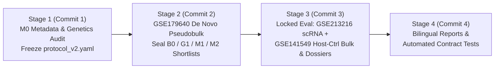
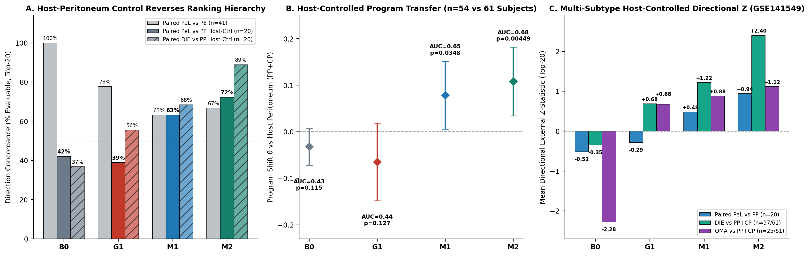
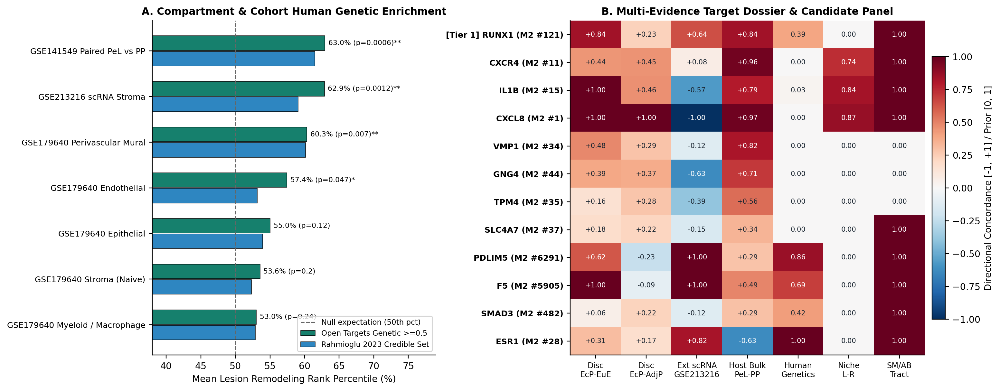

# EndoTarget v2

**Host-decontaminated lesion single-cell transcriptomics, niche crosstalk, and human genetics for target prioritization in endometriosis.**

[English](README.md) · [简体中文](README.zh-CN.md)

[](docs/PROTOCOL.md)
[](receipts/protocol_freeze.json)
[](receipts/prediction_seal.json)
[](CITATION.cff)
[](LICENSE)

In [EndoTarget v1](https://github.com/NingyuSUN/endotarget-evidence), cross-sectional donor-level comparisons of proliferative **eutopic** endometrial stromal fibroblasts (`22 + 22` donors) yielded `0` genes at `BH q < 0.05`, bounded median stromal disease differences below `1.5–1.8`-fold, and showed that global STRING random walk (`G1`) degraded cross-study agreement relative to expression ranking (`B0`) by `−38.4` percentage points.

EndoTarget v2 moves to **ectopic endometriosis lesions** (`GSE179640` discovery scRNA, `GSE213216` external scRNA, and `GSE141549` 408-array / 162-subject multi-lesion & host-peritoneum cohort) under a cryptographically sealed four-commit zero-leakage protocol (`protocol_freeze.json` $\rightarrow$ `prediction_seal.json` $\rightarrow$ `locked_evaluation_v2.json`).

**Main findings:**
1. **Naive lesion-versus-eutopic DE (`B0`) creates a cross-study replication illusion driven by normal host peritoneum.** Paired `EcP vs EuE` stromal analysis in `GSE179640` ($n=8$ pairs) detects `569` genes at `BH q < 0.05` and appears to replicate `9 / 20` (`45%`, `AUC = 0.991`) in external single-cell `GSE213216` (`EcP vs EuE`) and `13 / 20` (`65%`) in `GSE141549` (`Peritoneal Lesion vs PE`, $n=41$ pairs). Yet when tested against **matched unaffected peritoneum from the same women (`Peritoneal Lesion vs PP`, $n=20$ pairs)**, **`13 / 13` (`100%`) of `B0`'s `PE` hits fail (`0 / 20` joint replication; `10 / 13` invert sign)** because `B0` predominantly selects normal resident peritoneal fibroblast and mesothelial markers (`SFRP2`, `GPC3`, `TBX18`, `CDON`, `PDLIM3`, `S100A10`).
2. **Host-decontaminated dual-contrast scoring (`M1`) and genetics + niche L–R integration (`M2`) reverse the ranking hierarchy across host-controlled lesion validation (`GSE141549`), while exposing hormonal-regimen sensitivity in uncontrolled `GSE213216` `EcP vs EuE`.** Against host peritoneum in `GSE141549`, `M2` achieves `72.2%` (`13 / 18`) direction agreement in paired `PeL vs PP` (`2,000`-draw bootstrap `M2 − B0 = +31.4` percentage points, 95% CI `[+8.2, +46.5]`), `88.9%` (`16 / 18`) in paired `DIE vs PP` (vs `36.8%` for `B0`), and `AUC = 0.684` ($\theta = +0.108$ `[+0.034, +0.182]`, $p = 0.00449$) on `All PeL (n=54) vs PP+CP (n=61)` (vs `B0` `AUC = 0.430`, $p = 0.115$). Conversely, in `GSE213216` `EcP vs EuE`, `M1` and `M2` score `0 / 20` at `BH q < 0.05` (`M2 − B0 = −43.9` pp `[−55.0, −30.0]`) because `7 / 8` discovery `GSE179640` `EuE` donors were on `norethindrone/estradiol` suppression whereas `GSE213216` `EuE` donors had untreated cycling endometrium expressing high baseline `CXCL8`, `IL1B`, `SPHK1`, and `KCNK3`.
3. **Global STRING RWR (`G1`) fails again (`median degree 224.5` vs `5.2` for `B0`), human endometriosis genetics enriches specifically in ectopic lesion compartments, and `RUNX1` passes all four Tier-1 target gates.** Open Targets (`MONDO_0005133` / `EFO_0001065`) and Rahmioglu 2023 GWAS/SMR genes enrich significantly in discovery perivascular mural (`p = 7.5e-4`) and endothelial (`p = 0.0045`) cells, `GSE213216` lesion stroma (`p = 1.9e-4`), and host-controlled `GSE141549` `PeL vs PP` (`p = 2.9e-5`). Across all `10,972` shared universe genes, **`RUNX1` (`ENSG00000159216`)** is the sole target simultaneously supported by human genetics (`OT = 0.653`), discovery dual-contrast remodeling (`+2.51 / +0.45`), external scRNA replication (`+1.61`, `q = 0.00824`), external host-controlled bulk validation (`+0.84`, `q = 0.0492`), and small-molecule tractability.

| Study at a glance | Scope |
|---|---|
| **Discovery scRNA (`GSE179640`)** | `31` tissue `.h5` libraries, `14` donors, `115,402` QC cells (`37,691` de novo stromal fibroblasts); `8` matched `(EuE, EcP)` pairs, `6` matched `(EuE, EcP, AdjP)` triplets |
| **External scRNA (`GSE213216`)** | `29` locked non-redundant libraries, `18` patients, `242,430` QC cells (`106,424` de novo stromal fibroblasts); `12` `EcP`, `9` `EuE`, `6` `EcO`, `2` unaffected peritoneum (`4` matched natural-cycle pairs) |
| **External Bulk (`GSE141549`)** | `408` arrays mapped `100%` to `162` subjects (`SL 001–162`), `19,262` unique `ENSG` genes; paired `PeL vs PE` (`n=41`), host-controlled `PeL vs PP` (`n=20`), `DIE vs PP` (`n=20`), triplets (`n=18`), plus `OMA` and `PE vs CE` (`0` genes `q < 0.05`) |
| **Shared benchmark universe** | `10,972` expressed stromal `ENSG` genes on `97,462` STRING v12.5 direct (`experiments`/`database >= 0.700`) edges; zero HECA transferred labels |
| **Prior & genetics layers** | `404` human endometriosis genetic targets (Open Targets v26.09 + Rahmioglu 2023 *Nat Genet* GWAS/SMR/coding), `168` curated vascular/myeloid $\leftrightarrow$ stromal L–R pairs, GTEx v10 tissue eQTL/TPM context |

**Read the documentation:** [Full Results (EN)](reports/RESULTS.md) · [完整结果报告 (中文)](reports/RESULTS.zh-CN.md) · [Protocol](docs/PROTOCOL.md) · [Method Card](docs/METHOD_CARD.md) · [Target Dossiers](reports/target_dossiers.md)

---

## Zero-Leakage Study Design



---

## Benchmark Summary Across Discovery and Locked External Cohorts (`K = 20`)

| Method | Discovery Dual-Concordant / Mesothelial Soup | `GSE213216` scRNA `EcP vs EuE` `BH q<0.05` (Same Sign) | `GSE141549` Paired `PeL vs PE` (`n=41`) `BH q<0.05` | `GSE141549` Host-Ctrl `PeL vs PP` (`n=20`) Same Sign (`Host FP%`) | `GSE141549` Paired `DIE vs PP` (`n=20`) Same Sign | `GSE141549` `All PeL vs PP+CP` Program `AUC` ($p$) |
|---|---:|---:|---:|---:|---:|---:|
| **`B0` (Naive `EcP vs EuE`)** | `8/20` / `6/20` (`30%`) | **`9/20` (`68.4%`)** | **`13/20`** | `8/19` (`42.1%`, **`100%` FP**) | `7/19` (`36.8%`) | `0.430` (`0.115`) |
| **`G1` (Global STRING RWR)** | `13/20` / `0/20` (`0%`) | `4/20` (`47.4%`) | `10/20` | `7/18` (`38.9%`, **`90%` FP**) | `10/18` (`55.6%`) | `0.437` (`0.127`) |
| **`M1` (Dual-Contrast Host-Decontam)** | **`20/20` / `0/20`** | `0/20` (`36.8%`) | `6/20` | **`12/19` (`63.2%`)** | **`13/19` (`68.4%`)** | **`0.651` (`0.0348`)** |
| **`M2` (Genetics + Niche L–R)** | **`20/20` / `0/20`** | `0/20` (`31.6%`) | `3/20` | **`13/18` (`72.2%`)** | **`16/18` (`88.9%`)** | **`0.684` (`0.00449`)** |





---

## Repository Structure and Reproducibility

- `configs/protocol_v2.yaml` & `receipts/protocol_freeze.json` — Stage 1 frozen protocol and M0 SHA-256 lock.
- `manifests/` — Cohort sample/donor ledgers, canonical 7-lineage markers (`canonical_lineage_markers.tsv`), curated L–R pairs (`curated_niche_lr_pairs.tsv`), human genetics prior (`human_genetics_prior_v2.tsv`), and sealed candidate shortlists (`frozen_candidates_v2.tsv`).
- `scripts/` — End-to-end pipeline (`m0_audit_and_priors.py`, `freeze_protocol.py`, `fetch_gse179640.py`, `endotarget_lib.py`, `run_discovery_v2.py`, `fetch_external_cohorts.py`, `evaluate_locked.py`, `build_extended_dossier_panel.py`, `render_figures_v2.py`), capped at `8` CPU threads.
- `reports/` — Full bilingual results (`RESULTS.md`, `RESULTS.zh-CN.md`), target dossiers (`target_dossiers.md`, `target_dossiers.tsv`, `target_dossiers_extended_panel.tsv`), machine-readable JSON summaries, and SVG/PNG figures (`reports/figures/`).
- `tests/test_endotarget_v2.py` — Automated contract, SHA-256 chain, UMI conservation, zero-HECA-leakage, synthetic estimator, and report-number synchronization tests (`pytest`).

```bash
OMP_NUM_THREADS=8 OPENBLAS_NUM_THREADS=8 MKL_NUM_THREADS=8 .venv/bin/pytest -v
```

---

## Scope, Limitations, and Data Licenses

- Retrospective observational reanalysis with pre-external cryptographic freezes; not a prospective clinical trial or wet-lab perturbation study.
- Hormonal suppression in discovery `GSE179640` (`7 / 8` paired donors on `norethindrone/estradiol`) versus untreated natural-cycle eutopic donors in `GSE213216`, together with the `n = 6` discovery `AdjP` sample size, limits single-cell `EcP vs EuE` transfer of acute cytokine targets (`CXCL8`, `IL1B`, `SPHK1`, `KCNK3`).
- Third-party databases retain their respective terms: **Open Targets Platform** (https://platform-docs.opentargets.org/licence; `.licenses/opentargets_database_LICENSE.txt`), **GTEx Portal API v10** (https://gtexportal.org/home/license; `.licenses/gtex_database_LICENSE.txt`), and **STRING v12.5** (CC BY 4.0). Code is released under [MIT](LICENSE); documentation and figures under CC BY 4.0.
