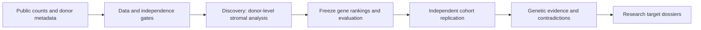

# EndoTarget Evidence

**Public single-cell evidence for prioritizing endometriosis research targets.**

Status: **DESIGN ONLY — 2026-10-13.** Data sources have been checked at the publication/catalog level. No expression matrices have been analyzed, no targets have been selected, no models or cloud jobs have run, and no remote repository has been created in this round.

[中文说明](README.zh-CN.md) · [Research protocol](docs/RESEARCH_PROTOCOL.md) · [Data sources and gates](docs/DATA_SOURCES.md)

## Research question

Which disease-associated expression changes in **eutopic endometrial stromal cells** reproduce in an independent study, and which genes warrant further research when public genetic evidence, contradictory findings, and intervention uncertainty are considered?

The intended decision is a short, justified research shortlist. Expression differences alone do not establish a causal target, an inhibition/activation strategy, or therapeutic efficacy.

## Why this project

This project connects reproductive biology and omics research with computational target assessment. Its planned contribution is a transparent cross-study analysis, a controlled graph-method comparison, and evidence dossiers that a biological research team can inspect. It is a retrospective public-data reanalysis, not a claim of a newly invented algorithm or a blinded prospective study.

## Bounded first release

- One disease, one primary stromal lineage, one discovery study and one independent replication study.
- Donor-level differential expression and explicit menstrual-phase/treatment controls.
- Three ranking baselines: expression evidence, network degree, and network propagation.
- Public human-genetic evidence as a separate evidence layer, followed by 3–5 candidate dossiers; report fewer if the evidence does not justify that many.
- Nextflow, containers, one documented AWS execution, and an English report for biologists are implementation deliverables, not completed capabilities.



## Candidate inputs

| Role | Source | Current evidence |
|---|---|---|
| Discovery | [GSE266265](https://www.ncbi.nlm.nih.gov/geo/query/acc.cgi?acc=GSE266265) | Public endometrial scRNA-seq; catalog reports 60 donors. Large RDS import and count-layer checks remain open. |
| Replication | [HECA / E-MTAB-14039](https://www.ebi.ac.uk/biostudies/arrayexpress/studies/E-MTAB-14039), newly generated nuclei | Public author portal exists. The eligible donor subset, raw-count layer and provenance must pass audit. |
| Genetic context | [GCST90205183](https://www.ebi.ac.uk/gwas/studies/GCST90205183) and the originating study's public gene-mapping evidence | Association-to-gene mapping must retain its evidence type. No de novo MR/colocalization in v1. |

These are candidate inputs, not an analysis-ready manifest. The complete audit and known limitations are in [DATA_SOURCES.md](docs/DATA_SOURCES.md).

## What the graph comparison measures

Can network propagation rank genes whose disease-associated expression changes transfer to another cohort better than expression-only and connectivity-only rankings? The endpoint measures **cross-study transcriptomic reproducibility**, not therapeutic target accuracy. Network propagation is a graph baseline; it is not a trained GNN or a foundation model.

## Results and reproducibility

**No scientific results are available yet.** There are no performance badges, example target scores, completed-run commands, or deployment claims in this design release. Planned commands and artifact contracts are explicitly marked in the engineering design.

Planned evidence: donor/exclusion flowchart; cross-cohort effect plots; three-method comparison; sensitivity/failure analysis; 3–5 evidence dossiers; a two-page biology brief; exact input/software/run receipts.

## Repository contents today

```text
README.md / README.zh-CN.md
docs/{RESEARCH_PROTOCOL,DATA_SOURCES}.md
manifests/source_inventory.csv
templates/{TARGET_DOSSIER,BIOLOGY_BRIEF}.md
receipts/metadata_audit_2026-10-13.json   # actual small metadata audit only
```

This folder can become the root of a repository named `endo-target-evidence`. The planned code layout is documented rather than represented by empty or nonfunctional modules.

## Data use and attribution

All scientific inputs must be publicly obtainable without private-data agreements or new experiments. Download from original providers; do not commit patient-level matrices or redistribute third-party resources by default. Record source terms individually. A publication's open-access license does not automatically establish the license of every dataset or dependency. A code license must be selected before software publication; this design does not relicense source material.

See [the source register](docs/DATA_SOURCES.md) for original studies.
