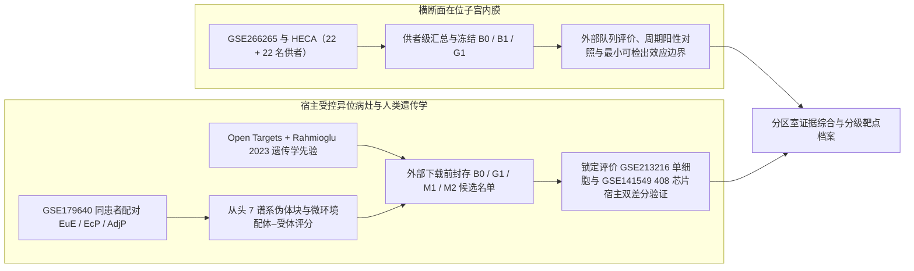
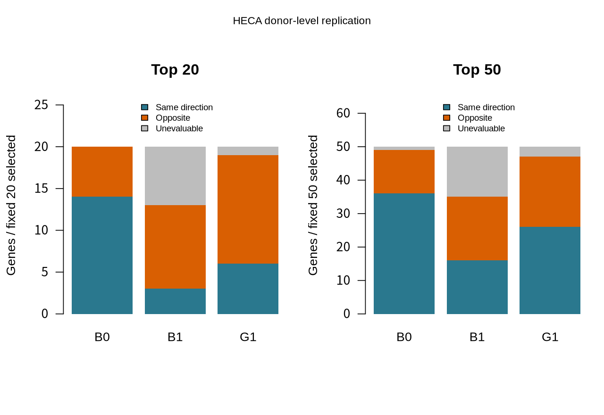
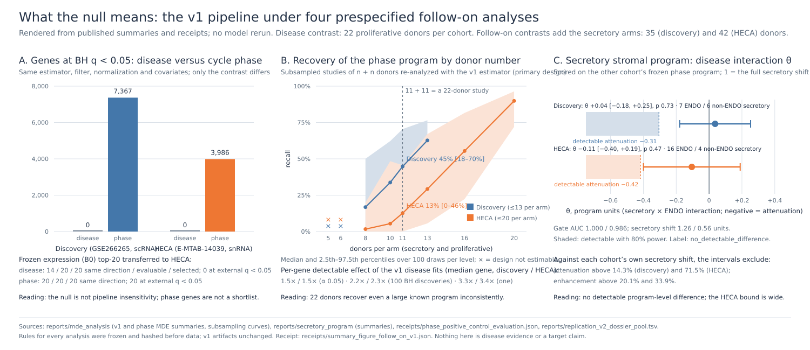
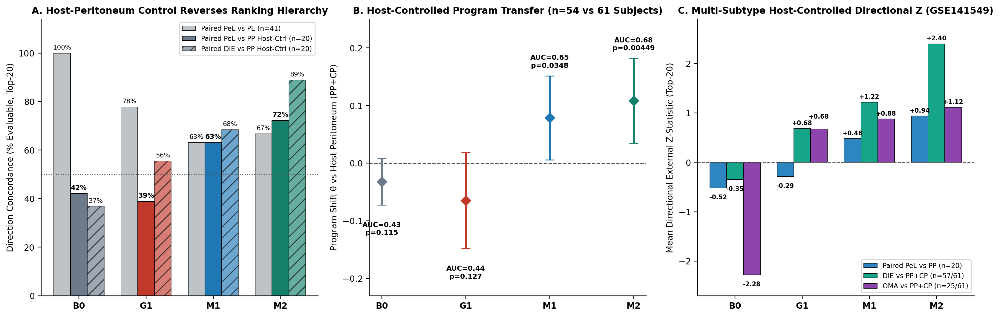

# EndoTarget Evidence

**以供者级单细胞转录组、宿主腹膜受控病灶建模、网络传播与人类遗传学评估子宫内膜异位症候选靶点的跨研究证据。**

[English](README.md) · [简体中文](README.zh-CN.md)

[](docs/INPUT_PROVENANCE.md)
[](docs/LOCAL_EXECUTION.md)
[](receipts/local_primary_container_replay.json)
[](v2/receipts/prediction_seal.json)
[](https://github.com/NingyuSUN/endotarget-evidence/actions/workflows/ci.yml)
[](CITATION.cff)
[](https://github.com/NingyuSUN/endotarget-evidence/releases/latest)
[](LICENSE)

在人类子宫内膜异位症组织中，可跨研究复现且受胚系遗传学支持的治疗靶点究竟分布于何处？常规差异表达或全图网络传播在什么条件下会产生系统性误判？EndoTarget Evidence 在**在位子宫内膜**与**异位病灶**两个组织区室中开展供者级单细胞及组织转录组建模，在外部数据读取前以密码学哈希冻结候选名单与模型参数，系统比较表达排序、STRING 网络传播与宿主去污染微环境评分，并整合 Open Targets 与 Rahmioglu 等（2023）的人类遗传学证据。

**主要结论：** 子宫内膜异位症的靶点证据取决于组织区室与宿主背景对照。横断面**在位子宫内膜**基质成纤维细胞未建立任何具有统计显著跨研究支持的候选靶点（`22 + 22` 名单细胞供者中 `0` 个基因达到 `BH q < 0.05`，两队列合并后中位可检出效应限定在 `< 1.5–1.8` 倍，对其他盆腔病变组织对照 `0` 个基因显著，且无胚系遗传学富集）。研究推进至**异位病灶及同患者未受累腹膜对照**（`GSE179640` 与 `GSE213216` 共 `357,832` 个质控后单细胞，配合 `GSE141549` 的 `162` 名受试者 / `408` 张多亚型与宿主腹膜芯片）后，配对病灶对在位内膜对比检出 `569` 个 `BH q < 0.05` 基质基因；但当病灶与**同一患者未受累腹膜（`PeL vs PP`）**对比时，朴素差异表达（`B0`）选出的前 20 名外部阳性基因出现 **`100%`（`13 / 13`）宿主腹膜背景假阳性坍塌**（`10 / 13` 方向反转）。引入双对比宿主去污染评分（`M1`）并进一步整合血管/髓系配体–受体互作与人类遗传学先验（`M2`）后，宿主受控验证中的方法排序完全反转：配对 `PeL vs PP` 同向率提升至 **`72.2%`（`13 / 18`）**（相对 `B0` 净增 **`+31.4` 个百分点**，配对自举 95% CI **`[+8.2, +46.5]`**），配对深部浸润型病灶（`DIE vs PP`）同向率达 **`88.9%`（`16 / 18`）**，全腹膜病灶对宿主腹膜程序迁移达到 **`AUC = 0.684`**（`p = 0.0045`）；人类遗传学风险在宿主受控病灶中显著富集（**`p = 2.9 × 10⁻⁵`**），并锁定同时通过四道预设门槛的核心多模态靶点 **`RUNX1`**（`L2G = 0.653`，发现单细胞、外部单细胞与宿主受控组织均 `BH q < 0.05`）及微环境/GWAS 背景候选基因（`CXCR4`、`ESR1`、`PDLIM5`、`F5`）。在两个组织区室及周期分期阳性对照中，全图 STRING 随机游走均因高度中心节点偏倚而显著劣于表达排序。

| 项目概览 | 范围 |
|---|---|
| 生物学区室 | 横断面在位子宫内膜（`GSE266265`、`HECA E-MTAB-14039`、`GSE51981`、`GSE6364`）与含同患者未受累腹膜对照的多亚型异位病灶（`GSE179640`、`GSE213216`、`GSE141549`） |
| 数据规模 | 四个单细胞/单核队列共保留 `561,364` 个细胞或细胞核；三个组织芯片队列共 `589` 份样本（其中 `GSE141549` 完整映射 `162` 名受试者 / `408` 份样本） |
| 方法比较 | 朴素差异表达（`B0`）、网络连接度（`B1`）、固定 STRING 随机游走（`G1`）、双对比宿主去污染评分（`M1`）、遗传学与微环境配体–受体整合评分（`M2`） |
| 遗传学与微环境层 | `404` 个内异症人类遗传学关联基因（Open Targets `MONDO_0005133` / `EFO_0001065` + Rahmioglu 等 2023 *Nat Genet*）、`168` 对血管/髓系–基质配体–受体对、GTEx v10 组织表达与 eQTL 参考 |
| 零泄漏约束 | 候选名单、效应方向、权重与评价规则均在读取外部队列表达矩阵前冻结并记录 SHA-256 回执 |
| 工程与契约核验 | Nextflow/Docker 主要任务复现（连续数值最大差 `1.10 × 10⁻¹³`）、精确整数 UMI 守恒、合成估计量单测与全仓相对链接及契约自动化检查 |

**结果入口：** [异位病灶与遗传学完整报告（中文）](v2/reports/RESULTS.zh-CN.md) · [English lesion report](v2/reports/RESULTS.md) · [多模态靶点档案](v2/reports/target_dossiers.md) · [在位内膜英文摘要](reports/results_summary_en.md) · [两页英文研究简报（PDF）](reports/executive_brief_en.pdf) · [在位方法卡](docs/METHOD_CARD.md) · [病灶方法卡](v2/docs/METHOD_CARD.md)

---

## 研究设计

所有单细胞数据均先按**供者与解剖取材位点**汇总原始整数计数，再进入统计模型，避免把同一名患者的数万个细胞误作独立样本。横断面非配对队列采用调整临床与批次协变量的 `edgeR` / `limma-voom` 建模；多位点病灶队列采用患者内配对设计（`~ donor + site`）或按供者分块的广义最小二乘（GLS）配合经验贝叶斯方差收缩。



| 区室与队列 | 测量与设计 | 供者或受试者数（样本数） | 保留细胞/核或基因数 | `BH q < 0.05` 显著基因数 |
|---|---|---:|---:|---:|
| **在位发现：** `GSE266265` | scRNA，增殖期非配对（`12` 病例 / `10` 对照） | `22` 名供者 | `150,788` 细胞 / `17,733` 基因 | `0` |
| **在位外部：** `HECA`（`E-MTAB-14039`） | snRNA，增殖期非配对（`15` 病例 / `7` 对照） | `22` 名供者 | `52,744` 细胞核 / `17,643` 基因 | `0`（`15,435` 共有基因合并后仍为 `0`） |
| **在位组织芯片：** `GSE51981` 与 `GSE6364` | 全组织芯片，自然周期 | `144` 与 `37` 份样本 | 全组织转录组 | 对盆腔病变对照 `0`（对全部对照 `9,593`） |
| **病灶发现：** `GSE179640` | scRNA，患者内配对 `EuE`、`EcP`、`AdjP`、`EcO` | `14` 名供者（`31` 文库；`8` 对 `EuE–EcP`，`6` 组三联配对） | `115,402` 细胞（基质 `37,691`）/ `12,188` 基因 | `569`（`EcP vs EuE`）；`0`（`EcP vs AdjP`，`n = 6`） |
| **病灶外部单细胞：** `GSE213216` | scRNA，供者去重 `EcP`、`EuE`、`EcO` | `18` 名患者（`29` 文库；`12` `EcP`、`9` `EuE`、`6` `EcO`） | `242,430` 细胞（基质 `106,424`）/ `15,794` 基因 | `2,844`（`EcP vs EuE` 供者分块 GLS） |
| **病灶与宿主芯片：** `GSE141549` | 多病灶与未受累腹膜芯片（`PE`、`PP`、`CE`、`CP`、`PeL`、`DIE`、`OMA`） | `162` 名受试者（`408` 芯片；`41` 对 `PeL–PE`，`20` 对 `PeL–PP`） | `19,262` 个 `ENSG` 基因 | `7,393`（`PeL vs PE`）；`1,755`（`PeL vs PP`）；`1,978`（`DIE vs PP`）；`0`（`PE vs CE`） |

在位队列的对照为非内异症手术供者，招募来源分离（[数据来源与纳入规则](docs/INPUT_PROVENANCE.md)）。异位病灶模块完全基于经典标志基因从头划分七大细胞谱系（基质成纤维、血管周壁细胞、上皮、内皮、髓系巨噬、淋系、间皮），零使用 HECA 迁移注释（[病灶研究协议](v2/docs/PROTOCOL.md)）。

---

## 在位子宫内膜：跨队列基线比较与可检出效应边界

在增殖期在位基质成纤维细胞中，三种冻结排序方法共享包含 `11,749` 个基因、`123,313` 条边的 STRING 功能关联网络（发现与外部队列各 `22` 名供者）。候选名单、方向和网络参数均在计算外部疾病效应前锁定。

| 方法 | 排序依据 | 外部队列同向 / 可评价 / 入选（`K = 20`） |
|---|---|---:|
| **表达排序（`B0`）** | 调整后疾病统计量的绝对值 | **14 / 20 / 20** |
| **连接度排序（`B1`）** | 加权网络连接度（拓扑对照） | **3 / 13 / 20** |
| **网络传播（`G1`）** | 以发现表达证据为起点的带重启随机游走 | **6 / 19 / 20** |

没有入选基因同时满足方向一致与外部 `BH q < 0.05`。观察到的 `G1 − B0` 同向率差值为 **−38.4 个百分点**（`487 / 500` 次有效配对供者重采样的 `95%` 条件区间为 `−38.9` 至 `+8.7` 个百分点；见[不确定性结果](reports/replication_v2_results.md)）。两种网络名单的同向比例均低于各自 `200` 组表达量与连接度匹配参考集合（第 `0.5` 百分位，而 `B0` 为第 `96.5` 百分位）。独立遗传证据核查仅保留 `1` 个不确定的 `PARP9` 案例，未形成受支持的靶点档案（[遗传证据报告](reports/genetic_evidence_report.md)）。



九项预先冻结并记录哈希的后续对照与边界分析（[绘图脚本](scripts/render_summary_figure_follow_on_v1.py)、[图表回执](receipts/summary_figure_follow_on_v1.json)）界定了在位内膜零结果的统计学含义：



| 预设对照与边界检验 | 记录结果 | 界定结论 |
|---|---|---|
| **周期分期阳性对照**（`35` 与 `42` 名增殖期对分泌期供者） | **7,367 与 3,986** 个基因 `BH q < 0.05`；表达前 20 名跨队列 **20 / 20** 同向且全部 `q < 0.05`；`G1 − B0` = **−37 个百分点**（`−53` 至 `−21`） | 供者级流程在该样本量下具备检出并传递强生物学程序的能力；即使真实信号很强，全图网络传播仍显著劣于表达排序。 |
| **单队列与两队列合并最小可检出效应**（`15,435` 个共有基因） | 合并后仍为 **`0` 个基因 `q < 0.05`**（最小 `q = 0.145`）；中位基因可检出效应在 `α = 0.05` 下为 **`1.27` 倍**，100 个发现 BH 边界下 **`1.52` 倍**，单一发现 **`1.79` 倍**（单队列为 `2.2–3.4` 倍） | 全族水平对 `60%` 的基因排除 `2` 倍以上的增殖期基质疾病差异（对 `24%` 排除 `1.5` 倍）；更微弱的横断面差异仍未排除。 |
| **分泌期程序交互与基质状态构成** | 分期 × 疾病交互 `θ = +0.04 [−0.18, +0.25]` 与 `−0.11 [−0.40, +0.19]`（`AUC 1.00 / 0.99`）；蜕膜化样状态比值比 `0.75`（`p = 0.18`）与 `1.08`（`p = 0.75`） | 在现有供者规模下，分泌期程序减弱或粗粒度基质亚群比例偏移均不能解释在位零结果。 |
| **胚系遗传集合与公开组织芯片队列**（`GSE51981` `n = 144`，`GSE6364` `n = 37`） | Rahmioglu / Open Targets 四个固定集合均无富集（`p = 0.42–0.98`）；组织水平分泌期交互 `θ = −0.09` 与 `−0.15`（`p ≥ 0.13`）；对盆腔病变对照 `0` 个基因显著；基质仅承载已发表全组织签名幅度的 `< 20%` | 阈值以下的在位基质疾病波动并未富集于内异症 GWAS 基因，也不能在病变受控的全组织内膜队列中复现。 |
| **公开单细胞队列扩展审计**（`GSE179640`、`GSE213216`） | 无激素混杂的自然周期在位病例–对照供者不足（`0 / 1` 与 `5 / 0`），但包含丰富的患者内**在位–异位病灶–未受累腹膜**配对样本 | 明确将靶点发现重点从非配对在位活检转向受宿主组织严格控制的异位病灶微环境。 |

在位分析英文分项报告：[阳性对照](reports/phase_positive_control_results.md) · [最小可检出效应](reports/mde_results.md) · [分泌期程序](reports/secretory_program_results.md) · [两队列合并边界](reports/combined_bound_results.md) · [状态构成检验](reports/composition_test_results.md) · [遗传集合检验](reports/genetic_set_test_results.md) · [组织芯片重复](reports/bulk_replication_results.md) · [已发表签名检验](reports/published_signature_test_results.md) · [队列扩展审计](reports/cohort_extension_feasibility.md)。

---

## 异位病灶：宿主背景去污染、微环境互作与人类遗传学锚定

### 为什么朴素病灶差异表达会产生跨队列复现假象，以及双对比宿主控制如何纠正

在 `GSE179640` 中比较患者内配对腹膜病灶与在位内膜（`EcP vs EuE`，`n = 8` 对）可检出 `569` 个 `BH q < 0.05` 基质基因；但把同一批病灶与同患者邻近未受累腹膜比较（`EcP vs AdjP`，`n = 6` 组三联配对）时，朴素排序（`B0`）前 20 名中有 **`12 / 20`（`60%`）** 方向相反（病灶低于正常腹膜，如 `GPC3` `−2.22`、`S100A10` `−1.03`、`SFRP2` `−0.87`），且 **`6 / 20`（`30%`）** 在腹膜间皮中富集超过 `4` 倍。

在下载任何外部病灶表达矩阵之前，研究在 `10,972` 个共有表达基因及 `97,462` 条 STRING v12.5 直接互作边上封存了四种排序方法（[协议冻结回执](v2/receipts/protocol_freeze.json)、[预测封存回执](v2/receipts/prediction_seal.json)、[封存候选表](v2/manifests/frozen_candidates_v2.tsv)）：
1. **`B0`（朴素配对病灶差异表达）：** 基质成纤维细胞配对 `EcP vs EuE` 调整后统计量排序。
2. **`G1`（全图 STRING 随机游走）：** 以 `|z(EcP vs EuE)|` 为种子在 STRING 网络上执行带重启随机游走（`r = 0.5`）。
3. **`M1`（双对比宿主去污染病灶评分）：** 要求 `EcP vs EuE` 与 `EcP vs AdjP` 同向重塑的合取最小统计量，并对间皮游离背景泄漏施加降权。
4. **`M2`（遗传学与微环境互作锚定评分）：** 按预设权重整合 `M1`（`0.55`）、病灶内血管内皮/髓系巨噬细胞对基质的配体–受体激活（`0.20`）及独立人类内异症遗传学先验（`0.25`）。

| 封存方法（`K = 20`） | 发现队列双对比同向 / 间皮污染 | `GSE213216` 单细胞 `EcP vs EuE` `BH q < 0.05`（同向率） | `GSE141549` 配对 `PeL vs PE`（`n = 41`）`BH q < 0.05` | `GSE141549` 宿主受控 `PeL vs PP`（`n = 20`）同向率（宿主假阳性率） | `GSE141549` 配对 `DIE vs PP`（`n = 20`）同向率 | `GSE141549` 全腹膜病灶对宿主腹膜（`54 vs 61`）程序 `AUC`（`p`） |
|---|---:|---:|---:|---:|---:|---:|
| **`B0`（朴素 `EcP vs EuE`）** | `8/20` / `6/20`（`30%`） | **`9/20`（`68.4%`）** | **`13/20`** | `8/19`（`42.1%`，**`100%` 假阳性**） | `7/19`（`36.8%`） | `0.430`（`0.115`） |
| **`G1`（全图 STRING RWR）** | `13/20` / `0/20`（`0%`） | `4/20`（`47.4%`） | `10/20` | `7/18`（`38.9%`，**`90%` 假阳性**） | `10/18`（`55.6%`） | `0.437`（`0.127`） |
| **`M1`（双对比宿主去污染）** | **`20/20` / `0/20`** | `0/20`（`36.8%`） | `6/20` | **`12/19`（`63.2%`）** | **`13/19`（`68.4%`）** | **`0.651`（`0.0348`）** |
| **`M2`（遗传学 + 微环境 L–R）** | **`20/20` / `0/20`** | `0/20`（`31.6%`） | `3/20` | **`13/18`（`72.2%`）** | **`16/18`（`88.9%`）** | **`0.684`（`0.00449`）** |



**宿主背景假阳性坍塌与方法层级反转。** 在 `GSE141549` 中，朴素 `B0` 在配对“腹膜病灶对患者在位内膜（`PeL vs PE`，`n = 41`）”中表面复现 `13 / 20`（`65%`），但当同一病灶类型对**同一患者未受累腹膜（`PeL vs PP`，`n = 20`）**检验时，这 `13` 个基因出现 **`13 / 13`（`100%`）假阳性坍塌**（`PE` 与 `PP` 联合显著数为 `0 / 20`，其中 `10 / 13` 符号反转）。同样，`B0` 在外部单细胞 `GSE213216` `EcP vs EuE` 中达到 `BH q < 0.05` 的全部 `9` 个基因（`SKAP2`、`SFRP2`、`S100A10`、`HTRA3`、`KCNJ12`、`TBX18`、`GPC3`、`PDLIM3`、`CDON`）在 `GSE141549` 宿主腹膜对照中无一通过（`8 / 9` 在 `PeL vs PP` 中方向为负）。控制宿主腹膜后，`M2` 在配对 `PeL vs PP` 中的同向率较 `B0` 高出 **+31.4 个百分点**（`2,000` 次受试者配对自举 95% CI `[+8.2, +46.5]`，`P(>0) = 0.9975`），在配对深部浸润型病灶（`DIE vs PP`）中达 **`88.9%`（`16 / 18`）**，并在全部腹膜病灶对宿主腹膜对比中实现显著正向程序迁移（`AUC = 0.684`，`θ = +0.108 [+0.034, +0.182]`，`p = 0.00449`）。全图 `G1` 再次将中位加权连接度放大 `43` 倍（`224.53` 对 `5.24`），并在前 50 名宿主受控程序迁移中显著反向（`AUC = 0.334`，`p = 0.0073`）。

**非宿主受控单细胞对比（`GSE213216` `EcP vs EuE`）中的临床用药混杂。** 在 `GSE213216` 的 `EcP vs EuE` 对比中，剔除常驻腹膜成纤维细胞标志基因剥离了支撑 `B0` 的取材部位差异，`M1` 与 `M2` 显著复现数为 `0 / 20`（`M2 − B0 = −43.9` 个百分点 `[−55.0, −30.0]`）。临床元数据核查显示：发现队列 `GSE179640` 中 `7 / 8` 名配对供者接受了炔诺酮或雌二醇激素抑制治疗（压低了在位内膜基线炎症表达），而外部队列 `GSE213216` 采集的是未用药自然周期在位内膜，其生理状态下即高表达急性细胞因子与通道基因（`CXCL8`、`IL1B`、`SPHK1`、`KCNK3`），加之发现队列 `AdjP` 三联配对样本量较小（`n = 6`）。在不含腹膜取材背景的 `GSE213216` 卵巢子宫内膜异位囊肿（`EcO vs EuE`）中，`M1` 与 `M2` 恢复 `63.2%`（`12 / 19`）同向率（前 50 名分别有 `6` 个与 `5` 个基因达到 `BH q < 0.05`）。

### 区室解析的人类遗传学富集与多模态靶点档案

与在位基质无遗传富集（`p = 0.42–0.98`）形成鲜明对比，`404` 个内异症人类遗传学基因集（Open Targets `MONDO_0005133` / `EFO_0001065` 与 Rahmioglu 等 2023 可信集/SMR 基因）在**宿主受控腹膜病灶**（`GSE141549` 配对 `PeL vs PP`，Mann–Whitney **`p = 2.9 × 10⁻⁵`**，表达匹配置换检验可信集 `p = 0.0005`）、**外部单细胞病灶基质**（`GSE213216`，**`p = 1.9 × 10⁻⁴`**）以及**发现队列血管周壁细胞**（**`p = 7.5 × 10⁻⁴`**）和**血管内皮细胞**（**`p = 0.0045`**）中显著富集。


| 证据层级 / 类别 | 靶点（`ENSG`） | 病灶变化方向 | 发现队列 `log2FC`（`EuE` / `AdjP`） | `GSE213216` 单细胞 `log2FC`（`BH q`） | `GSE141549` `PeL vs PP` `log2FC`（`BH q`） | 遗传学与微环境支持 | 成药性 |
|---|---|---|---|---:|---:|---|---|
| **Tier 1（锁定四重门槛多模态靶点）** | **`RUNX1`**（`ENSG00000159216`） | `UP_in_Lesion` | `+2.51` / `+0.45` | **`+1.61`（`0.00824`）** | **`+0.84`（`0.0492`）** | Open Targets `L2G = 0.653`（`G_prior = 0.39`） | 小分子可成药（`SM = True`） |
| **`M2` 前 20 微环境轴候选** | **`CXCR4`**（`ENSG00000121966`） | `UP_in_Lesion` | `+1.33` / `+0.91` | `+0.19`（`0.859`） | **`+0.96`（`0.0320`）** | `CXCL12–CXCR4` 血管–基质互作激活（`0.74`） | 已有临床小分子与抗体 |
| **`M2` 前 50 经典 GWAS 受体** | **`ESR1`**（`ENSG00000091831`） | `DOWN_in_Lesion` | `−0.94` / `−0.34` | **`−2.06`（`0.00226`）** | `+0.63`（`0.078`；`PeL vs PE` `−1.37`，`q = 1.5e-5`） | `6q25.1` 经典 GWAS 位点（`G_prior = 1.00`） | 已有临床小分子与抗体 |
| **GWAS 可信集跨模态候选** | **`PDLIM5`**（`ENSG00000163110`） | `UP_in_Lesion` | `+1.87` / `−0.46` | **`+2.56`（`0.00212`）** | **`+0.29`（`0.0181`）** | `4q22.3` GWAS/SMR 可信集（`G_prior = 0.86`） | 抗体可成药（`AB = True`） |
| **编码区错义 GWAS 候选（`rs6025`）** | **`F5`**（`ENSG00000198734`） | `UP_in_Lesion` | `+4.14` / `−0.17` | `+2.53`（`0.0596`） | **`+0.49`（`0.0386`）** | `1q24.2` 错义突变可信集（`G_prior = 0.69`） | 已有临床小分子与抗体 |

在全部 `10,972` 个共有宇宙基因中，**`RUNX1`** 是唯一同时满足全部四项预设 Tier-1 门槛的靶点（人类遗传学关联、发现队列双对比同向重塑、外部单细胞 `BH q < 0.05` 及外部宿主受控组织 `PeL vs PP` `BH q < 0.05`）；受上述用药差异影响，`M1`/`M2` 前 50 名短期名单中无基因同时在两个外部队列达到 `BH q < 0.05`（Tier 2 为 `0` 个）。完整靶点证据见[靶点档案](v2/reports/target_dossiers.md)、[扩展候选面板表](v2/reports/target_dossiers_extended_panel.tsv)及[病灶完整中文报告](v2/reports/RESULTS.zh-CN.md)。

---

## 方法实现、工程核验与复现指南

| 组成部分 | 工程与统计实现 | 核验入口 |
|---|---|---|
| 供者与宿主感知建模 | 临床纳入审核、精确整数 UMI 伪体块守恒（病灶模块 `357,832` 细胞 + 在位模块 `203,532` 细胞/核）、患者内配对与供者分块 GLS 模型、显式宿主腹膜对照 | [在位方法卡](docs/METHOD_CARD.md)、[供者筛选图](reports/figures/donor_flow_v1.svg)、[病灶方法卡](v2/docs/METHOD_CARD.md) |
| 受控排序与先验整合 | 共同基因集合、固定 STRING 参数、从头 7 谱系标志物（零 HECA 标签迁移）、精选血管/髓系配体–受体库与预锁定遗传学评分 | [在位排序代码](scripts/rank_targets.py)、[病灶协议配置](v2/configs/protocol_v2.yaml)、[病灶核心统计库](v2/scripts/endotarget_lib.py) |
| 不确定性与重采样 | 供者/受试者配对自举重采样（在位 `500` 次、病灶与宿主芯片 `2,000` 次）、逐供者留一拟合与表达/连接度匹配参考集 | [重采样说明](docs/RESAMPLING.md)、[在位运行记录](receipts/real_resampling_execution.json)、[病灶锁定评估 JSON](v2/reports/locked_evaluation_summary_v2.json) |
| 密码学冻结与容器复现 | 在位模块采用 Nextflow DSL2 与 Docker 容器复现（连续数值最大差 `1.10 × 10⁻¹³`）；病灶模块采用四阶段 SHA-256 哈希链（`protocol_freeze` → `prediction_seal` → `locked_evaluation` → `figures`） | [在位主流程](main.nf)、[容器复现回执](receipts/local_primary_container_replay.json)、[预测封存回执](v2/receipts/prediction_seal.json)、[锁定评价回执](v2/receipts/locked_evaluation_v2.json) |

每次推送时，[GitHub Actions](.github/workflows/ci.yml) 自动运行三组软件与契约检查：（1）基于锁定依赖的在位模块 Python 单元测试及覆盖全仓跟踪文档的相对 Markdown 链接检查；（2）Bioconductor 3.20 环境下的 R 供者级模型与临床敏感性测试；（3）干净检出环境下的病灶模块 `pytest` 契约测试，核验 SHA-256 哈希链、供者/受试者配对去重、整数 UMI 守恒、合成估计量数学性质及双语报告与汇总结果的一致性。上述流程属于软件与证据链完整性检查，不等同于生物学重跑。

### 查看与复现

```bash
git clone https://github.com/NingyuSUN/endotarget-evidence.git
cd endotarget-evidence

# 全仓 Markdown 相对链接完整性检查（仅依赖 Python 标准库）
python3 scripts/check_markdown_links.py

# 异位病灶与遗传学模块契约、SHA-256 证据链与合成估计量测试
OMP_NUM_THREADS=8 OPENBLAS_NUM_THREADS=8 MKL_NUM_THREADS=8 pytest v2/tests -q
```

**仅克隆仓库并不包含完整重跑所需的原始大文件。** 单细胞原始计数矩阵、芯片大型工作簿、中间缓存与运行环境已通过 [`.gitignore`](.gitignore) 排除，并由 `receipts/` 与 `v2/receipts/` 中的 SHA-256 回执记录。复现在位内膜 Nextflow/Docker 主要结果请参照 [`docs/LOCAL_EXECUTION.md`](docs/LOCAL_EXECUTION.md)；复现异位病灶与人类遗传学完整流程（`v2/scripts/`）请参照 [`v2/docs/PROTOCOL.md`](v2/docs/PROTOCOL.md)。

| 目的 | 入口 |
|---|---|
| 阅读异位病灶、宿主双差分与遗传学结果 | [中文病灶与遗传完整报告](v2/reports/RESULTS.zh-CN.md)、[English lesion report](v2/reports/RESULTS.md)、[多模态靶点档案](v2/reports/target_dossiers.md) |
| 阅读在位内膜基线比较与可检出效应边界 | [英文简报（PDF）](reports/executive_brief_en.pdf)、[英文在位结果摘要](reports/results_summary_en.md)、[中文在位生物学报告](reports/biology_report_zh.md) |
| 核对统计假设、公式与冻结协议 | [在位方法卡](docs/METHOD_CARD.md)、[病灶方法卡](v2/docs/METHOD_CARD.md)、[病灶协议说明](v2/docs/PROTOCOL.md) |
| 查看复现环境、目录索引与云端方案 | [本地复现说明](docs/LOCAL_EXECUTION.md)、[文档目录](docs/README.md)、[AWS 部署说明：未执行](docs/AWS_DEPLOYMENT.md) |

---

## 适用范围与限制

- 本研究是对公开队列的回顾性观察性重分析，虽在读取外部数据前执行了严格的密码学冻结，但并非前瞻性临床试验或湿实验功能扰动研究。
- 在单细胞病灶发现队列（`GSE179640`）中，`7 / 8` 名配对供者接受了炔诺酮或雌二醇激素抑制，而外部队列 `GSE213216` 采集了未用药自然周期在位内膜，且发现队列邻近未受累腹膜（`AdjP`）仅含 `6` 组三联配对（单基因水平 `0` 个达到 `BH q < 0.05`）。这种用药背景不对称限制了急性炎症转录本（`CXCL8`、`IL1B`、`SPHK1`、`KCNK3`）在非宿主受控单细胞 `EcP vs EuE` 对比中的迁移，提示未来单细胞研究应同时采集未用药自然周期供者及同患者未受累腹膜对照。
- 在位发现数据采用作者二级汇总估计计数，HECA 原始计数与 H5 之间仍有 `8,248` 个计数差异未逐特征归因（见[在位方法卡](docs/METHOD_CARD.md)）。最小可检出效应量以原拟合方差估计为条件；低于所述边界的效应并未被证明不存在。
- 胚系遗传学关联（如 `RUNX1` 的 `L2G = 0.653` 及 `ESR1`、`PDLIM5`、`F5` 的可信集映射）与宿主受控病灶高表达共同构成早期靶点汇聚证据，但不能直接决定治疗调控方向（抑制或激动）或临床疗效。本项目未训练图神经网络或基础模型，也未生成药物分子或抗体。

---

## 引用

请使用 [`CITATION.cff`](CITATION.cff) 中的元数据引用本仓库；各标签版本与研究更新记录见 [`CHANGELOG.md`](CHANGELOG.md) 和 [GitHub 发布页](https://github.com/NingyuSUN/endotarget-evidence/releases)。

> Sun N. (2026). EndoTarget Evidence: cross-study target prioritization in endometriosis using donor-level transcriptomics, host-controlled lesion modeling, and human genetics. https://github.com/NingyuSUN/endotarget-evidence

```bibtex
@misc{sun2026endotarget,
  author = {Sun, Ningyu},
  title  = {EndoTarget Evidence: cross-study target prioritization in endometriosis using donor-level transcriptomics, host-controlled lesion modeling, and human genetics},
  year   = {2026},
  url    = {https://github.com/NingyuSUN/endotarget-evidence}
}
```

---

## 许可

代码采用 [MIT 许可证](LICENSE)。本项目撰写的文档、报告和图表采用 [CC BY 4.0](https://creativecommons.org/licenses/by/4.0/deed.zh-hans)。第三方公开队列与数据库仍适用其各自条款，包括 NCBI GEO（`GSE266265`、`GSE51981`、`GSE6364`、`GSE179640`、`GSE213216`、`GSE141549`）、ArrayExpress（`E-MTAB-14039`）、**Open Targets Platform**（https://platform-docs.opentargets.org/licence；[`v2/.licenses/opentargets_database_LICENSE.txt`](v2/.licenses/opentargets_database_LICENSE.txt)）、**GTEx Portal API v10**（https://gtexportal.org/home/license；[`v2/.licenses/gtex_database_LICENSE.txt`](v2/.licenses/gtex_database_LICENSE.txt)）以及 **STRING**（CC BY 4.0）；详见[`docs/DATA_SOURCES.md`](docs/DATA_SOURCES.md)与[`docs/INPUT_PROVENANCE.md`](docs/INPUT_PROVENANCE.md)。

维护者：[Ningyu Sun](https://github.com/NingyuSUN)。实现与审查使用了 AI 辅助。原始研究归属与历史运行编号追溯分别记录于[`docs/INPUT_PROVENANCE.md`](docs/INPUT_PROVENANCE.md)、[`docs/GENETIC_EVIDENCE_METHOD.md`](docs/GENETIC_EVIDENCE_METHOD.md)与[`docs/PUBLICATION_HISTORY.md`](docs/PUBLICATION_HISTORY.md)。
