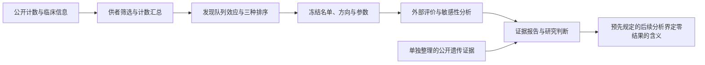

# EndoTarget Evidence

**以供者级转录组和网络分析评估子宫内膜异位症候选靶点的跨研究证据。**

[English](README.md) · [简体中文](README.zh-CN.md)

[](docs/INPUT_PROVENANCE.md)
[](docs/LOCAL_EXECUTION.md)
[](receipts/local_primary_container_replay.json)

生物网络能否帮助筛出在另一项研究中仍保留疾病表达关联的基因？本项目比较表达排序与两种网络基线，在另一子宫内膜队列中评价冻结的候选名单，再单独整理遗传证据，形成可追溯的研究判断。

**主要结论：未形成得到统计显著跨研究支持的靶点名单，也未建立网络传播优于表达排序的证据。研究建议是保留候选池，等待更强证据。** 2026 年 10 月的四项预先规定的后续分析表明：同一流程在这一样本量下能检出已知的周期分期程序；对中位基因而言，在实际面对的多重比较下，零结果把效应限定在约 2.2–3.4 倍以下；分泌期基质程序也没有可检出的疾病差异。

| 项目概览 | 范围 |
|---|---|
| 生物学对象 | 增殖期在位子宫内膜基质成纤维细胞 |
| 数据 | 发现队列 22 名供者、150,788 个细胞；外部队列 22 名供者、52,744 个细胞核 |
| 方法比较 | 在共同的 11,749 个基因上比较表达、网络连接度和固定网络传播 |
| 评价 | 外部表达方向一致性、供者重采样、临床敏感性分析 |
| 工程复现 | Docker 中重新执行 5 个主要 Nextflow 步骤，34 张科学表和 8 份结果元数据一致 |
| 后续分析 | 分期阳性对照、最小可检出效应量、分泌期程序级疾病对比、公开队列扩展审计，均在执行前冻结（2026 年 10 月） |

**结果入口：** [两页英文研究简报](reports/executive_brief_en.pdf) · [方法卡](docs/METHOD_CARD.md) · [完整结果与图表](reports/replication_v2_results.md)

## 研究设计

先按供者汇总计数，再进行统计建模；同一个人的大量细胞不会被当成大量独立患者。两个队列分别使用 edgeR 和 limma-voom 建模，调整年龄、技术批次和腺肌症。



| 队列 | 病例 / 对照 | 保留的细胞或核 | 受检基因 | BH q < 0.05 的基因 |
|---|---:|---:|---:|---:|
| 发现：GSE266265 | 12 / 10 | 150,788 个细胞 | 17,733 | 0 |
| 外部：HECA，E-MTAB-14039 | 15 / 7 | 52,744 个细胞核 | 17,643 | 0 |

统计样本量是**每个队列 22 名供者**。对照为非内异症手术供者，可能有其他疾病。两研究招募来源分离，但没有基因型数据确认所有个体完全不重叠。[数据来源与纳入规则](docs/INPUT_PROVENANCE.md)。

## 基线比较结果

三种方法使用相同的 11,749 个基因和 123,313 条 STRING 功能关联边。名单、发现队列表达方向和参数均在计算外部疾病效应前冻结。

| 方法 | 排序依据 | 同向 / 可评价 / 原定入选 |
|---|---|---:|
| **表达排序 B0** | 调整后疾病统计量的绝对值 | **14 / 20 / 20** |
| **连接度排序 B1** | 加权网络连接度，作为拓扑对照 | **3 / 13 / 20** |
| **网络传播 G1** | 以发现表达证据为起点的带重启随机游走 | **6 / 19 / 20** |

G1 是固定图算法，没有模型训练或参数搜索。无法在外部评价的基因保留为缺失，不从后续名次补位。B1 未达到预定的至少 16/20 可评价门槛。两种网络名单的同向比例都低于各自 200 组表达量/连接度匹配参考集合（第 0.5 百分位，B0 为第 96.5 百分位）：这是描述性的“低于参考”模式，而不只是没有改进；该百分位不是校准的 p 值。


**如何理解：** 同向只是表达变化正负号一致，不能作为靶点准确率。没有入选基因同时满足同向且外部 BH q < 0.05；BH 校正使用完整受检基因集合，控制多重比较造成的假阳性。不显著也不证明没有疾病效应。

固定样本中，G1 减 B0 的同向比例相差 **−38.4 个百分点**。500 次配对外部供者重采样中，487 次有效、13 次未通过模型设计检查；95% 条件区间为 **−38.9 至 +8.7 个百分点**，包含零，不能确认一般性方法优势。重采样噪声会把两种方法的同向比例都拉向 50%，因此该区间并不以观察差值为中心（见[英文结果摘要的解读说明](reports/results_summary_en.md#notes-for-interpretation)）。发现队列逐一排除供者的 22/22 轮分析均已完成。[不确定性与敏感性结果](reports/replication_v2_results.md)。

遗传层保留全部 40 个冻结候选基因：所选来源中，SKIDA1 有有限映射，另 39 个缺少可用映射。档案规则产生 1 个 PARP9 不确定案例，没有得到支持的靶点档案。[遗传证据报告](reports/genetic_evidence_report.md)。

## 零结果意味着什么：后续分析

2026 年 10 月 26–27 日新增四项预先规定的分析，每项都在计算任何新数值之前冻结并哈希记录规则、输入和阈值。它们原样复用 v1 估计流程，不重新拟合疾病模型，所有 v1 产物逐字节不变，也不提名任何基因。分泌期基因不是内异症基因；阳性对照名单是周期生物学，不是候选名单。

| 分析 | 结果 | 界定了什么 |
|---|---|---|
| **分期阳性对照：** 同一 v1 流程比较增殖期与分泌期供者（35 与 42 名） | **7,367 与 3,986** 个基因 BH q < 0.05；冻结的表达前 20 名在外部队列 **20 / 20** 同向且全部 q < 0.05；G1 减 B0 −37 个百分点，95% 区间 −53 至 −21 | 流程在这一样本量下能检出并跨队列传递大型供者级程序，疾病对比的零结果不是流程不灵敏。即使信号很强，网络传播的传递仍差于表达排序。 |
| **最小可检出效应量：** 基于保存的 v1 拟合 | 中位基因：单一检验 α 0.05 下 **1.5 倍**，100 个发现的 BH 边界下 **2.2–2.3 倍**，单一发现 **3.3–3.4 倍**；11 + 11 名供者的研究中位数只召回分期程序的 45%（发现）和 13%（HECA） | 对多数基因可排除 4 倍的增殖期基质疾病差异，全族水平对约五分之一的基因可排除 2 倍；1.5 倍效应仍无法排除。22 名供者即使面对数千基因的程序也只能不稳定地检出。 |
| **分泌期程序级疾病对比：** 每个队列用另一队列冻结的分期程序打分；分期 × 疾病交互 | 签名跨队列 AUC 1.00 与 0.99；θ **+0.04**（−0.18 至 +0.25）与 **−0.11**（−0.40 至 +0.19）程序单位；可检出的减弱为 0.31 与 0.42 单位；交互项没有基因 q < 0.05 | 两个队列的分泌期基质成纤维细胞都没有可检出的程序级疾病差异：发现队列排除超过分泌期变化 14% 的减弱，HECA 不能排除 71% 以内的损失。唯一名义显著的敏感性分析（排除腺肌症供者，p 0.026）方向为增强，未在另一队列重现。 |
| **队列扩展审计：** GSE213216 与 GSE179640，仅元数据 | 自然周期在位内膜供者 **5 内异症 / 0 非内异症** 与 **0 / 1**；配对的在位–病灶样本 4 对与 8 对；两项研究都已包含在 HECA 细胞图谱中 | 没有公开单细胞队列能够扩展在位内膜的供者级对比；未下载任何表达数据。其余符合条件的公开供者已在上述分析中。 |

报告（英文）：[阳性对照](reports/phase_positive_control_results.md)、[最小可检出效应量](reports/mde_results.md)、[分泌期程序](reports/secretory_program_results.md)、[队列扩展](reports/cohort_extension_feasibility.md)。协议、冻结回执和图表见[方法卡](docs/METHOD_CARD.md#follow-on-analyses-what-the-null-resolves)，汇总见[英文结果摘要](reports/results_summary_en.md#follow-on-analyses-october-2026)。

## 方法与工程实现

| 组成 | 实现 | 核验入口 |
|---|---|---|
| 供者级分析 | 临床纳入审核、计数来源、协变量调整与明确排除记录 | [方法卡](docs/METHOD_CARD.md)、[供者筛选图](reports/figures/donor_flow_v1.svg) |
| 受控图方法比较 | 共同基因集合、固定参数、外部评价与缺失结果范围 | [排序代码](scripts/rank_targets.py)、[算法参数](config/ranking_algorithm.json) |
| 不确定性分析 | 配对供者重采样、逐供者排除和描述性匹配参考集合 | [重采样方法](docs/RESAMPLING.md)、[运行记录](receipts/real_resampling_execution.json) |
| 可复现流程 | Nextflow DSL2、锁定 R/Python 依赖、Docker、文件哈希和缓存检查 | [发现流程](main.nf)、[外部流程](replication.nf)、[复现说明](docs/LOCAL_EXECUTION.md) |

本地容器复现完成全部 5 个主要步骤，离散选择完全一致，连续数值最大差 **1.10 × 10⁻¹³**，小于事先规定的绝对误差 10⁻⁸。合成数据测试还完成 5 个首次执行步骤和 5 个缓存复用步骤。这些是对相同数据的工程核验，不能替代生物学复核。[主要结果复现记录](receipts/local_primary_container_replay.json) · [缓存检查](receipts/local_container_nextflow.json)。

## 查看与复现

报告、图表、代码和小型证据文件可以直接在 GitHub 阅读，也可以克隆到本地：

```bash
git clone https://github.com/NingyuSUN/endotarget-evidence.git
cd endotarget-evidence
```

**仅克隆仓库并不具备完整重跑条件。** 大型输入、中间结果、运行环境和缓存不在 Git 中；完整复现还需恢复记录引用的文件，并匹配对应环境和路径。

| 目的 | 入口 |
|---|---|
| 阅读研究结论 | [英文简报](reports/executive_brief_en.pdf)、[英文结果摘要](reports/results_summary_en.md)、[中文生物学报告](reports/biology_report_zh.md) |
| 核对方法与图表 | [方法卡](docs/METHOD_CARD.md) |
| 复现指定的主要结果 | [前提、命令和检查标准](docs/LOCAL_EXECUTION.md) |
| 查看云端部署方案 | [AWS 说明：未执行](docs/AWS_DEPLOYMENT.md) |
| 查找方法、结果和来源 | [文档目录](docs/README.md) |

## 适用范围与限制

- 这是回顾性公开数据分析，外部效应计算前有冻结记录，但不是预注册或盲法研究。作者标签、分期判定、残余混杂、细胞构成及细胞与细胞核测量差异仍限制解释。
- 发现数据采用作者二级汇总的估计计数，没有重算完整原 RDS。HECA 原始计数与 H5 差异中仍有 8,248 个计数未逐特征归因，详见[方法卡](docs/METHOD_CARD.md)。
- 遗传证据限定于一项 2023 年研究。缺少映射不等于阴性证据，表达关联不等于因果关系，也不能确定激活或抑制策略。
- 后续分析给出的是边界和对照，不是疾病证据。最小可检出效应量以原拟合的方差估计为条件；分泌期程序对比只有 13 与 20 名分泌期供者，其中对照 6 与 4 名；队列审计依赖 HECA 作者整理的临床字段。低于所述边界的效应并未被证明不存在。
- 本项目用于早期靶点证据评估，不生成药物分子或抗体，没有训练 GNN 或基础模型，也没有验证治疗效果。AWS 部署尚未执行。

## 许可

代码采用 [MIT 许可证](LICENSE)。本项目撰写的文档、报告和图表采用 [CC BY 4.0](https://creativecommons.org/licenses/by/4.0/deed.zh-hans)。第三方数据、参考资源和出版物仍适用其各自条款，见[来源登记](docs/DATA_SOURCES.md)和[输入来源说明](docs/INPUT_PROVENANCE.md)。

维护者：[Ningyu Sun](https://github.com/NingyuSUN)。实现与审查使用了 AI 辅助。原始研究及来源归属见[输入来源说明](docs/INPUT_PROVENANCE.md)和[遗传证据方法](docs/GENETIC_EVIDENCE_METHOD.md)。

历史运行编号与当前公开提交的对应关系见[来源追溯说明](docs/PUBLICATION_HISTORY.md)。
