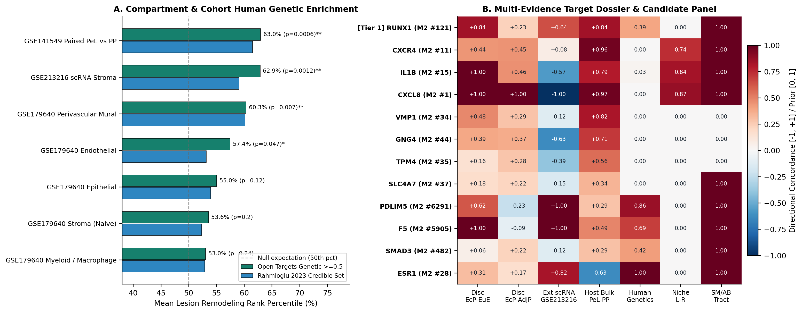

# EndoTarget v2

**融合宿主组织去污染病灶单细胞转录组、微环境配受体互作与人类遗传学的子宫内膜异位症靶点优选基准研究。**

[English](README.md) · [简体中文](README.zh-CN.md)

[](docs/PROTOCOL.md)
[](receipts/protocol_freeze.json)
[](receipts/prediction_seal.json)
[](CITATION.cff)
[](LICENSE)

在 [EndoTarget v1](https://github.com/NingyuSUN/endotarget-evidence) 中，针对增殖期 **在位子宫内膜** 基质成纤维细胞的跨队列供者级对比（`22 + 22` 名供者）未检出任何 `BH q < 0.05` 差异基因（`0` 个），将中位基因效应限定在 `1.5–1.8` 倍以下，且全局 STRING 随机游走（`G1`）较原始表达排序（`B0`）损失 `−38.4` 个百分点。

EndoTarget v2 将研究对象推进至 **异位内异症病灶**（发现单细胞队列 `GSE179640`、外部单细胞队列 `GSE213216`、以及外部 `408` 芯片 / `162` 名受试者多病灶与宿主腹膜对照队列 `GSE141549`），严格执行四次 Git 提交的零泄漏哈希锁定链路（`protocol_freeze.json` $\rightarrow$ `prediction_seal.json` $\rightarrow$ `locked_evaluation_v2.json`）。

**主要结论：**
1. **朴素“病灶 vs 在位内膜”差异排序（`B0`）制造了由正常宿主腹膜背景驱动的跨研究重复假象。** 在发现队列 `GSE179640`（$n=8$ 对）中，同患者配对 `EcP vs EuE` 基质模型检出 `569` 个 `BH q < 0.05` 基因，`B0` 前 20 名在外部单细胞 `GSE213216`（`EcP vs EuE`）中看似重复 `9 / 20`（`45%`，`AUC = 0.991`），在 `GSE141549` 配对 `腹膜病灶 vs 在位内膜 (PeL vs PE)`（$n=41$ 对）中也达到 `13 / 20`（`65%`）。然而一旦在同患者配对 **未受累腹膜对照（`PeL vs PP`，$n=20$ 对）** 中检验，**`B0` 的 `13` 个 `PE` 显著命中基因 `100%`（`13 / 13`）失效（双重验证 `0 / 20`；其中 `10 / 13` 符号反转）**——说明 `B0` 实质上捕获的是正常腹膜驻留成纤维细胞与间皮背景标志物（`SFRP2`、`GPC3`、`TBX18`、`CDON`、`PDLIM3`、`S100A10`）。
2. **宿主去污染双重对比评分（`M1`）与遗传+微环境锚定评分（`M2`）在宿主腹膜对照验证（`GSE141549`）中全面逆转排序表现，同时揭示了未控 `GSE213216` `EcP vs EuE` 中的激素用药偏倚。** 在 `GSE141549` 宿主对照中，`M2` 前 20 名在配对 `PeL vs PP` 中同向率达 `72.2%`（`13 / 18`；`2,000` 次受试者重采样 `M2 − B0 = +31.4` 个百分点，95% CI `[+8.2, +46.5]`），在配对深部浸润病灶 `DIE vs PP` 中达 `88.9%`（`16 / 18` vs `B0` `36.8%`），并在全部受试者 `PeL (n=54) vs PP+CP (n=61)` 程序投射中显著迁移（`AUC = 0.684`，$\theta = +0.108$ `[+0.034, +0.182]`，$p = 0.00449$；`B0` 为 `AUC = 0.430`，$p = 0.115$）。相反，在未控宿主背景的 `GSE213216` `EcP vs EuE` 中，`M1` 与 `M2` 为 `0 / 20` `BH q < 0.05`（`M2 − B0 = −43.9` 个百分点 `[−55.0, −30.0]`），原因在于发现队列 `GSE179640` 中 `7 / 8` 对供者处于炔诺酮/雌二醇激素抑制下，而 `GSE213216` 的 `EuE` 来自自然周期未用药内膜（生理性高表达 `CXCL8`、`IL1B`、`SPHK1`、`KCNK3`）。
3. **全局 STRING 随机游走（`G1`）再次因高连接度管家节点偏倚失败（中位连接度 `224.5` vs `B0` `5.2`）；人类内异症遗传学在病灶多细胞室中显著富集；`RUNX1` 成为唯一通过全部四道一级（Tier 1）门槛的多模态靶点。** Open Targets（`MONDO_0005133` / `EFO_0001065`）与 Rahmioglu 2023 GWAS/SMR 基因集在发现队列血管周壁细胞（`p = 7.5e-4`）和血管内皮细胞（`p = 0.0045`）、`GSE213216` 病灶基质（`p = 1.9e-4`）以及宿主对照 `GSE141549` `PeL vs PP`（`p = 2.9e-5`）中均显著富集。在 `10,972` 个共享比较基因中，仅 **`RUNX1`（`ENSG00000159216`）** 同时具备人类遗传支持（`OT = 0.653`）、发现双重对比同向重塑（`+2.51 / +0.45`）、外部单细胞显著重复（`+1.61`，`q = 0.00824`）、外部宿主腹膜对照显著验证（`+0.84`，`q = 0.0492`）与小分子可成药性。

| 项目概览 | 范围 |
|---|---|
| **发现单细胞队列（`GSE179640`）** | `31` 个组织 `.h5` 文库，`14` 名供者，`115,402` 个质控后细胞（`37,691` 个从头注释基质成纤维细胞）；`8` 对同患者 `(EuE, EcP)` 配对，`6` 组 `(EuE, EcP, AdjP)` 三联配对 |
| **外部单细胞队列（`GSE213216`）** | `29` 个确定性锁定文库，`18` 名患者，`242,430` 个质控后细胞（`106,424` 个从头注释基质成纤维细胞）；`12` 名 `EcP`、`9` 名 `EuE`、`6` 名 `EcO`、`2` 名未受累腹膜（含 `4` 对自然周期同患者配对） |
| **外部多亚型组织队列（`GSE141549`）** | `408` 张芯片 `100%` 映射至 `162` 名受试者（`SL 001–162`），`19,262` 个唯一 `ENSG` 基因；含配对 `PeL vs PE`（`n=41`）、宿主对照 `PeL vs PP`（`n=20`）、`DIE vs PP`（`n=20`）、三联（`n=18`）及在位对照 `PE vs CE`（`0` 个 `q < 0.05`） |
| **共享比较基因空间** | `10,972` 个基质表达 `ENSG` 基因与 `97,462` 条 STRING v12.5 直接实验/数据库边（`>= 0.700`）；全程零 HECA 转移标签 |
| **人类遗传与配受体先验** | `404` 个人类内异症遗传支持基因（Open Targets v26.09 + Rahmioglu 2023 *Nat Genet*），`168` 对血管/髓系 $\leftrightarrow$ 基质配受体对，GTEx v10 组织表达与 eQTL 注释 |

**文档导航：** [完整结果报告 (中文)](reports/RESULTS.zh-CN.md) · [Full Results (EN)](reports/RESULTS.md) · [预设方案 Protocol](docs/PROTOCOL.md) · [方法卡 Method Card](docs/METHOD_CARD.md) · [靶点证据档案](reports/target_dossiers.md)

---

## 四提交零泄漏研究流程


---

## 跨队列方法比较总表（`K = 20`）

| 方法 | 发现双重同向 / 间皮污染数 | `GSE213216` 单细胞 `EcP vs EuE` `BH q<0.05`（同向率） | `GSE141549` 配对 `PeL vs PE`（`n=41`）`BH q<0.05` | `GSE141549` 宿主对照 `PeL vs PP`（`n=20`）同向率（宿主假阳性率） | `GSE141549` 配对 `DIE vs PP`（`n=20`）同向率 | `GSE141549` `All PeL vs PP+CP` 程序投射 `AUC` ($p$) |
|---|---:|---:|---:|---:|---:|---:|
| **`B0`（朴素 `EcP vs EuE`）** | `8/20` / `6/20`（`30%`） | **`9/20`（`68.4%`）** | **`13/20`** | `8/19`（`42.1%`, **`100%` FP**） | `7/19`（`36.8%`） | `0.430`（`0.115`） |
| **`G1`（全局 STRING RWR）** | `13/20` / `0/20`（`0%`） | `4/20`（`47.4%`） | `10/20` | `7/18`（`38.9%`, **`90%` FP**） | `10/18`（`55.6%`） | `0.437`（`0.127`） |
| **`M1`（双重对比宿主去污染）** | **`20/20` / `0/20`** | `0/20`（`36.8%`） | `6/20` | **`12/19`（`63.2%`）** | **`13/19`（`68.4%`）** | **`0.651`（`0.0348`）** |
| **`M2`（遗传 + 微环境配受体）** | **`20/20` / `0/20`** | `0/20`（`31.6%`） | `3/20` | **`13/18`（`72.2%`）** | **`16/18`（`88.9%`）** | **`0.684`（`0.00449`）** |




---

## 本地契约与完整性核验

```bash
OMP_NUM_THREADS=8 OPENBLAS_NUM_THREADS=8 MKL_NUM_THREADS=8 .venv/bin/pytest -v
```

---

## 适用范围、局限性与第三方许可说明

- 本项目系基于公开队列与外部评估前加密锁定的回顾性观察重分析，不构成前瞻性临床试验或湿实验干预验证。
- 发现队列 `GSE179640`（`7 / 8` 对供者接受炔诺酮/雌二醇治疗）与外部队列 `GSE213216`（自然周期未用药在位内膜）之间的激素背景差异，以及发现队列 `AdjP` 三联样本量限制（$n=6$），制约了急性炎症细胞因子类靶点（`CXCL8`、`IL1B`、`SPHK1`、`KCNK3`）在未控宿主背景的 `EcP vs EuE` 中的迁移。
- 第三方数据库遵循各自许可条款：**Open Targets Platform**（https://platform-docs.opentargets.org/licence；见 `.licenses/opentargets_database_LICENSE.txt`）、**GTEx Portal API v10**（https://gtexportal.org/home/license；见 `.licenses/gtex_database_LICENSE.txt`）及 **STRING v12.5**（CC BY 4.0）。本项目代码按 [MIT 许可证](LICENSE) 发布，文档与图表按 CC BY 4.0 发布。
