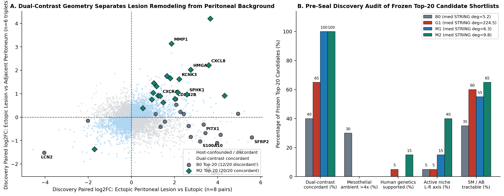
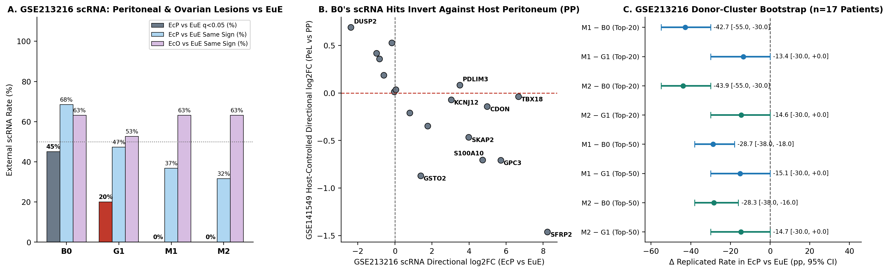
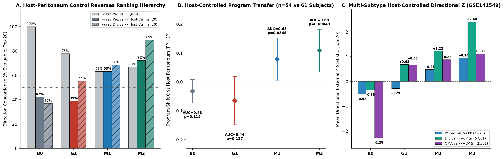
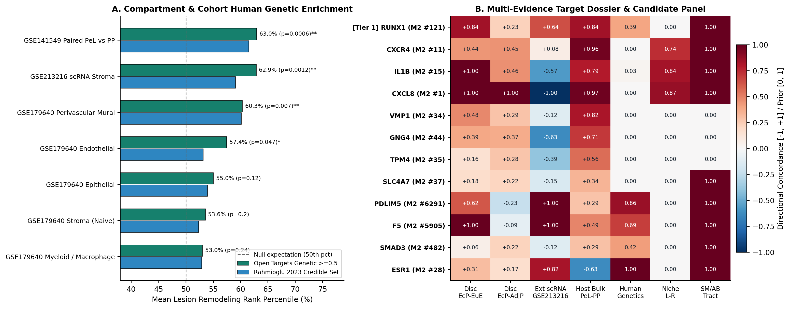

# EndoTarget v2 — Full Scientific Results

[English](RESULTS.md) · [简体中文](RESULTS.zh-CN.md)

**Execution status:** Single-pass locked evaluation completed under `configs/protocol_v2.yaml` (`protocol_freeze.json` SHA-256 `d05e7a20852bce9dd54d6ff39f466b1482e141378aa2ce4c9055e457b3f31996`) and `manifests/frozen_candidates_v2.tsv` (`prediction_seal.json` SHA-256 `37d98e8c49e3e7242dbc5752503779b5e68b0c8d116148994cbd8222a5b7e73f`). No rule, threshold, or candidate rank was modified after external cohort download.

---

## 1. Executive Summary

1. **Moving from eutopic endometrium (v1) to paired ectopic peritoneal lesions (`GSE179640`, $n=8$ pairs) uncovers `569` differentially expressed stromal genes at `BH q < 0.05` (versus `0` in v1), but `60%` (`12 / 20`) of the top naive lesion hits (`B0`) are host-tissue artifacts.** When compared against matched within-patient adjacent unaffected peritoneum (`EcP vs AdjP`, $n=6$ triplets), `12 / 20` `B0` candidates move in the opposite direction (`EcP < AdjP`, e.g., `GPC3` `−2.22`, `S100A10` `−1.03`, `SFRP2` `−0.87`, `PITX1` `−0.31`), and `6 / 20` (`30%`) are `>4`-fold enriched in peritoneal mesothelium.
2. **External 408-array / 162-subject multi-tissue validation (`GSE141549`) proves that naive single-cell `EcP vs EuE` replication is a peritoneal site-of-biopsy illusion, and that `M1` / `M2` reverse the hierarchy once host peritoneum is controlled.**
   - Naive `B0` Top-20 appears to replicate strongly in `GSE213216` single-cell `EcP vs EuE` (`9 / 20 = 45%` at `BH q < 0.05`, `AUC = 0.991`) and in `GSE141549` paired `Peritoneal Lesion vs PE` (`13 / 20 = 65%` at `BH q < 0.05`, `19 / 19 = 100%` same sign). Yet in paired `Peritoneal Lesion vs Unaffected Peritoneum (PP)` ($n=20$ women), `B0` collapses to **`1 / 20` (`5%`)**, **`0 / 20` (`0%`) joint `PE`+`PP` replication**, **`100%` (`13 / 13`) host false-positive rate (`10 / 13` sign-inverted)**, and `42.1%` (`8 / 19`) direction concordance.
   - Host-decontaminated `M1` and genetics/niche-anchored `M2` achieve **`63.2%` (`12 / 19`)** and **`72.2%` (`13 / 18`)** direction concordance in paired `PeL vs PP` (`2,000`-draw paired subject bootstrap `M2 − B0 = +31.4` percentage points, 95% CI `[+8.2, +46.5]`, `P(>0) = 0.9975`), **`88.9%` (`16 / 18`)** concordance in paired `DIE vs PP` ($n=20$, vs `36.8%` for `B0`), and positive program-level transfer in `All Peritoneal Lesion (n=54) vs Host Peritoneum PP+CP (n=61)` (`M2` Top-20: **`AUC = 0.684`**, $\theta = +0.108$ `[+0.034, +0.182]`, $p = 0.00449$; `M1` Top-20: **`AUC = 0.651`**, $\theta = +0.079$ `[+0.006, +0.152]`, $p = 0.0348$; versus `B0` `AUC = 0.430`, $\theta = -0.032$, $p = 0.115$, and `G1` `AUC = 0.437`, $\theta = -0.065$, $p = 0.127$).
3. **Why `M1` / `M2` did not transfer to uncontrolled `GSE213216` `EcP vs EuE` (`0 / 20` at `BH q < 0.05`):** Removing peritoneal resident fibroblast markers strips away the site-of-biopsy signal that inflates `B0` in `EcP vs EuE`, exposing a clinical regimen mismatch between `GSE179640` (`7 / 8` `EuE` donors suppressed on `norethindrone/estradiol`) and `GSE213216` (untreated natural-cycle `EuE` expressing high physiological `CXCL8`, `IL1B`, `SPHK1`, `KCNK3`), compounded by the small discovery `AdjP` sample size ($n=6$ triplets, `0` individual `BH q < 0.05` genes). In `GSE213216` ovarian endometrioma (`EcO vs EuE`), `M1` and `M2` recover `63.2%` (`12 / 19`) direction agreement (`6 / 50` and `5 / 50` at `BH q < 0.05`).
4. **Global STRING RWR (`G1`) loses again despite `569` discovery DE genes:** `G1` inflates median STRING weighted degree `43`-fold (`224.53` vs `5.24` for `B0`), trails `B0` by `−25.0` percentage points in `GSE213216`, exhibits `90–95%` host false-positive collapse in `GSE141549`, and significantly inverts on `All PeL vs PP+CP` Top-50 program transfer ($\theta = -0.098$, `AUC = 0.334`, $p = 0.0073$).
5. **Human endometriosis genetics is significantly enriched in ectopic lesion compartments, and `RUNX1` passes all four Tier-1 target gates:** Whereas eutopic stroma in v1 showed zero genetic enrichment, Open Targets (`MONDO_0005133` / `EFO_0001065`) and Rahmioglu 2023 GWAS/SMR sets are enriched in discovery perivascular mural (`p = 7.5e-4`) and endothelial (`p = 0.0045`) remodeling, external `GSE213216` lesion stroma (`p = 1.9e-4`), and host-controlled `GSE141549` `PeL vs PP` (`p = 2.9e-5`). **`RUNX1` (`ENSG00000159216`)** is the sole gene in the `10,972`-gene shared universe meeting all pre-locked Tier-1 criteria simultaneously.

---

## 2. Discovery Audit (`GSE179640`) and Pre-Seal Shortlist Diagnostics

Across `31` tissue scRNA libraries (`140,433` raw cells), `115,402` cells passed QC and were annotated de novo without HECA labels into `stromal_fibroblast` (`37,691`), `lymphoid` (`22,200`), `epithelial` (`19,519`), `myeloid_macrophage` (`13,489`), `endothelial` (`11,725`), `perivascular_mural` (`6,065`), and `mesothelial` (`1,220`), excluding `2,405` cross-lineage doublets and `1,088` low-score cells. Exact raw UMI conservation held (`1,411,712,651 = 1,358,543,298` retained `+ 2,561,961` `<20`-cell buckets `+ 50,607,392` excluded).

| Discovery Contrast / Metric | Sample Size & Degrees of Freedom | Tested / Universe Genes | Genes at `BH q < 0.05` |
|---|---|---|---|
| Paired `EcP vs EuE` (`stromal_fibroblast`) | `8` matched patients (`E01–E07, E09`), `df_res = 7`, `d0 = 3.65` | `12,188` expressed / `10,972` in $\mathcal{U}$ | **`569`** (`429` in $\mathcal{U}$) |
| Paired `EcP vs AdjP` (`stromal_fibroblast`) | `6` matched patients (`E01–E05, E09`), `df_res = 5`, `d0 = 5.74` | `12,188` expressed / `10,972` in $\mathcal{U}$ | **`0`** (`0` in $\mathcal{U}$) |

| Frozen Method (`K = 20`) | Dual-Contrast Concordant | Mesothelial Soup (`>4x`) | Human Genetics (`G_prior > 0`) | Active Niche L–R (`N_LR > 0`) | SM / AB Tractable | Median STRING Weighted Degree |
|---|---:|---:|---:|---:|---:|---:|
| **`B0` (Naive `EcP vs EuE`)** | `8 / 20` (`40%`) | `6 / 20` (`30%`) | `0 / 20` (`0%`) | `1 / 20` (`5%`) | `7 / 20` (`35%`) | `5.24` |
| **`G1` (Global STRING RWR)** | `13 / 20` (`65%`) | `0 / 20` (`0%`) | `1 / 20` (`5%`) | `1 / 20` (`5%`) | `12 / 20` (`60%`) | **`224.53`** |
| **`M1` (Dual-Contrast Host-Decontam)** | **`20 / 20` (`100%`)** | **`0 / 20` (`0%`)** | `0 / 20` (`0%`) | `3 / 20` (`15%`) | `11 / 20` (`55%`) | `6.33` |
| **`M2` (Genetics + Niche L–R)** | **`20 / 20` (`100%`)** | **`0 / 20` (`0%`)** | **`3 / 20` (`15%`)** | **`8 / 20` (`40%`)** | **`13 / 20` (`65%`)** | `9.82` |

---

## 3. External Single-Cell Evaluation (`GSE213216`, Fonseca et al. 2023)

Across `29` locked scRNA libraries (`275,533` raw cells), `242,430` QC-passing cells yielded `106,424` de novo `stromal_fibroblast` cells (`907,628,470` total UMIs conserved exactly). Primary donor-blocked GLS (`EcP n=12` vs `EuE n=9` across `17` patients, consensus $\hat{\rho} = 0.159$, `df_res = 15`, `15,794` expressed genes) detected `2,844` genes at `BH q < 0.05`.

| Method | `Top-20` Same Sign / Eval | `Top-20` `BH q < 0.05` (`/20`) | `Top-50` Same Sign / Eval | `Top-50` `BH q < 0.05` (`/50`) | `Top-20` Program `AUC`, $\theta$ `[95% CI]` | `EcO vs EuE` (`n=5 vs 9`) `Top-20` Same Sign (`Top-50 q<0.05`) |
|---|---:|---:|---:|---:|---|---:|
| **`B0`** | `13 / 19` (`68.4%`) | **`9 / 20` (`45%`)** | `31 / 49` (`63.3%`) | **`16 / 50` (`32%`)** | `0.991`, `+0.801` `[+0.551, +1.050]` | `12 / 19` (`63.2%`) (`11 / 50`) |
| **`G1`** | `9 / 19` (`47.4%`) | `4 / 20` (`20%`) | `28 / 49` (`57.1%`) | `9 / 50` (`18%`) | `0.667`, `+0.191` `[−0.302, +0.684]` | `10 / 19` (`52.6%`) (`1 / 50`) |
| **`M1`** | `7 / 19` (`36.8%`) | `0 / 20` (`0%`) | `18 / 48` (`37.5%`) | `1 / 50` (`2%`) | `0.315`, `−0.320` `[−0.754, +0.114]` | `12 / 19` (`63.2%`) (`6 / 50`) |
| **`M2`** | `6 / 19` (`31.6%`) | `0 / 20` (`0%`) | `16 / 48` (`33.3%`) | `2 / 50` (`4%`) | `0.287`, `−0.342` `[−0.759, +0.074]` | `12 / 19` (`63.2%`) (`5 / 50`) |

- **Donor-cluster bootstrap (`1,998 / 2,000` valid draws) on `Top-20` `BH q < 0.05` rate in `EcP vs EuE`**:
  - `M1 − B0`: **`−42.7` percentage points** (`95% CI [−55.0, −30.0]`)
  - `M1 − G1`: **`−13.4` percentage points** (`95% CI [−30.0, +0.0]`)
  - `M2 − B0`: **`−43.9` percentage points** (`95% CI [−55.0, −30.0]`)
  - `M2 − G1`: **`−14.6` percentage points** (`95% CI [−30.0, +0.0]`)
- **Critical cross-cohort audit (Panel 2B)**: All `9` `B0` Top-20 genes that achieved `BH q < 0.05` in `GSE213216` `EcP vs EuE` (`SKAP2`, `SFRP2`, `S100A10`, `HTRA3`, `KCNJ12`, `TBX18`, `GPC3`, `PDLIM3`, `CDON`) fail host-peritoneum control in `GSE141549` (`8 / 9` negative in `PeL vs PP`, `PDLIM3` `+0.08, q = 0.95`).

---

## 4. External 408-Sample / 162-Subject Tissue & Host-Controlled Double-Difference Validation (`GSE141549`)

Across `408` arrays mapped to `19,262` unique `ENSG` genes and deduplicated across `162` women (`SL 001`–`SL 162`), paired `Peritoneal Lesion vs PE` ($n=41$) yielded `7,393` genes at `BH q < 0.05`, paired host-controlled `Peritoneal Lesion vs PP` ($n=20$) yielded `1,755`, paired `DIE vs PP` ($n=20$) yielded `1,978`, and eutopic `PE vs CE` ($n=92$ vs $38$) yielded **`0` genes at `BH q < 0.05`**.

| Method (`K = 20` / `K = 50`) | Paired `PeL vs PE` (`n=41`) `BH q<0.05` (Same Sign) | Host-Ctrl Paired `PeL vs PP` (`n=20`) Same Sign (`BH q<0.05`) | Joint `PE & PP` Both `q<0.05` (`K=20`) | Host False-Positive Share of `PE` Hits (`K=20`, Sign-Inverted) | Paired `DIE vs PP` (`n=20`) `Top-20` Same Sign | `All PeL vs PP+CP` (`54 vs 61`) `Top-20` Program `AUC`, $\theta$ `[95% CI]`, $p$ |
|---|---|---|---|---|---|---|
| **`B0`** | `13/20` (`100%`) / `31/50` (`91.8%`) | `8/19` (`42.1%`, `1`) / `26/49` (`53.1%`, `5`) | `0 / 20` | **`100%` (`13/13`; `10` inverted)** | `7 / 19` (`36.8%`) | `0.430`, `−0.032` `[−0.073, +0.008]`, `0.115` |
| **`G1`** | `10/20` (`77.8%`) / `20/50` (`66.7%`) | `7/18` (`38.9%`, `2`) / `20/45` (`44.4%`, `2`) | `1 / 20` (`ACTB`) | **`90.0%` (`9/10`; `8` inverted)** | `10 / 18` (`55.6%`) | `0.437`, `−0.065` `[−0.148, +0.019]`, `0.127` |
| **`M1`** | `6/20` (`63.2%`) / `11/50` (`51.1%`) | **`12/19` (`63.2%`, `1`) / `32/47` (`68.1%`, `7`)** | `0 / 20` | `100%` (`6/6`; `4` inverted) | **`13 / 19` (`68.4%`)** | **`0.651`, `+0.079` `[+0.006, +0.152]`, `0.0348`** |
| **`M2`** | `3/20` (`66.7%`) / `12/50` (`56.2%`) | **`13/18` (`72.2%`, `1`) / `31/48` (`64.6%`, `7`)** | `0 / 20` | `100%` (`3/3`; `2` inverted) | **`16 / 18` (`88.9%`)** | **`0.684`, `+0.108` `[+0.034, +0.182]`, `0.00449`** |

- **Paired subject bootstrap (`2,000 / 2,000` valid draws) on Host-Controlled `PeL vs PP` direction concordance**:
  - `M1 − B0`: **`+23.9` percentage points** (`95% CI [+0.0, +42.1]`, `P(>0) = 0.951`) on `Top-20`; **`+19.2` pp** (`95% CI [+6.3, +29.9]`, `P(>0) = 0.9985`) on `Top-50`.
  - `M2 − B0`: **`+31.4` percentage points** (`95% CI [+8.2, +46.5]`, `P(>0) = 0.9975`) on `Top-20`; **`+17.4` pp** (`95% CI [+5.1, +30.1]`, `P(>0) = 0.995`) on `Top-50`.
  - `M2 − G1` (`Top-50` `BH q < 0.05` rate in `PeL vs PP`): **`+13.0` percentage points** (`95% CI [+2.0, +26.0]`, `P(>0) = 0.992`).
- **Multi-subtype generalization (`All DIE vs PP+CP`, `n=57 vs 61`; `All OMA vs PP+CP`, `n=25 vs 61`)**:
  - In `DIE vs PP+CP`, `M2` Top-20 reaches **`88.9%` (`16 / 18`)** same sign, `7 / 20` (`35%`) `BH q < 0.05`, and mean directional $z = +2.40$ (versus `−0.35` for `B0`).
  - In `OMA vs PP+CP`, `M1` Top-20 reaches `7 / 20` (`35%`) `BH q < 0.05` (`mean z = +0.88`) and `M2` reaches `72.2%` same sign (`5 / 20` `q < 0.05`, `mean z = +1.12`), whereas `B0` inverts strongly (`mean z = −2.28`).

---

## 5. Compartment-Resolved Human Genetics and Multi-Evidence Target Dossiers

### 5.1 Compartment-Resolved Human Genetic Enrichment

| Cohort & Lesion Compartment Contrast | Open Targets Genetic `>= 0.5` Mean Pct (`Mann–Whitney p`, `Expr-Matched Perm p`) | Rahmioglu 2023 Credible Set Mean Pct (`Mann–Whitney p`, `Perm p`) | Combined Human Genetics (`404` Set) Mean Pct (`Mann–Whitney p`) |
|---|---|---|---|
| `GSE141549` Host-Ctrl `Paired PeL vs PP` (`n=20`) | **`63.0%`** (`6.0e-4`, `0.0020`) | **`61.5%`** (`6.4e-5`, `0.0005`) | **`56.0%`** (`2.9e-5`) |
| `GSE213216` External scRNA `stromal_fibroblast` | **`62.9%`** (`0.0012`, `0.0010`) | **`59.1%`** (`0.0019`, `0.0005`) | **`55.7%`** (`1.9e-4`) |
| `GSE179640` Discovery `perivascular_mural` | **`60.3%`** (`0.0070`, `0.0050`) | **`60.2%`** (`7.5e-4`, `0.0015`) | **`53.6%`** (`0.0148`) |
| `GSE179640` Discovery `endothelial` | **`57.4%`** (`0.0474`, `0.0190`) | `53.1%` (`0.176`, `0.259`) | **`54.4%`** (`0.0045`) |
| `GSE179640` Discovery `epithelial` | `55.0%` (`0.122`, `0.175`) | `53.9%` (`0.117`, `0.176`) | **`53.1%`** (`0.0277`) |
| `GSE179640` Discovery `stromal_fibroblast` (naive) | `53.6%` (`0.201`, `0.088`) | `52.3%` (`0.235`, `0.212`) | `49.8%` (`0.556`) |
| `GSE179640` Discovery `myeloid_macrophage` | `53.0%` (`0.242`, `0.243`) | `52.9%` (`0.200`, `0.089`) | `50.9%` (`0.295`) |

### 5.2 Evidence-Graded Target Dossiers (`reports/target_dossiers.tsv` & `target_dossiers_extended_panel.tsv`)

- **Locked Tier-1 Multi-Modal Target (`1` gene across `10,972` in $\mathcal{U}$)**:
  - **`RUNX1` (`ENSG00000159216`)**: Upregulated in lesion stroma across discovery `EcP vs EuE` (`log2FC = +2.51`, `q = 0.011`) and `EcP vs AdjP` (`+0.45`, `M1_core = 1.32`), replicated in external single-cell `GSE213216` (`+1.61`, `BH q = 0.00824`) and external host-controlled `GSE141549` paired `PeL vs PP` (`+0.84`, `BH q = 0.0492`; `PeL vs PE` `+0.97`, `q = 8.51e-5`; `DIE vs PP` `+0.53`, `q = 0.067`), anchored by Open Targets endometriosis `genetic_association = 0.653` (`L2G = 0.653`, `G_prior = 0.392`), small-molecule tractable (`SM = True`), and strongly expressed in GTEx v10 cultured fibroblasts (`20.22 TPM`), ovary (`4.86 TPM`), and uterus (`1.36 TPM`).
- **Locked Tier-2 Shortlist Targets (`0` genes)**: Because `M1`/`M2` Top-50 inflammatory remodeling candidates inverted against untreated cycling `EuE` in `GSE213216`, `0` Top-50 shortlist genes achieved simultaneous `BH q < 0.05` in *both* `GSE213216` `EcP vs EuE` and `GSE141549` `PeL vs PP`.
- **Notable Niche & GWAS Context Candidates** (`reports/target_dossiers_extended_panel.tsv`):
  - **`CXCR4` (`M2 #11`)**: `CXCL12–CXCR4` vascular–stromal axis (`N_LR = 0.74`), discovery dual-contrast `+1.33 / +0.91`, `GSE141549` host-controlled `PeL vs PP` `+0.96` (`BH q = 0.032`), `GSE213216` concordant positive (`+0.19`), clinical SM/AB drugs available.
  - **`ESR1` (`M2 #28`)**: Canonical `6q25.1` GWAS locus (`G_prior = 1.00`), concordantly downregulated in discovery `EcP vs EuE` (`−0.94`) and `EcP vs AdjP` (`−0.34`), replicated in `GSE213216` lesion stroma (`−2.06`, `BH q = 0.00226`) and `GSE141549` `PeL vs PE` (`−1.37`, `q = 1.47e-5`), reflecting endometriotic estrogen-receptor switching (`ESR1` loss vs uterine origin).
  - **`PDLIM5` (`4q22.3` credible set, `G_prior = 0.86`) & `F5` (`1q24.2` missense `rs6025`, `G_prior = 0.69`)**: Replicated across `GSE213216` (`+2.56, q = 0.0021` and `+2.53, q = 0.060`) and `GSE141549` host-controlled `PeL vs PP` (`+0.29, q = 0.018` and `+0.49, q = 0.039`), excluded from `M1` only because discovery `n=6` `AdjP` was slightly higher (`−0.46` and `−0.17`).

---

## 6. Data & Database Attributions

- Public transcriptomic cohorts: NCBI GEO `GSE179640` (Tan et al. 2022), `GSE213216` (Fonseca et al. 2023), `GSE141549` (Gabriel et al. 2020).
- Open Targets Platform v26.09 (`MONDO_0005133` / `EFO_0001065`): Queried via official Open Targets GraphQL wrapper; terms at https://platform-docs.opentargets.org/licence.
- Rahmioglu et al. 2023 (*Nat Genet*, DOI `10.1038/s41588-023-01323-z`): Public GWAS & SMR supplementary tables (`41588_2023_1323_MOESM4_ESM.xlsx`).
- GTEx Portal API v10: Queried via official GTEx CLI wrapper; terms at https://gtexportal.org/home/license.
- STRING v12.5: Human functional associations (`9606`), CC BY 4.0 (https://string-db.org/cgi/access).
