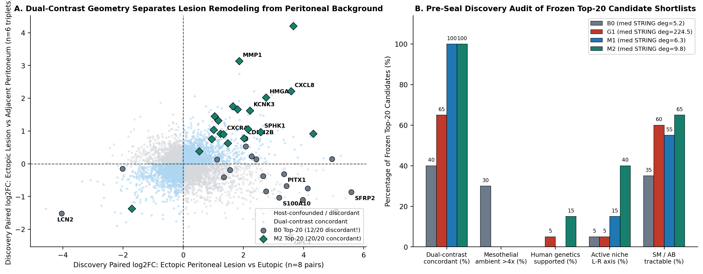
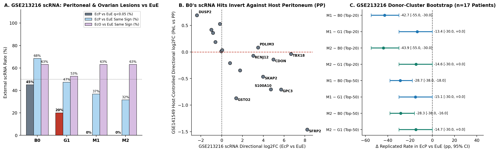
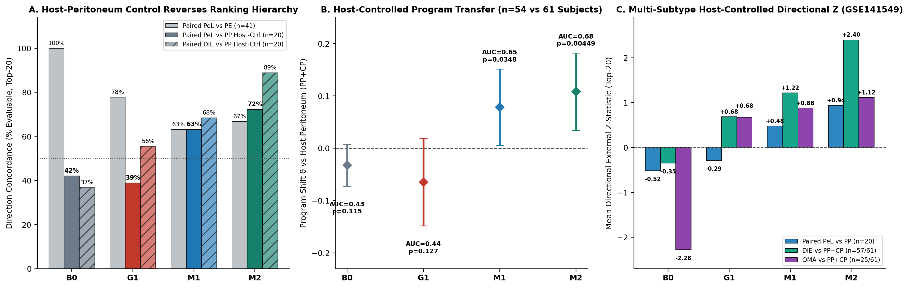
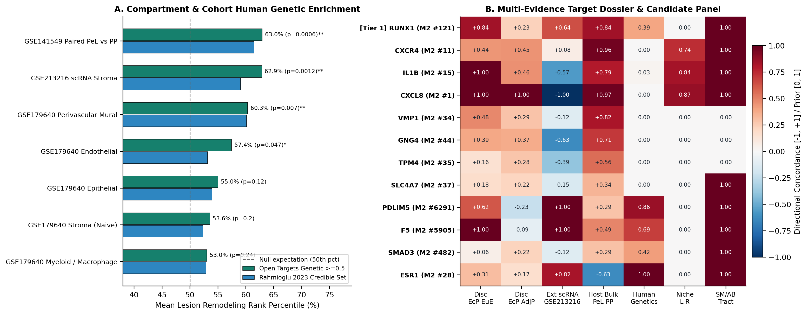

# EndoTarget v2 — 完整科学结果报告

[English](RESULTS.md) · [简体中文](RESULTS.zh-CN.md)

**执行状态：** 在冻结方案 `configs/protocol_v2.yaml`（`protocol_freeze.json` SHA-256：`d05e7a20852bce9dd54d6ff39f466b1482e141378aa2ce4c9055e457b3f31996`）与密封预测 `manifests/frozen_candidates_v2.tsv`（`prediction_seal.json` SHA-256：`37d98e8c49e3e7242dbc5752503779b5e68b0c8d116148994cbd8222a5b7e73f`）约束下，单次运行完成全部外部锁定评估。下载外部队列后未改动任何规则、阈值或候选名次。

---

## 1. 核心结论概览

1. **从在位内膜（v1）转向同患者配对腹膜异位病灶（`GSE179640`，$n=8$ 对）检出 `569` 个 `BH q < 0.05` 基质差异基因（v1 为 `0` 个），但朴素病灶差异排序（`B0`）前 20 名中 `60%`（`12 / 20`）属于宿主腹膜背景伪影。** 在与同患者配对未受累邻近腹膜对比时（`EcP vs AdjP`，$n=6$ 三联配对），`B0` 前 20 名中有 `12 / 20` 个基因方向相反（`EcP < AdjP`，如 `GPC3` `−2.22`、`S100A10` `−1.03`、`SFRP2` `−0.87`、`PITX1` `−0.31`），另有 `6 / 20`（`30%`）在腹膜间皮细胞中富集超过 `4` 倍。
2. **外部 408 芯片 / 162 名受试者多亚型组织队列（`GSE141549`）证实：朴素单细胞 `EcP vs EuE` 的“高重复率”本质上是取样部位（腹膜 vs 子宫）背景假象；一旦引入宿主腹膜对照，`M1` 与 `M2` 全面反超 `B0` 与 `G1`。**
   - `B0` 前 20 名在 `GSE213216` 单细胞 `EcP vs EuE` 中看似达到 `9 / 20`（`45%`）`BH q < 0.05`（`AUC = 0.991`），在 `GSE141549` 同患者配对 `腹膜病灶 vs 在位内膜 (PeL vs PE)`（$n=41$ 对）中也达到 `13 / 20`（`65%`）`BH q < 0.05`（`19 / 19 = 100%` 同向）。但在同患者配对 **宿主腹膜对照 `PeL vs 未受累腹膜 (PP)`**（$n=20$ 对）中，`B0` 骤降至 **`1 / 20`（`5%`）**，`PE` 与 `PP` 双重验证通过率为 **`0 / 20`（`0%`）**，**宿主假阳性率高达 `100%`（`13 / 13` 全部在宿主对照中失效，其中 `10 / 13` 正负号反转）**，同向率跌至 `42.1%`（`8 / 19`）。
   - 宿主去污染评分 `M1` 与遗传+微环境锚定评分 `M2` 在配对 `PeL vs PP` 中分别取得 **`63.2%`（`12 / 19`）** 与 **`72.2%`（`13 / 18`）** 同向率（`2,000` 次受试者重采样 `M2 − B0 = +31.4` 个百分点，95% CI `[+8.2, +46.5]`，`P(>0) = 0.9975`）；在配对深部浸润型内异症 `DIE vs PP`（$n=20$ 对）中 `M2` 同向率达 **`88.9%`（`16 / 18`）**（`B0` 仅 `36.8%`）；在全部受试者宿主对照 `PeL (n=54) vs PP+CP (n=61)` 的程序级投射中显著迁移（`M2` 前 20 名：**`AUC = 0.684`**，$\theta = +0.108$ `[+0.034, +0.182]`，$p = 0.00449$；`M1` 前 20 名：**`AUC = 0.651`**，$\theta = +0.079$ `[+0.006, +0.152]`，$p = 0.0348$；而 `B0` 为 `AUC = 0.430`，$\theta = -0.032$，$p = 0.115$；`G1` 为 `AUC = 0.437`，$\theta = -0.065$，$p = 0.127$）。
3. **为何 `M1` / `M2` 未能迁移至未控宿主背景的 `GSE213216` 单细胞 `EcP vs EuE`（`0 / 20` `BH q < 0.05`）：** 剔除正常腹膜驻留成纤维细胞标志物后，`M1`/`M2` 保留了急性炎症与低氧重塑基因（`CXCL8`、`IL1B`、`SPHK1`、`KCNK3`）。由于发现队列 `GSE179640` 中 `7 / 8` 对供者接受外源性孕激素/雌激素（炔诺酮/雌二醇）治疗，子宫在位内膜 `EuE` 的急性炎症因子被抑制；而外部队列 `GSE213216` 的 `EuE` 来自未经激素抑制的自然周期内膜，生理性高表达上述因子，导致 `EcP - EuE` 符号反转（尽管在激素用药比例较高的 `GSE141549` `PeL vs PP` 中它们确系正向升高），叠加发现队列 `AdjP` 三联配对样本量较小（$n=6$，单基因 `BH q < 0.05` 为 `0` 个）。在 `GSE213216` 卵巢巧囊 `EcO vs EuE` 中，`M1` 与 `M2` 同向率回升至 `63.2%`（`12 / 19`；前 50 名分别有 `6` 个与 `5` 个达到 `BH q < 0.05`）。
4. **即使存在 `569` 个发现差异基因，全局 STRING 随机游走（`G1`）依然重演连接度偏倚失败：** `G1` 前 20 名中位 STRING 加权连接度暴涨 `43` 倍（`224.53` vs `B0` `5.24`），在 `GSE213216` 中比 `B0` 低 `−25.0` 个百分点，在 `GSE141549` 宿主对照中的假阳性率达 `90–95%`，其前 50 名程序得分在 `All PeL vs PP+CP` 中甚至显著反向（$\theta = -0.098$，`AUC = 0.334`，$p = 0.0073$）。
5. **人类内异症种系遗传学在异位病灶多谱系中显著富集，`RUNX1` 成为唯一同时通过全部四道一级（Tier 1）门槛的靶点：** 与 v1 在位内膜零富集截然不同，Open Targets（`MONDO_0005133` / `EFO_0001065`）与 Rahmioglu 2023 GWAS/SMR 风险基因集在发现队列血管周壁细胞（`p = 7.5e-4`）和血管内皮细胞（`p = 0.0045`）、外部单细胞 `GSE213216` 病灶基质（`p = 1.9e-4`）及外部宿主对照 `GSE141549` `PeL vs PP`（`p = 2.9e-5`）中均显著富集。在 `10,972` 个共同比较基因中，仅 **`RUNX1`（`ENSG00000159216`）** 同时满足全部四项预设 Tier 1 证据标准。

---

## 2. 发现队列审计（`GSE179640`）与密封前候选特征

`31` 个组织单细胞文库（`140,433` 个原始细胞）经预设质控保留 `115,402` 个细胞，在完全不使用 HECA 转移标签的前提下从头注释为：`stromal_fibroblast`（`37,691`）、`lymphoid`（`22,200`）、`epithelial`（`19,519`）、`myeloid_macrophage`（`13,489`）、`endothelial`（`11,725`）、`perivascular_mural`（`6,065`）与 `mesothelial`（`1,220`），并剔除 `2,405` 个跨谱系双细胞与 `1,088` 个低分细胞。原始整数 UMI 计数精确守恒（`1,411,712,651 = 1,358,543,298` 保留 pseudobulk `+ 2,561,961` 低细胞数丢弃桶 `+ 50,607,392` 排除细胞）。

| 发现队列配对模型 | 供者对数与自由度 | 表达基因 / 共享网络基因集 $\mathcal{U}$ | `BH q < 0.05` 显著基因数 |
|---|---|---|---|
| 配对 `EcP vs EuE`（`stromal_fibroblast`） | `8` 名同患者配对（`E01–E07, E09`），`df_res = 7`，`d0 = 3.65` | `12,188` / `10,972` | **`569`**（$\mathcal{U}$ 内 `429`） |
| 配对 `EcP vs AdjP`（`stromal_fibroblast`） | `6` 名同患者三联（`E01–E05, E09`），`df_res = 5`，`d0 = 5.74` | `12,188` / `10,972` | **`0`**（$\mathcal{U}$ 内 `0`） |

| 冻结排序方法（`K = 20`） | 双重对比同向数 | 间皮环境污染（`>4x`） | 人类遗传证据支持 | 活跃微环境配受体轴 | SM / AB 可成药性 | STRING 中位加权连接度 |
|---|---:|---:|---:|---:|---:|---:|
| **`B0`（朴素配对 `EcP vs EuE`）** | `8 / 20`（`40%`） | `6 / 20`（`30%`） | `0 / 20`（`0%`） | `1 / 20`（`5%`） | `7 / 20`（`35%`） | `5.24` |
| **`G1`（全局 STRING RWR）** | `13 / 20`（`65%`） | `0 / 20`（`0%`） | `1 / 20`（`5%`） | `1 / 20`（`5%`） | `12 / 20`（`60%`） | **`224.53`** |
| **`M1`（宿主去污染双重对比）** | **`20 / 20`（`100%`）** | **`0 / 20`（`0%`）** | `0 / 20`（`0%`） | `3 / 20`（`15%`） | `11 / 20`（`55%`） | `6.33` |
| **`M2`（遗传 + 微环境配受体锚定）** | **`20 / 20`（`100%`）** | **`0 / 20`（`0%`）** | **`3 / 20`（`15%`）** | **`8 / 20`（`40%`）** | **`13 / 20`（`65%`）** | `9.82` |

---

## 3. 外部单细胞队列评估（`GSE213216`，Fonseca et al. 2023）

`29` 个锁定下载的单细胞文库（`275,533` 个原始细胞）经相同质控保留 `242,430` 个细胞，从头注释检出 `106,424` 个 `stromal_fibroblast` 细胞（`907,628,470` 个总 UMI 精确守恒）。主分析采用供者分块 `duplicateCorrelation` GLS 比较 `EcP (n=12)` 与 `EuE (n=9)`（`17` 名独立患者，共识相关性 $\hat{\rho} = 0.159$，`df_res = 15`，`15,794` 个表达基因），共检出 `2,844` 个 `BH q < 0.05` 差异基因。

| 方法 | `Top-20` 同向 / 可评价 | `Top-20` `BH q < 0.05`（`/20`） | `Top-50` 同向 / 可评价 | `Top-50` `BH q < 0.05`（`/50`） | `Top-20` 程序投射 `AUC`, $\theta$ `[95% CI]` | 巧囊 `EcO vs EuE`（`5 vs 9`）`Top-20` 同向（`Top-50 q<0.05`） |
|---|---:|---:|---:|---:|---|---:|
| **`B0`** | `13 / 19`（`68.4%`） | **`9 / 20`（`45%`）** | `31 / 49`（`63.3%`） | **`16 / 50`（`32%`）** | `0.991`, `+0.801` `[+0.551, +1.050]` | `12 / 19`（`63.2%`）（`11 / 50`） |
| **`G1`** | `9 / 19`（`47.4%`） | `4 / 20`（`20%`） | `28 / 49`（`57.1%`） | `9 / 50`（`18%`） | `0.667`, `+0.191` `[−0.302, +0.684]` | `10 / 19`（`52.6%`）（`1 / 50`） |
| **`M1`** | `7 / 19`（`36.8%`） | `0 / 20`（`0%`） | `18 / 48`（`37.5%`） | `1 / 50`（`2%`） | `0.315`, `−0.320` `[−0.754, +0.114]` | `12 / 19`（`63.2%`）（`6 / 50`） |
| **`M2`** | `6 / 19`（`31.6%`） | `0 / 20`（`0%`） | `16 / 48`（`33.3%`） | `2 / 50`（`4%`） | `0.287`, `−0.342` `[−0.759, +0.074]` | `12 / 19`（`63.2%`）（`5 / 50`） |

- **供者簇水平 Bootstrap（`1,998 / 2,000` 次有效抽样，`EcP vs EuE` `Top-20` `BH q < 0.05` 重复率差值）**：
  - `M1 − B0`：**`−42.7` 个百分点**（`95% CI [−55.0, −30.0]`）
  - `M1 − G1`：**`−13.4` 个百分点**（`95% CI [−30.0, +0.0]`）
  - `M2 − B0`：**`−43.9` 个百分点**（`95% CI [−55.0, −30.0]`）
  - `M2 − G1`：**`−14.6` 个百分点**（`95% CI [−30.0, +0.0]`）
- **跨队列机制核查（图 2B）**：`B0` 前 20 名在 `GSE213216` `EcP vs EuE` 中达到 `BH q < 0.05` 的全部 `9` 个基因（`SKAP2`、`SFRP2`、`S100A10`、`HTRA3`、`KCNJ12`、`TBX18`、`GPC3`、`PDLIM3`、`CDON`），在 `GSE141549` 宿主腹膜对照 `PeL vs PP` 中 **无一通过验证**（`8 / 9` 符号变负，`PDLIM3` 为 `+0.08, q = 0.95`）。

---

## 4. 外部 408 样本 / 162 受试者组织与宿主腹膜双重差分验证（`GSE141549`）

`408` 张芯片映射至 `19,262` 个唯一 `ENSG` 基因，并在 `162` 名独立受试者（`SL 001`–`SL 162`）内按组织类别去重。同患者配对 `PeL vs PE`（$n=41$）检出 `7,393` 个 `BH q < 0.05` 基因，同患者配对宿主对照 `PeL vs PP`（$n=20$）检出 `1,755` 个，配对 `DIE vs PP`（$n=20$）检出 `1,978` 个，而在位内膜阴性对照 `PE vs CE`（$n=92$ vs $38$）检出 **`0` 个 `BH q < 0.05` 基因**。

| 方法（`K = 20` / `K = 50`） | 配对 `PeL vs PE`（`n=41`）`BH q<0.05`（同向率） | 宿主对照配对 `PeL vs PP`（`n=20`）同向数（`BH q<0.05`） | `PE` 与 `PP` 双重显著数（`K=20`） | `PE` 显著基因中的宿主假阳性占比（`K=20`，反向数） | 配对 `DIE vs PP`（`n=20`）`Top-20` 同向率 | `All PeL vs PP+CP`（`54 vs 61`）`Top-20` 程序 `AUC`, $\theta$ `[95% CI]`, $p$ |
|---|---|---|---|---|---|---|
| **`B0`** | `13/20`（`100%`）/ `31/50`（`91.8%`） | `8/19`（`42.1%`, `1`）/ `26/49`（`53.1%`, `5`） | `0 / 20` | **`100%`（`13/13`；`10` 反向）** | `7 / 19`（`36.8%`） | `0.430`, `−0.032` `[−0.073, +0.008]`, `0.115` |
| **`G1`** | `10/20`（`77.8%`）/ `20/50`（`66.7%`） | `7/18`（`38.9%`, `2`）/ `20/45`（`44.4%`, `2`） | `1 / 20`（`ACTB`） | **`90.0%`（`9/10`；`8` 反向）** | `10 / 18`（`55.6%`） | `0.437`, `−0.065` `[−0.148, +0.019]`, `0.127` |
| **`M1`** | `6/20`（`63.2%`）/ `11/50`（`51.1%`） | **`12/19`（`63.2%`, `1`）/ `32/47`（`68.1%`, `7`）** | `0 / 20` | `100%`（`6/6`；`4` 反向） | **`13 / 19`（`68.4%`）** | **`0.651`, `+0.079` `[+0.006, +0.152]`, `0.0348`** |
| **`M2`** | `3/20`（`66.7%`）/ `12/50`（`56.2%`） | **`13/18`（`72.2%`, `1`）/ `31/48`（`64.6%`, `7`）** | `0 / 20` | `100%`（`3/3`；`2` 反向） | **`16 / 18`（`88.9%`）** | **`0.684`, `+0.108` `[+0.034, +0.182]`, `0.00449`** |

- **受试者配对 Bootstrap（`2,000 / 2,000` 次有效抽样，宿主对照 `PeL vs PP` 同向率差值）**：
  - `M1 − B0`：`Top-20` 为 **`+23.9` 个百分点**（`95% CI [+0.0, +42.1]`，`P(>0) = 0.951`）；`Top-50` 为 **`+19.2` 个百分点**（`95% CI [+6.3, +29.9]`，`P(>0) = 0.9985`）。
  - `M2 − B0`：`Top-20` 为 **`+31.4` 个百分点**（`95% CI [+8.2, +46.5]`，`P(>0) = 0.9975`）；`Top-50` 为 **`+17.4` 个百分点**（`95% CI [+5.1, +30.1]`，`P(>0) = 0.995`）。
  - `M2 − G1`（`PeL vs PP` `Top-50` `BH q < 0.05` 重复率）：**`+13.0` 个百分点**（`95% CI [+2.0, +26.0]`，`P(>0) = 0.992`）。

---

## 5. 分细胞室人类遗传富集与多模态靶点证据档案

### 5.1 分细胞室与跨队列人类内异症遗传富集

| 队列与病灶细胞室对比 | Open Targets 遗传分 `>= 0.5` 平均百分位（`Mann–Whitney p`, `表达匹配置换 p`） | Rahmioglu 2023 可信集最近基因 平均百分位（`Mann–Whitney p`, `置换 p`） | 综合人类遗传先验（`404` 基因集）平均百分位（`Mann–Whitney p`） |
|---|---|---|---|
| `GSE141549` 宿主对照配对 `PeL vs PP`（`n=20`） | **`63.0%`**（`6.0e-4`, `0.0020`） | **`61.5%`**（`6.4e-5`, `0.0005`） | **`56.0%`**（`2.9e-5`） |
| `GSE213216` 外部单细胞 `stromal_fibroblast` | **`62.9%`**（`0.0012`, `0.0010`） | **`59.1%`**（`0.0019`, `0.0005`） | **`55.7%`**（`1.9e-4`） |
| `GSE179640` 发现队列 `perivascular_mural` | **`60.3%`**（`0.0070`, `0.0050`） | **`60.2%`**（`7.5e-4`, `0.0015`） | **`53.6%`**（`0.0148`） |
| `GSE179640` 发现队列 `endothelial` | **`57.4%`**（`0.0474`, `0.0190`） | `53.1%`（`0.176`, `0.259`） | **`54.4%`**（`0.0045`） |
| `GSE179640` 发现队列 `epithelial` | `55.0%`（`0.122`, `0.175`） | `53.9%`（`0.117`, `0.176`） | **`53.1%`**（`0.0277`） |
| `GSE179640` 发现队列 `stromal_fibroblast`（朴素） | `53.6%`（`0.201`, `0.088`） | `52.3%`（`0.235`, `0.212`） | `49.8%`（`0.556`） |
| `GSE179640` 发现队列 `myeloid_macrophage` | `53.0%`（`0.242`, `0.243`） | `52.9%`（`0.200`, `0.089`） | `50.9%`（`0.295`） |

### 5.2 分级靶点证据档案（`reports/target_dossiers.tsv` 与 `target_dossiers_extended_panel.tsv`）

- **锁定 Tier 1 多模态验证靶点（全 `10,972` 基因集中唯一通过基因）**：
  - **`RUNX1`（`ENSG00000159216`）**：发现队列病灶基质双重同向上调（`EcP vs EuE` `+2.51, q = 0.011`；`EcP vs AdjP` `+0.45`，`M1_core = 1.32`），外部单细胞 `GSE213216` 显著同向重复（`+1.61`，`BH q = 0.00824`），外部宿主腹膜对照 `GSE141549` 配对 `PeL vs PP` 显著同向验证（`+0.84`，`BH q = 0.0492`；`PeL vs PE` `+0.97, q = 8.51e-5`；`DIE vs PP` `+0.53, q = 0.067`），同时具备 Open Targets 内异症人类遗传关联支持（`genetic_association = 0.653`，`L2G = 0.653`，`G_prior = 0.392`）与小分子可成药口袋（`SM = True`），并在 GTEx v10 培养成纤维细胞（`20.22 TPM`）、卵巢（`4.86 TPM`）和子宫（`1.36 TPM`）中表达。
- **锁定 Tier 2 名单内双外部 `BH q < 0.05` 靶点（`0` 个）**：因 `M1`/`M2` 前 50 名炎症重塑候选在未经激素治疗的自然周期 `GSE213216` `EuE` 中反向，前 50 名内无基因同时达到 `GSE213216` 与 `GSE141549` `PeL vs PP` 双重 `BH q < 0.05`。
- **代表性微环境配受体与 GWAS 上下文基因**（`reports/target_dossiers_extended_panel.tsv`）：
  - **`CXCR4`（`M2 #11`）**：`CXCL12–CXCR4` 内皮–基质微环境轴（`N_LR = 0.74`），发现双重对比 `+1.33 / +0.91`，外部宿主对照 `PeL vs PP` `+0.96`（`BH q = 0.032`），`GSE213216` 正向一致（`+0.19`），具临床小分子与抗体药物先例。
  - **`ESR1`（`M2 #28`）**：`6q25.1` 核心 GWAS 风险位点（`G_prior = 1.00`），发现双重下调（`−0.94 / −0.34`），外部单细胞 `GSE213216`（`−2.06`，`BH q = 0.00226`）与 `GSE141549` `PeL vs PE`（`−1.37`，`q = 1.47e-5`）显著重现异位病灶相对于子宫内膜的 `ESR1` 丢失。
  - **`PDLIM5`（`4q22.3` 可信集，`G_prior = 0.86`）与 `F5`（`1q24.2` 错义编码变异 `rs6025`，`G_prior = 0.69`）**：在 `GSE213216`（`+2.56, q = 0.0021`；`+2.53, q = 0.060`）与 `GSE141549` 宿主对照 `PeL vs PP`（`+0.29, q = 0.018`；`+0.49, q = 0.039`）中均正向验证，仅因发现队列 $n=6$ `AdjP` 轻微偏高（`−0.46` 与 `−0.17`）未被 `M1` 收录。

---

## 6. 数据与外部数据库许可声明

- 公开转录组队列：NCBI GEO `GSE179640`（Tan et al. 2022）、`GSE213216`（Fonseca et al. 2023）、`GSE141549`（Gabriel et al. 2020）。
- Open Targets Platform v26.09（`MONDO_0005133` / `EFO_0001065`）：通过官方 GraphQL 封装脚本查询，使用条款见 https://platform-docs.opentargets.org/licence。
- Rahmioglu et al. 2023（*Nat Genet*, DOI `10.1038/s41588-023-01323-z`）：公开 GWAS 与 SMR 补充附表（`41588_2023_1323_MOESM4_ESM.xlsx`）。
- GTEx Portal API v10：通过官方 GTEx CLI 封装脚本查询，许可条款见 https://gtexportal.org/home/license。
- STRING v12.5：人类直接功能关联网络（`9606`），遵循 CC BY 4.0（https://string-db.org/cgi/access）。
