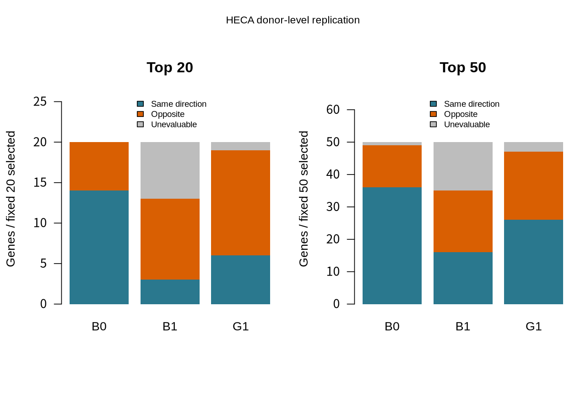
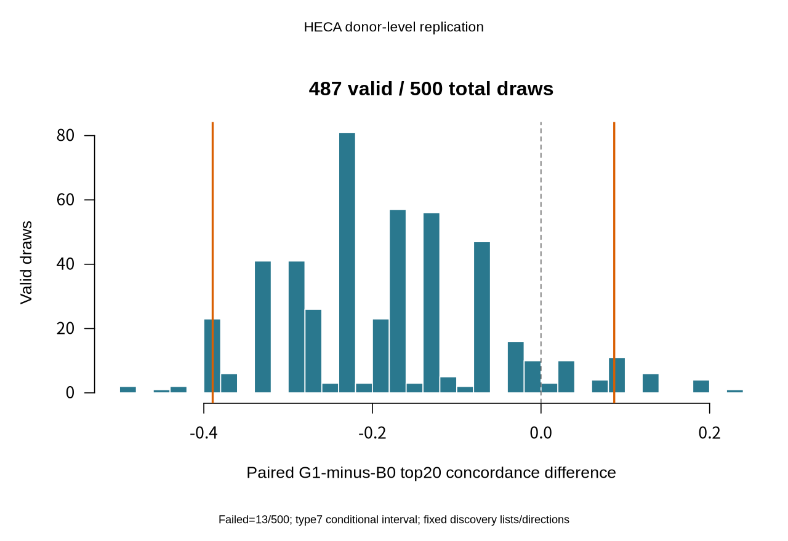

# EndoTarget Evidence：给生物学研究者的综合报告

**本次公开数据分析没有形成得到显著跨队列表达支持的靶点名单，也没有证据支持网络传播优于表达排序。** 这是一项完成了预定主要分析、可行敏感性和失败评估的研究结果；它不证明内异症没有相关表达变化，也不证明某个基因不值得继续研究。实际容器运行仍未完成。

## 研究对象和分析单位

比较作者判定为增殖期的在位子宫内膜基质细胞。发现队列为12名内异症供者、10名非内异症供者，共150,788个细胞；HECA复核为15名病例、7名对照，共52,744个细胞核。每名供者的计数先汇总，统计样本量是22与22，不能把细胞数量当作独立患者数量。对照可能有其他妇科疾病。

两研究的招募来源不同；现有公开信息支持来源分离，没有基因型数据证明所有历史个体完全不重叠。细胞标签和分期沿用经过审计的作者定义，包含表达辅助判定；它们不是独立的纯度或组织学确认。

每个队列独立进行计数过滤、归一化和供者模型拟合，调整年龄、批次和腺肌症。发现17,733个受检基因、外部17,643个受检基因中，达到完整受检基因集合BH q<0.05的均为0。这里的q用于控制同时检查许多基因造成的假阳性；不能只对选中的20个基因重新校正以获得阳性。

## 固定名单在外部发生了什么

三种方法使用同一发现网络：11,749个基因、123,313条关联边。表达排序按疾病效应的统计强度排列；连接度排序只看网络连接数量和权重；网络传播把表达证据沿固定网络分配。各方法的表达变化方向均来自发现队列。参数、名单、方向和匹配随机集合在计算HECA疾病效应前冻结。

| 方法 | 前20同向 | 可评价 | 原始选入 | 同向比例 | 同向且外部q<0.05 |
|---|---:|---:|---:|---:|---:|
| 表达排序 B0 |14|20|20|70.0%|0|
| 连接度排序 B1 |3|13|20|23.1%|0|
| 网络传播 G1 |6|19|20|31.6%|0|

B1有7个基因、G1有1个基因未通过外部表达过滤，保留为无法评价，没有从后续名次补位。B1只有13/20可评价，未达到预定16/20门槛。完整前50结果及缺失范围见[主要复核报告](replication_v2_results.md)。

同向仅表示估计变化的正负号相同；很小、噪声很大的变化也可能同向。因此70%不代表70%的靶点正确，更不代表治疗成功率。

## 为什么点估计相差很大，仍不能确认方法优劣

固定样本中，G1减B0的同向比例为−38.4个百分点。将外部供者按疾病组有放回抽样500次，所有方法使用同一次供者抽样，保持发现名单、方向和原始可评价分母不变。487次可拟合、13次因协变量不能被分别估计而失败，失败没有被补抽。

有效抽样的95%百分位区间为**−38.9至+8.7个百分点**，包含零。这表示供者抽样变化可以明显改变差距；当前没有证据支持G1优于B0，也不应把一次点估计推广为可靠的普遍优劣。这一区间以成功抽样和已固定发现名单为条件，不包括发现选择、标签误差或未来实验的不确定性。

发现队列逐一去掉22名供者并重新过滤、拟合、排名，22轮均完成：

| 方法 | 每轮保留原前20的数量范围 | 22轮中位数 |
|---|---:|---:|
| B0 |6–20|14.5|
| B1 |20–20|20|
| G1 |16–20|19.5|

每轮基因数均为整数；14.5和19.5是偶数轮次中间两个值的平均。网络名单较稳定，并没有转化为更好的外部方向一致性。稳定性与复现能力是不同问题。

200个表达量/连接度匹配集合给出的百分位是描述性比较，不是200次独立生物重复或校准的p值。它们没有替代上述供者不确定性评估。

## 临床与分期敏感性

原方案中的三个可估计子集已完成；定义和设计在主要效应计算前已有记录，包装脚本在观察主结果后实现并于每次子集计算前留存哈希。这是可审计的预设敏感性执行，不是预注册或盲法验证。

| 场景 | 病例/对照 | 受检基因 | q<0.05 |
|---|---:|---:|---:|
| 发现：排除明确组织学分期矛盾 |11/9|17,761|0|
| 发现：排除腺肌症 |8/10|17,678|0|
| 外部：排除腺肌症 |12/7|17,425|0|

外部排除腺肌症后，固定前20同向为B0 15/20、G1 10/19；均没有同向且q<0.05的基因。外部严格分期只剩10/3，未满足至少5名对照；发现严格分期再排除腺肌症为7/9，未满足至少8名病例。这两种场景没有拟合，不能称为已经证明稳健。

30、50、100个主谱系细胞的门槛保留相同供者和样本，因此复用主分析结果。两队列年龄各22/22完整，没有因年龄缺失排除供者，未触发额外去掉年龄的条件性分析。周期日有记录的是发现22/22、外部16/22；原始周期日、组织学和作者最终分期之间的差异被保留，没有事后设置新界限。详见[临床敏感性与来源说明](clinical_sensitivity_report.md)。

## 细胞构成限制

已从缓存作者标签还原发现22×12种、HECA22×7种供者—亚型完整表，分别精确汇总到150,788个细胞和52,744个核。两研究标签分别报告，没有强行视为相同亚型。

HECA的eStromal_MMPs比例按供者等权平均为病例23.97%（15人）、对照2.00%（7人）；病例内差异很大，四名供者分别为92.52%、91.55%、76.53%和71.00%。这是描述性构成观察，没有疾病关联检验，也没有据此删除供者。总体表达关联可能同时包含亚型比例和状态内部表达变化，当前分析不能把两者分开。

固定23-marker检查已完成，但标记RNA比例不同于细胞比例，也不能证明纯度。详见[供者亚型构成](stromal_composition.md)和[固定标记检查](lineage_marker_audit.md)。

## 遗传证据与研究决定

冻结的40基因池全部保留。预设2023年研究中，SKIDA1有有限位置映射及共享内异症/疼痛分析中的bulk内膜eQTL注释；两条出自同一论文，不算两次独立验证。另39个没有本次来源中的可用映射，不是39个阴性遗传检验。没有建立因果基因或增加/抑制它的治疗方向。详见[遗传证据报告](genetic_evidence_report.md)。

预定规则没有选出满足同向且外部q<0.05的支持档案，也没有满足精确反向条件的冲突档案，只选出一个不确定案例PARP9：发现log2差异+0.4659，外部−0.1415，外部未校正95%区间[−0.4126,+0.1296]、q=0.9699。正负号不同但区间跨零，属于不确定，不足以建立反向效应。

**研究建议是保留待证（hold）**。当前结果不能指导药物或抗体设计、激活或抑制方向。未来若继续研究，应先解决状态适用性、表达精度及独立证据；本项目不要求也没有实施湿实验。

## 完成范围与仍存在的限制

已完成主要跨来源分析、冻结基线比较、供者不确定性、预定可行临床敏感性、失败场景、原始分期/年龄说明、描述性细胞构成、独立遗传层和确定性不确定档案。缺乏显著支持是结果的一部分，不能用调整名单或阈值来消除。

发现数据复用公开作者二级汇总，保留Alevin小数估计计数，没有重算完整原RDS。HECA原始总计数与保存H5总计数相差9,607/360,765,431（0.00266%）；其中1,359由全局缺失特征解释，8,248尚未逐特征归因，未人为调整计数以吻合。缺乏独立细胞重注释、个体基因型去重和状态内部表达模型仍限制解释。

Nextflow和全部分析真实运行于SRV01项目独立环境；容器构建与实际容器运行尚未验证。AWS仅有[未执行部署说明](../docs/AWS_DEPLOYMENT.md)，不能写成云部署经验。软件测试、哈希和模型调用记录是工程证据，不是治疗或临床验证。

YELLOW — 理解尚未评估。需要能独立说明：为什么按供者计算；方向、q和区间分别回答什么；为什么稳定名单不一定复现好；为什么组成与状态内部变化不能混为一谈；为什么遗传映射不等于干预因果。没有新增研究选择需要用户决定；真实Docker运行需要服务器管理员提供合适的账户访问。
