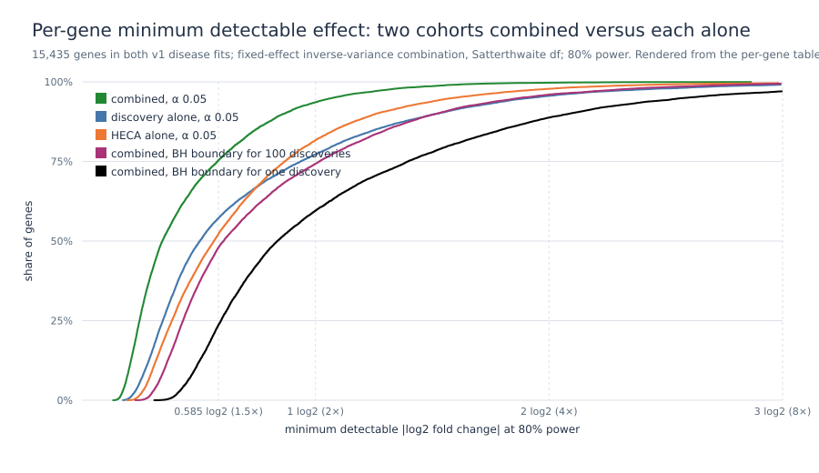

# Two-cohort combined bound on the proliferative-phase stromal disease contrast — results

**Label under the frozen rules: `no_combined_discovery`.** Pooling the precision of the two
v1 disease fits over the 15,435 genes estimable in both cohorts, no gene reaches BH q < 0.05
(smallest q 0.145). The pooled test detects, for the median gene, a 1.27-fold difference as a
single prespecified test, 1.52-fold at the BH boundary for 100 discoveries and 1.79-fold for a
single discovery, against 1.42–1.48, 1.98–2.09 and 2.88–2.99-fold for each cohort alone on the
same genes. The pooled intervals exclude twofold proliferative-phase stromal disease
differences for 94% of these genes per gene and for 60% family-wide, and 1.5-fold differences
for 75% per gene and 24% family-wide. The two cohorts' estimates agree in sign for 53% of
genes and are uncorrelated (Spearman 0.03), as expected when neither carries a detectable
signal.

Completed 2026-11-02 under the [protocol](../docs/COMBINED_BOUND_PROTOCOL.md) frozen the same
day before any combined value was computed (freeze
[`combined_bound_freeze.json`](../receipts/combined_bound_freeze.json), git head 51f35a5;
results receipt [`combined_bound_results.json`](../receipts/combined_bound_results.json)).
Inputs: the two published per-gene tables of the MDE analysis, which carry the saved v1 fit
quantities (log2 fold change, moderated SE, total degrees of freedom), pinned by hash and
listed in the MDE results receipt. No count matrix, design or model was touched. Executed
locally once with Python 3.10.21, NumPy 2.2.6 and SciPy 1.15.2 (the v1 runtime versions);
run time about four minutes, almost all of it the exact non-central t solutions.

## Family and estimator

| Quantity | Value |
|---|---|
| Genes estimable in both cohorts (combined family) | 15,435 |
| Discovery-only / HECA-only genes (listed, not combined) | 2,298 / 2,208 |
| Estimator | fixed-effect inverse-variance combination; Welch–Satterthwaite degrees of freedom 13.1 to 27.9 |
| Combined moderated SE, median (5th–95th percentile) | 0.118 (0.063–0.369) log2 |
| Genes at BH q < 0.05 | **0** (minimum p 9.4 × 10⁻⁶, minimum q 0.145, maximum \|t\| 6.08) |
| Cochran Q p < 0.05 | 1,085 genes (7.0%; 5% expected under homogeneity); median I² 0 |

The smallest combined p belongs to ENSG00000105808 (β −0.89 log2, discovery −0.95, HECA −0.62,
Q p 0.39); its q is 0.145. The [top-20 table](combined_bound/top20_by_abs_t.tsv) is descriptive;
no gene in it is nominated.

## Detectable effects of the pooled test

Minimum detectable |log2 fold change| at 80% power, solved exactly on the non-central t
distribution at each gene's combined SE and degrees of freedom; single-cohort values on the
same 15,435 genes at the same α:

| Scenario (per-gene α) | Combined, median (IQR) | Combined, fold | Discovery alone, median | HECA alone, median | Combined genes with MDE ≤ 1 log2 |
|---|---|---|---|---|---|
| α 0.05 | 0.34 (0.25–0.58) | **1.27×** | 0.51 (1.42×) | 0.57 (1.48×) | 94% |
| BH boundary, 1,000 discoveries (3.2 × 10⁻³) | 0.49 (0.35–0.83) | 1.41× | 0.76 | 0.84 | 83% |
| BH boundary, 100 discoveries (3.2 × 10⁻⁴) | 0.61 (0.43–1.02) | **1.52×** | 0.99 (1.98×) | 1.06 (2.09×) | 74% |
| BH boundary, 10 discoveries (3.2 × 10⁻⁵) | 0.72 (0.51–1.21) | 1.65× | 1.24 | 1.31 | 67% |
| BH boundary, one discovery (3.2 × 10⁻⁶) | 0.84 (0.60–1.40) | **1.79×** | 1.53 (2.88×) | 1.58 (2.99×) | 60% |

Pooling lowers the median detectable effect by about a third at α 0.05 and by almost half at
the single-discovery boundary, because the pooled test gains both precision and degrees of
freedom (the per-cohort tests rest on 12.6 to 15.1 total degrees of freedom). The closed-form
approximation (t_crit + t₀.₈) ŝ agrees with the exact solution within 0.002 log2 at α 0.05
and departs by up to 0.37 log2 at the smallest α; exact values are reported.

## What the pooled intervals exclude

| Interval | within ±0.585 (1.5×) | within ±1 (2×) | within ±2 (4×) |
|---|---:|---:|---:|
| Combined, per-gene 95% | 11,563 (74.9%) | 14,468 (93.7%) | 15,398 (99.8%) |
| Combined, family-wide Bonferroni 95% (α 3.2 × 10⁻⁶) | 3,765 (24.4%) | 9,250 (59.9%) | 13,863 (89.8%) |
| Discovery alone, per-gene 95% | 8,328 (54.0%) | 11,724 (76.0%) | 14,667 (95.0%) |
| HECA alone, per-gene 95% | 8,181 (53.0%) | 12,726 (82.4%) | 15,080 (97.7%) |

Read with the single-cohort MDE report: the v1 data alone excluded twofold differences
family-wide for a fifth of genes; together they exclude them for three fifths, and they now
exclude 1.5-fold differences family-wide for a quarter of genes rather than under 1%.

## Agreement between cohorts (descriptive)

Same sign of the disease log2 fold change in 8,208 of 15,435 genes (53.2%); Pearson
correlation −0.13, Spearman 0.03. The Pearson value is pulled by a few large, imprecise
estimates; the rank correlation is the better description. Neither statistic is tested; both
are what two null fits look like, and they are consistent with the frozen top-20 transfer
of 14 / 20 in v1.

## Sensitivities (none changes the label)

| Sensitivity | Genes at BH q < 0.05 | Minimum p |
|---|---:|---|
| Stouffer weighted z (per-cohort t p values, weights 1/SE) | 0 | 1.4 × 10⁻⁵ |
| Normal-approximation inverse-variance test (same β̂ and ŝ, standard normal reference) | 50 | 1.2 × 10⁻⁹ |
| Primary restricted to genes with Q p ≥ 0.05 | 0 among 14,350 | — |

The normal approximation would declare 50 discoveries. It ignores the 13 to 28 degrees of
freedom of the pooled test and is not a valid reference here; it is reported to show that the
degrees-of-freedom correction, not the pooling, decides the outcome. The Stouffer combination,
which respects each cohort's degrees of freedom, agrees with the primary result.

## Readings

- **No gene crosses the family-wide threshold when both cohorts' precision is pooled.** The
  "why not combine the cohorts" question has a prespecified answer: combining them tightens
  the bound substantially but changes nothing about the shortlist, which remains empty.
- **The pooled bound is the project's statement for proliferative-phase stromal disease
  differences in public single-cell data**: differences above about 1.3-fold per gene, and
  above 1.5- to 1.8-fold at the multiplicity faced, would have been detected for the median
  gene; fourfold differences are excluded for 90% of genes family-wide, twofold for 60%.
- **Heterogeneity is at the level expected by chance** (7% of genes at Q p < 0.05), so the
  precision-weighted average is a reasonable summary; it still averages a single-cell and a
  single-nucleus platform and is not a common effect.

## What this does and does not establish

It establishes, under rules fixed before computation, how much the two v1 cohorts exclude
together and that no gene becomes a discovery when their precision is pooled. It adds no
donor, does not separate stromal-state composition from within-state change, and does not
nominate a target; the MDE values are conditional on the realized moderated variances of
the original fits, and the single-cohort comparisons are computed on the 15,435 shared
genes, so they differ slightly from the full-family values in the MDE report.

## Files

[`reports/combined_bound/`](combined_bound/): per-gene table (both cohort estimates, pooled
estimate, interval, Q, sensitivities and all MDE scenarios), cohort-only gene list, top-20
table, summary and figure. Receipts: [freeze](../receipts/combined_bound_freeze.json),
[results](../receipts/combined_bound_results.json). Code:
[`scripts/combined_bound_analysis.py`](../scripts/combined_bound_analysis.py),
[`scripts/combined_bound_freeze.py`](../scripts/combined_bound_freeze.py),
[tests](../tests/test_combined_bound.py).
