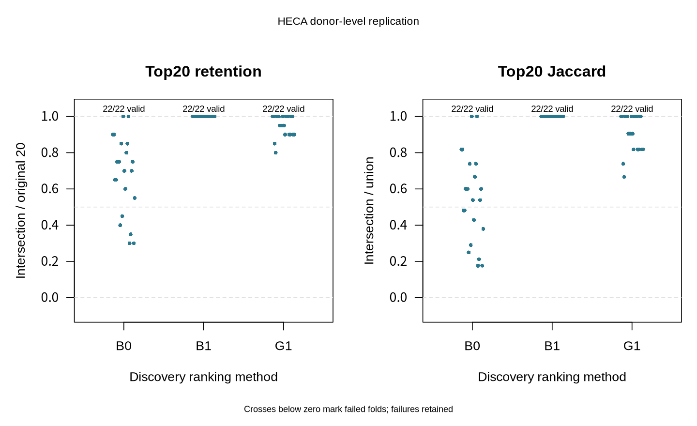
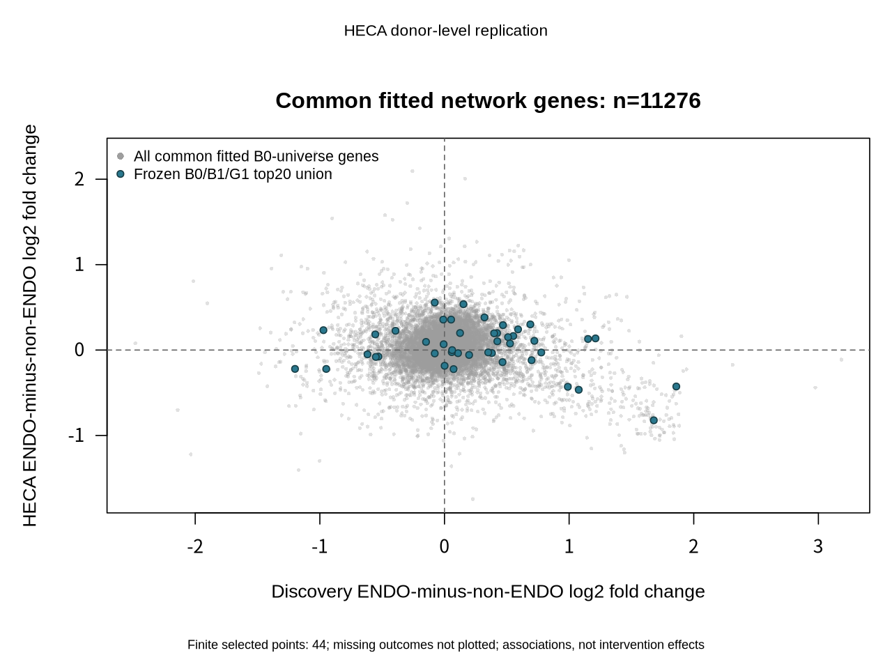
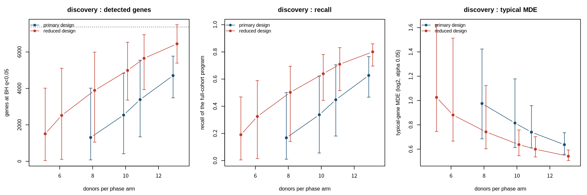
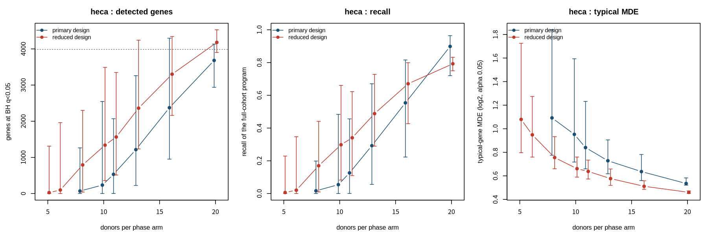
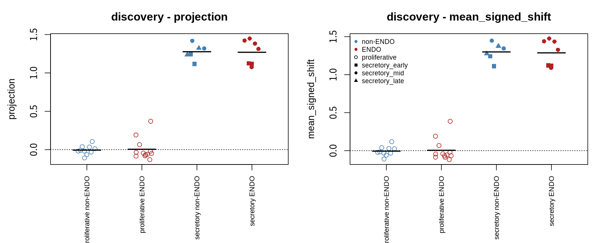
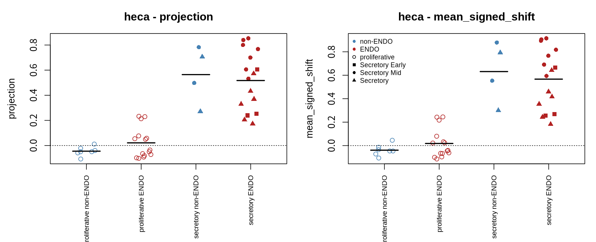

# External evaluation results — English summary

This page summarizes the generated bilingual report
[replication_v2_results.md](replication_v2_results.md) in English and, since
27 October 2026, the four prespecified follow-on analyses. It adds no new
analysis: every number below is copied from that report, its receipts, the
[research brief](executive_brief_en.md) or the four follow-on results reports
linked in their section. The generated reports remain the authoritative records
and list all traceable inputs.

**Main result.** Of the frozen top-20 lists, expression ranking (B0) had 14
same-direction genes among 20 evaluable and 20 selected; network propagation (G1)
had 6 / 19 / 20. In the external cohort, 0 of 17,643 tested genes reached
BH q < 0.05. These results do not confirm a therapeutic target or an intervention
direction. Four later prespecified analyses, summarized under
[Follow-on analyses](#follow-on-analyses-october-2026), show that the same
pipeline detects a known expression program at these sample sizes, bound the
effects the null leaves open, find no detectable disease difference in the
secretory-phase stromal program and find no public cohort that extends the design.

## Question

Within author-adjudicated proliferative-phase eutopic endometrial stromal cells,
do rankings frozen in the discovery cohort — expression (B0), network degree (B1)
and network propagation (G1) — preserve the direction of expression change in an
independent cohort? Counts are summed per donor and each person is one
statistical unit. Rankings, directions, top-20/50 lists and matched reference sets
were frozen before any external disease effect was computed.

External cohort: 15 cases and 7 non-endometriosis controls (22 donors); 17,643
genes entered the full tested family and none reached BH q < 0.05. The smallest
unadjusted p was 6.993 × 10⁻⁵ and the smallest BH q was 0.9699. Each cohort was
modeled separately with library-size/composition normalization and donor-level
weighted fits, adjusting for the frozen age, batch and adenomyosis covariates.
A log2 difference is an association that can include cell-state composition and
unmeasured confounding; controls can have other gynecological conditions.

## Fixed-list results

| Method | k | Same direction | Evaluable | Selected | Same direction among evaluable | Missing-outcome bounds | Same direction and full-family q < 0.05 |
|---|---:|---:|---:|---:|---:|---:|---:|
| B0 | 20 | 14 | 20 | 20 | 70.0% | 70.0%–70.0% | 0 |
| B0 | 50 | 36 | 49 | 50 | 73.5% | 72.0%–74.0% | 0 |
| B1 | 20 | 3 | 13 | 20 | 23.1% | 15.0%–50.0% | 0 |
| B1 | 50 | 16 | 35 | 50 | 45.7% | 32.0%–62.0% | 0 |
| G1 | 20 | 6 | 19 | 20 | 31.6% | 30.0%–35.0% | 0 |
| G1 | 50 | 26 | 47 | 50 | 55.3% | 52.0%–58.0% | 0 |

Direction agreement only asks whether evaluable genes keep the same sign; small,
imprecise effects can agree by chance. The missing-outcome bounds treat every
unevaluable gene as all-disagreeing or all-agreeing; lists are never refilled and
missing genes are never counted as opposite. Top 20 is the primary descriptive
endpoint and top 50 is secondary. Seven B1 genes and one G1 gene failed external
expression filtering. B1 and G1 share 9 of their top-20 genes.

G1 minus B0 (top 20) was −0.384, with missing-outcome bounds [−0.40, −0.35]. Both
methods needed at least 16/20 evaluable genes, and no advantage could be claimed
if the bounds included zero or could reverse. No evidence met all predefined
conditions for G1 outperforming B0.

## Matched reference sets

| Method | Status | Adequately covered sets | Observed percentile | Observed list coverage |
|---|---|---:|---:|---:|
| B0 | ESTIMABLE | 200/200 | 96.5 | 20/20 |
| B1 | ESTIMABLE | 200/200 | 0.5 | 13/20 |
| G1 | ESTIMABLE | 200/200 | 0.5 | 19/20 |

Each method has 200 frozen sets matched on expression and degree, with directions
taken from each gene's own discovery effect. The percentile is a descriptive
position; the sets share genes and donors, so they are neither 200 independent
biological replicates nor a calibrated p value.

## Donor sensitivity

Paired external-donor resampling completed 500 of 500 draws: 487 valid and 13
failed (design not full rank). All methods share the same donor draws, fixed
discovery lists/directions and original evaluable denominators; failures are not
replaced. The conditional 95% interval for the G1 − B0 top-20 difference was
[−0.390, +0.087] (type-7 percentile of valid draws). It describes external
donor-sampling variation for the already selected lists only.

All 22 discovery leave-one-donor-out refits completed (0 failures). Each refit
repeats filtering, model fitting and ranking without one donor.

| Method | Valid / total folds | Median top-20 retention [range] | Median Jaccard [range] |
|---|---:|---:|---:|
| B0 | 22/22 | 0.725 [0.3, 1] | 0.569 [0.176, 1] |
| B1 | 22/22 | 1 [1, 1] | 1 [1, 1] |
| G1 | 22/22 | 0.975 [0.8, 1] | 0.952 [0.667, 1] |

Retention is the intersection divided by the original 20; Jaccard is the
intersection divided by the union. Stable network lists did not yield better
external sign agreement.

## Notes for interpretation

These observations follow directly from the reported numbers; they were not
prespecified and have not been tested further.

- **The bootstrap interval is not centered on the observed difference.** The
  observed G1 − B0 value (−0.384) lies at the lower edge of the interval
  [−0.390, +0.087], and most valid draws fall near −0.2. Resampling external
  donors adds noise to each gene's external sign, which pulls both methods'
  agreement toward 50% and shrinks their difference. The interval therefore
  overstates how often the difference could reach zero. This does not change the
  conclusion: G1 showed no advantage, and its observed agreement was lower than
  B0's.
- **B1 and G1 agreed less often than their matched reference sets.** Both
  network lists sit at the 0.5th percentile of their 200 matched sets, and 13 of
  19 evaluable G1 genes changed direction. This is a descriptive
  lower-than-reference pattern, not only an absence of improvement; the
  percentile is not a calibrated p value. Possible contributors, such as systematic
  single-cell versus single-nucleus differences for highly connected genes or
  cell-state composition, were not investigated.

## Candidate pool and dossiers

The union of the frozen B0 and G1 top-20 lists contains 40 genes, all retained in
the supplementary tables. The deterministic rule allowed up to three
same-direction genes with full-family q < 0.05, one precise opposite case and one
missing/inconclusive case, each chosen by full B0 rank and stable ID. It selected
one dossier and zero supported same-direction dossiers.

**PARP9 (ENSG00000138496).** Expression inconclusive: discovery log2 difference
+0.4659; external −0.1415, unadjusted 95% interval [−0.4126, 0.1296], full-family
q = 0.9699. No mapping in the audited genetics source. Cell-state specificity and
intervention direction are not established. Recommendation: **hold** pending
better expression precision or missing evidence; no drug or clinical
recommendation.

Genetic evidence comes from one prespecified 2023 publication and its public
mapping table; several annotations from that paper are not independent
confirmation, and a missing mapping is not a negative genetic test. See the
[genetic evidence report](genetic_evidence_report.md).

## Follow-on analyses (October 2026)

Four analyses were added on 26–27 October 2026 under rules frozen and hashed before
any new value was computed. They reuse the v1 estimator unchanged, refit no disease
model and leave every v1 artifact byte-identical; each ran once on the analysis host
in the v1 runtime. Numbers are copied from the linked results reports.

### Phase positive control

The v1 pipeline on a contrast it should detect: secretory minus proliferative donors,
with disease, age, batch and adenomyosis adjusted and the B0/B1/G1 lists frozen in
discovery before the HECA fit
([protocol](../docs/PHASE_POSITIVE_CONTROL_PROTOCOL.md),
[results](phase_positive_control_results.md)).

| Cohort | Donors (secretory / proliferative) | Primary cells or nuclei | Genes tested | BH q < 0.05 |
|---|---:|---:|---:|---:|
| Discovery, GSE266265 | 13 / 22 | 225,207 | 17,341 | 7,367 |
| External, HECA E-MTAB-14039 | 20 / 22 | 94,150 | 17,243 | 3,986 |

| Endpoint | Observed | Prespecified rule | Result |
|---|---|---|---|
| P1 within-cohort detection | 7,367 and 3,986 | ≥ 100 in each cohort | pass |
| P2 transfer of the frozen B0 top-20 | 20 / 20 same direction, 20 / 20 at HECA q < 0.05 | ≥ 16 / 20 same direction and ≥ 10 / 20 at q < 0.05 | pass |
| S1 marker panel (explanatory) | discovery 5 / 7, HECA 6 / 7 | ≥ 6 / 7 in both | not met |
| S2 network baselines (descriptive) | G1 − B0 = −0.37; conditional 95% interval [−0.53, −0.21]; 499 / 500 valid draws | no superiority claim unless the interval excludes zero | G1 below B0 across the interval |

The proliferative arms are exactly the v1 donors, whose disease fits gave 0 genes at
q < 0.05 on the same pipeline. The v1 null is therefore not pipeline insensitivity.
Secretory-phase genes are cycle biology, not endometriosis genes, and the
positive-control lists are not a shortlist. Under a strong signal, propagation on this
graph ranks hub genes with small phase effects and transfers worse than expression
ranking.

### Minimum detectable effect

From the saved v1 fits, the smallest true log2 fold change each gene's moderated test
would have rejected with 80% power, solved exactly on the non-central t distribution
at its realized precision; `bh_k` is the Benjamini–Hochberg boundary when exactly
k genes are rejected ([protocol](../docs/MDE_ANALYSIS_PROTOCOL.md),
[results](mde_results.md)).

| Cohort | Scenario | Median MDE (log2; fold) | Genes with MDE ≤ 1 log2 |
|---|---|---:|---:|
| Discovery (17,733 genes, residual df 10) | α 0.05, single gene | 0.57; 1.5× | 73% |
| | `bh_k100` | 1.12; 2.2× | 45% |
| | `bh_k1` | 1.73; 3.3× | 19% |
| HECA (17,643 genes, residual df 12) | α 0.05, single gene | 0.63; 1.5× | 76% |
| | `bh_k100` | 1.20; 2.3× | 40% |
| | `bh_k1` | 1.78; 3.4× | 17% |

Genes whose disease-coefficient interval lies within ±1 log2 (twofold): 72%
(discovery) and 78% (HECA) per gene, 21% and 20% under family-wide Bonferroni
intervals; within ±2 log2 (fourfold): 94% and 97% per gene, 57% and 60%
family-wide; within ±0.585 log2 (1.5-fold): 49% and 47% per gene, under 1%
family-wide. Precision varies about eightfold across genes and follows expression
level.

Donor subsampling on the phase cohorts (100 draws per level, v1 estimator
re-estimated per draw; recall is the share of the full-cohort q < 0.05 program
recovered with the same sign; discovery levels end at 13, its number of secretory
donors):

| n per arm | Design | Discovery recall, median [2.5th–97.5th] | HECA recall, median [2.5th–97.5th] |
|---:|---|---|---|
| 5 or 6 | primary | not estimable (0 / 100 draws) | not estimable (0 / 100 draws) |
| 8 | primary | 0.17 [0.01, 0.50] (30 valid draws) | 0.02 [0, 0.20] (66 valid draws) |
| 11 | primary | 0.45 [0.18, 0.70] | 0.13 [0.001, 0.46] (98 valid draws) |
| 11 | reduced | 0.71 [0.52, 0.83] | 0.34 [0.11, 0.62] |
| 13 | primary | 0.63 [0.47, 0.77] | 0.29 [0.06, 0.67] |
| 20 | primary | — | 0.90 [0.72, 0.96] |

The v1 analysis was sensitive to 1.5-fold effects per gene and to 2.2- to 3.4-fold
effects at the multiplicity it faced; its intervals exclude fourfold proliferative
stromal disease differences for most genes under any reading and twofold differences
for a fifth of genes family-wide. A 22-donor study of this design recovers even a
several-thousand-gene program inconsistently. These values are conditional on the
realized variance estimates, do not say that any specific gene's effect is small and
do not choose a future sample size.

### Secretory-phase program-level disease contrast

Test of an attenuated secretory stromal program in endometriosis (the
progesterone-resistance hypothesis) on the positive-control matrices. Each cohort is
scored on the other cohort's frozen phase program (β-weighted projection; 1 = the
signature cohort's full secretory shift), a validity gate requires AUC ≥ 0.9 for
phase, and the primary estimand θ is the secretory × ENDO interaction on all donors;
labels were fixed before any donor was scored
([protocol](../docs/SECRETORY_PROGRAM_PROTOCOL.md),
[results](secretory_program_results.md)).

| Cohort | Secretory donors (ENDO / non-ENDO) | Signature genes | AUC | θ | 95% interval | p | Detectable attenuation (80% power) | Label |
|---|---:|---:|---:|---:|---|---:|---:|---|
| Discovery | 7 / 6 | 3,580 | 1.000 | +0.037 | −0.179 to +0.253 | 0.73 | 0.31 | `no_detectable_difference` |
| HECA | 16 / 4 | 6,570 | 0.986 | −0.105 | −0.400 to +0.189 | 0.47 | 0.42 | `no_detectable_difference` |

Pair label: `no_detectable_difference`. Relative to each cohort's secretory shift
(1.26 and 0.56 program units), the intervals exclude an attenuation above 14% in
discovery and admit anything short of a 71% loss in HECA. Secretory-only estimates
with age and sub-phase adjustment are −0.02 to −0.06 (discovery) and +0.05 to +0.10
(HECA), all p > 0.4; mid-secretory donors score higher than early ones in both
cohorts. No gene reaches BH q < 0.05 for the interaction (families 17,341 and
17,243); limma `fry` on the signatures gives p 0.60 (up) and 0.38 (down), and the
gene-level projections (+0.036, −0.081) reproduce θ. Leave-one-donor-out θ ranges
from −0.03 to +0.10 (discovery) and −0.16 to −0.04 (HECA). The only sensitivity whose
interval excludes zero, discovery with adenomyosis donors excluded
(+0.20 [+0.03, +0.37], p 0.026, 4 versus 6 donors), points to a larger secretory
shift in the remaining endometriosis donors, is not reproduced in HECA (−0.10) and
by rule changes no label.

### Cohort extension feasibility

Metadata-only audit of GSE213216 (Fonseca et al. 2023) and GSE179640 (Tan et al.
2022) against the v1 eligibility rules, using the GEO records and the HECA authors'
donor curation ([report](cohort_extension_feasibility.md)).

| Study | Natural-cycle eutopic single-cell donors (ENDO / non-ENDO) | Matched eutopic–lesion pairs | Verdict |
|---|---|---:|---|
| GSE213216 | proliferative 3 / 0; secretory 2 / 0 | 4 (natural cycle) | no eligible disease stratum |
| GSE179640 | proliferative 0 / 1 (hormonally treated cohort by design) | 8 (7 under treatment) | no eligible disease stratum |

Neither study reaches the floor of 5 donors per disease group within a phase, so
neither can extend the eutopic donor-level contrasts or support a donor-level
meta-analysis; nothing was downloaded. Both are external datasets inside the HECA
cells atlas, so an analysis with HECA-derived labels would not be independent of
HECA. They remain lesion-context resources for a differently designed study.

## Limits

- The 30/50/100-cell thresholds select the same 22 + 22 donors, libraries and
  designs, so the primary fits are reused; this is not three independent
  validations. All 44 donors have complete ages.
- The follow-on analyses are bounds and controls, not disease evidence: the MDE
  values are conditional on the realized variance estimates of the original fits;
  the subsampling levels stop at 13 and 20 per arm; the secretory program contrast
  rests on 13 and 20 secretory donors (6 and 4 non-ENDO) and on the authors'
  sub-phase labels; the extension audit relies on the HECA authors' curation of
  clinical fields that the GEO records lack.
- Discovery reuses author-provided secondary Alevin estimated (fractional) counts;
  the original full RDS was not recomputed. In HECA, raw and stored H5 totals for
  52,744 nuclei differ by 9,607 / 360,765,431 counts (0.00266%): 1,359 are
  explained by globally missing features and 8,248 remain unassigned.
- Inherited phase and cell labels with marker checks support group-level
  plausibility, not purity or independent re-annotation. Separate recruitment
  sources do not establish genotype-confirmed non-overlap of individuals.
- Clinical subset analyses are reported separately in the
  [clinical sensitivity report](clinical_sensitivity_report.md) (Chinese); the
  [research brief](executive_brief_en.md) summarizes them in English.
